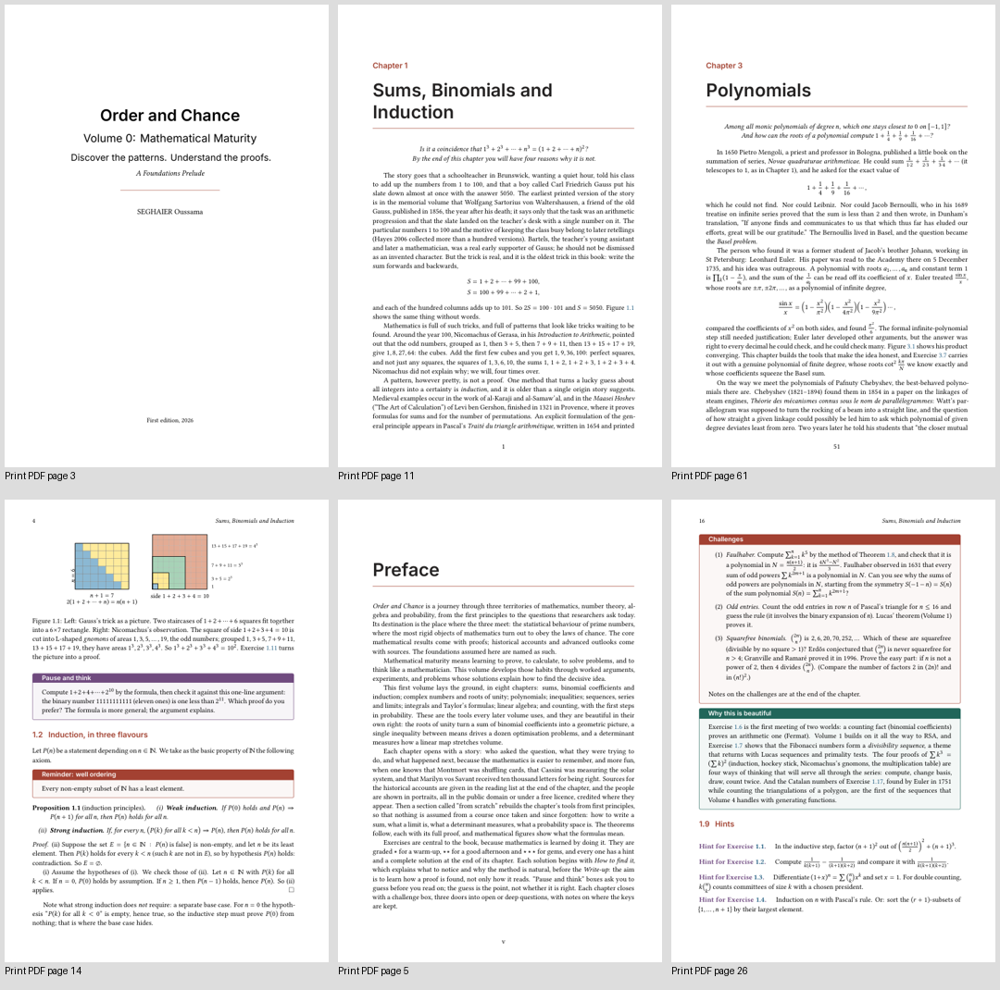

# Colour interiors and typography

The first edition uses one 7 × 10 inch interior in full colour for both PDFs.
The reading PDF prepends the approved front; the print manuscript starts at the
half-title. EPUB and the web readers use matching typography and semantic colours.

## Typography

| Use | Typeface |
| --- | --- |
| Body, proofs and italic passages | Libertinus Serif |
| Mathematics, including bold Greek vectors | Libertinus Math |
| Chapter/section headings and box labels | Inter Text, optical size 14 |
| Code and Lean Unicode symbols | DejaVu Sans Mono |

The body remains 11 pt, with 1.045 line spacing. Font files, licences, provenance
and SHA-256 hashes are bundled in `common/fonts/`; builds use these files rather
than system-installed substitutes. PDF/figure typesetting uses XeLaTeX. EPUB
embeds the original faces; readers serve matching WOFF2 files. Reading devices
can override EPUB typography.

## Colour roles

| Role | Colour |
| --- | --- |
| Chapter accents, section headings, reminders | Coral `#A34232` |
| Exercises and PDF cross-reference links | Blue `#235E82` |
| Beauty notes and subsection headings | Teal `#22675B` |
| Thinking prompts | Plum `#704B80` |

Text and mathematics remain dark on white. Box title strips use white lettering;
light fills preserve contrast in their contents. Scientific figures retain their
existing colour meanings. Web/EPUB dark themes use brighter accent variants.

## Paperback configuration

The production setting is **Premium color ink / white paper**, 7 × 10 inches,
no interior bleed. Premium colour permits books from 24 pages, including the short
problem books; standard colour starts at 72 pages. The outside cover bleed remains
0.125 inch. Spines use **0.002347 inch per even-rounded print page**, derived from
the actual final print PDF, and the canonical JSON controls generated TeX,
metadata, listings and wraps.

Sources: [KDP cover guidance](https://kdp.amazon.com/en_US/help/topic/G201953020)
and [print options](https://kdp.amazon.com/en_US/help/topic/G201834180).

## Compatibility and verification

The migration preserves mathematical statements and reference identifiers.
Long inline formulas in Volumes 0, 4, 10, 14, 15 and P1 are moved to displays where the
new font metrics require it. One subscript in Volume 12 gains explicit grouping.
Legacy number-system commands work in unbraced scripts; Greek/math bookmark
strings use Unicode equivalents; bold vectors use the font's bold alphabet.
Lean symbols are native Unicode, with complete code-font coverage. Download-PDF
checks resolve XeLaTeX's indirect annotation arrays before comparing the body.

The build rejects missing glyphs, unavailable font shapes, wrong font families,
lost coral/blue accents, split/oversized boxes, horizontal/vertical overflow,
unresolved references, wrong page sizes and unembedded/bitmap fonts. Cache schema
5 invalidates older interiors. Regression tests include real typesetting of
colour/font output, Greek bookmarks, vector notation, Unicode code, whole-box
movement and solution-heading placement.

The typography change itself leaves all 65 protected cover source/assets unchanged
against its starting hash record. The concurrent print-vector upgrade from `788fb50`
is retained in full, including its resolution preflight; this typography update adds
no cover-art or lettering changes. Production wrap width follows the new page count
and paper coefficient.

Browser checks confirm loaded Libertinus/Inter fonts, coral headings, readable
dark-mode headings, no page overflow at 320 px and no JavaScript errors.

The integrated publishing suite passes all **48 tests**, including the concurrent
print-cover preflight regressions. Complete-library publication also checks every
PDF pair, current print metadata and cover preflight before assembling the release.
