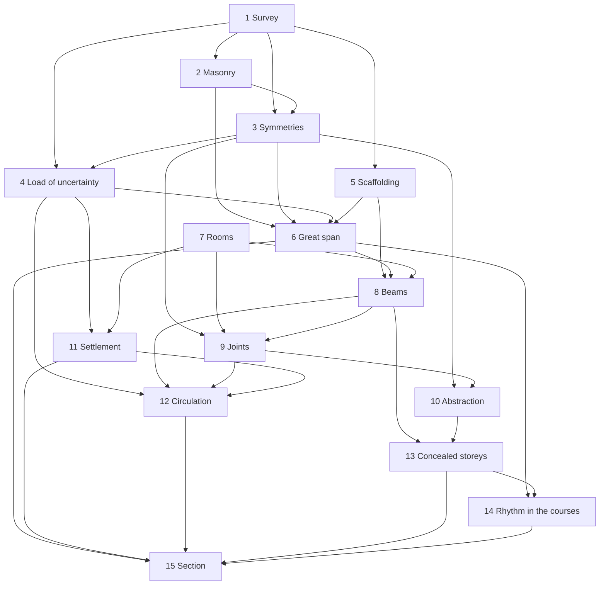

# Series content plan

Planning document only. It does not change a manuscript, a catalog entry, a cover, or a build file. The reader's numbering below is the approved fifteen-book order. On disk, after commit `9ba2905`, the same books are still Volumes 0–14, and Crossroads is still a separate problem book. Old Volume \(N\) is Book \(N+1\).

The series subtitle that frames this plan is **Order and Chance: The Hidden Architecture of Mathematics**. Per-volume subtitles in `common/volume-subtitles.json` stay as they are. This document does not put the new subtitle on a cover or a title page.

## Frozen Edition 1 titles

Titles and subtitles are frozen. The plan changes content to fit them. It does not change a title to fit a chapter.

The series subtitle is the frame of the story: **Order and Chance: The Hidden Architecture of Mathematics**. One building. Each book is a floor. The floor's name is the promise a reader can see on the contents page.

| | |
| --- | --- |
| Series | Order and Chance: The Hidden Architecture of Mathematics |
| Part I. Foundations | |
| 1 | First Principles: Proof, Problem Solving and Mathematical Thinking |
| 2 | The Integers: Primes, Patterns and Proofs |
| 3 | Symmetry: Groups, Rings and Fields |
| 4 | Chance: The Logic of Uncertainty |
| Part II. Bridges | |
| 5 | Calculation: From Formula to Insight |
| 6 | Crossroads: Arithmetic Meets Analysis |
| Part III. Analysis and Geometry | |
| 7 | Spaces: Topology, Measure and Limits |
| 8 | Analysis: Operators, Spectra and Transforms |
| 9 | Shapes: The Geometry of Connection |
| 10 | Abstraction: Categories, Algebra and Homology |
| Part IV. Randomness | |
| 11 | Randomness: Martingales, Limits and Ergodicity |
| 12 | Random Motion: The Geometry of Random Paths |
| Part V. Number | |
| 13 | Arithmetic: From Equations to Hidden Worlds |
| 14 | The Primes: Their Hidden Rhythm |
| Part VI. Synthesis | |
| 15 | Order and Chance: The Meeting of Structure and Randomness |

**Design rule.** Each book's parts and chapters must visibly deliver its title and its subtitle. A contents page that does not contain the subtitle's words has not kept the promise. A chapter that does not serve those words moves to the book whose title it does serve, or it leaves the edition. The directories on disk still use the old catalog names (`tome6-spaces`, `tome9-higher-structures`, `tome14-order-and-chance`, and the rest). This plan does not edit that catalog.

Statuses were read off the files, not off the catalog blurb. Every chapter entry in `book-01.md`–`book-15.md` names the current path. The sources for the judgments are the nineteen `main.tex` files (sixteen remain), the chapter openings and section lists, `docs/review/SERIES-REVIEW-2026-10.md`, `docs/review/CAPSTONE-PLAN.md`, `docs/SERIES-STRUCTURE.md`, `docs/DESIGN.md`, and the 7×10 page table in `review/7X10-PAGINATION.md`. Several defects in the October review are already repaired in the sources; the rework order does not send anyone back to fix them. They are listed under "Already repaired".

## Status words

| Word | Meaning |
| --- | --- |
| KEEP | The chapter is the right mathematics, in the right book, at a length the floor can hold. |
| REVISE | The chapter stays. A proof, a label, a cross-reference, or the way it sits in the story has to change. |
| EXPAND | The chapter is the right one and is thinner than the load it carries. |
| MERGE | Two write-ups of one idea become one, and the surviving text says so. |
| SPLIT | One file is doing two jobs. |
| MOVE | The mathematics is good and belongs on another floor. |
| NEW | The floor needs this chapter and the file is an opening, or absent. |
| CUT | Do not print it as part of the fifteen-book story. |

A light REVISE often means one paragraph that names the series question, or a forward pointer. It does not mean a rewrite.

---

# A. The story

## The question

One question is asked on the ground floor and answered on the top floor.

**Can pure order and pure chance be told apart, and why do the primes look random yet obey laws?**

From the street the primes look like loose rubble, and chance looks like weather. The series is the walk inside. Each book opens another floor, or puts a hand on a member that was already carrying load. The last book draws the section through the whole building. The section is the answer, and the answer is not a single yes or no.

Pure order and pure chance can be told apart only by naming the member and the load. A deterministic set can match the mean and the variance of a random model and still fail a short-interval test. For the normal order of \(\omega(n)\), for the count of primes in bulk, and for \(\log|\zeta|\) at a random height, the Gaussian or the Poisson law is a theorem. For intervals of length \((\log x)^\lambda\), Maier's theorem says the coin model is false. For the pair correlation of the zeros, the sine kernel is a theorem only on a limited range and a conjecture past it. For class groups and ranks, the random model is a heuristic with a proved linear-algebra shadow. The primes look random because several of their statistics are the statistics of a random model. They obey laws because those statistics can be named, and because other statistics remember the small primes, the characters, and the zeros.

The workshop on the top floor is the drawing board. It teaches the reader to leave a conjecture labelled as a conjecture. That is how a finished section still has unfinished details.

## The building

The subtitle is the frame, used where the mathematics already has that shape.

| Stage | Books | What the reader can now see |
| --- | --- | --- |
| Setting out | 1–4 | The survey, the masonry, the symmetries of the plan, and the load of uncertainty. Four materials, not yet asked to carry one span. |
| The span | 5–6 | Scaffolding, then the first arch that puts the primes on both a law and a Gaussian. The arch holds in bulk. A crack is marked and not yet proved. |
| The inhabited structure | 7–10 | Rooms, beams, joints, and the hidden frame. "Typical", "spectrum", and "symmetry" become things a later floor can quote. |
| The structure in time | 11–12 | Settlement under a long load, and the circulation: paths with no tangent, spectra that move and repel. |
| The concealed storeys | 13–14 | Rooms that were already inside the integers, and the rhythm in the courses of primes. |
| The section | 15 | One drawing. Which members are order, which are chance, and which only look like one of the two. |

The same members return on later floors, doing different work. A motif that appears once and is reprinted is a defect. A motif that returns transformed is the building.

## The fifteen floors

| Book | Element | Question | Climax | Cliffhanger the next floor takes up |
| --- | --- | --- | --- | --- |
| 1 First Principles | The survey | When is a pattern a structural fact? | The weak law, after the sum of cubes and the hat check have used one standard of proof. Stirling gives an infinite process a shape. | The bell curve is an integral, not yet a theorem about many small loads. The primes are not yet a course of masonry. |
| 2 The Integers | The masonry | Do the primes have a pattern one can prove? | Quadratic reciprocity. | Unique factorisation has failed in \(\mathbb Z[\sqrt{-5}]\) and been restored by ideals, in one field. Characters and Legendre's sieve are in place. Dirichlet's theorem is not. |
| 3 Symmetry | The symmetries of the plan | What survives a transformation, and which openings cannot be cut? | \(X^5-4X+2\) has Galois group \(S_5\). The character table is the same floor's second summit. | Those characters are the detectors Book 6 will aim at residue classes. The same theory will later count shuffles and space eigenvalues. |
| 4 Chance | The load of uncertainty | What code does chance obey? | Lindeberg's central limit theorem. Brownian motion exists. | A walk comes home in the plane and may be lost in space. The primes are not yet these coins. Existence without a construction is now a method. |
| 5 Calculation | The scaffolding | What exact structure remains when a closed form does not? | Riemann's functional equation. | The prime number theorem is one Tauberian step away. The sign of the quadratic Gauss sum is known. The zeros are not yet carrying the primes. |
| 6 Crossroads | The great span | In bulk, are the primes a law or a game of chance? | The prime number theorem, the explicit formula, and Erdős–Kac. | Cramér's coins get the large gaps almost right. Maier's theorem is marked as a remark. A modular form appears, just long enough to show there is a further storey. |
| 7 Spaces | The rooms | What is a limit, a length, a room, once the lower floors are asked to define their words? | Lebesgue's integral, Fubini, and Baire's theorem: a typical continuous function is nowhere differentiable. | The rooms exist. Conditional expectation, which the upper floors use as a beam, is still an exercise. |
| 8 Analysis | The beams | What is the spectrum of a beam of infinite dimension? | The compact spectral theorem, Plancherel, and Ikehara's second proof of the prime number theorem. | The spectral theorem stops at compact operators. The adèles are built. The zeros are not yet a spectrum. |
| 9 Shapes | The joints | How do rooms connect, and what curvature is visible from inside? | Gauss–Bonnet, and Weyl's integration formula for a random unitary matrix. | The cubic group law is finished in Book 13, not here. Continued fractions return as cutting sequences on the modular surface. The zeros are not these eigenvalues yet. |
| 10 Abstraction | The hidden frame | What holds the rooms when one stops looking at a single object? | The cutoff for random transpositions, and the abstract Dedekind domain. | The class group is an object. Book 13 will compute its size. Book 15 will ask whether it is a random group. |
| 11 Randomness | Settlement | What replaces the bell curve when there is no variance, or when one deterministic system is watched for a long time? | Donsker's theorem, and Furstenberg's proof of Roth's theorem. | Permutation cycles and prime factors want one Poisson–Dirichlet law. The arithmetic half quotes Selberg–Delange, which this book does not prove. |
| 12 Random Motion | The circulation | What is the geometry of a path with no tangent? | Itô's formula, and Dyson Brownian motion: eigenvalues that move and repel. | The still spectra, the sine kernel and the graph-theoretic Riemann hypothesis, are Book 8's. \(\log\|\zeta\|\) is not yet a Gaussian. |
| 13 Arithmetic | The concealed storeys | When unique factorisation fails, what rooms were already inside the integers? | The class-number formula, and Tate's thesis for \(\mathbb Q\): the functional equation again, from adelic Poisson summation. | Artin reciprocity is admitted. The rank of an elliptic curve is finite and not determined. Modularity is stated. The statistical questions are Book 15's. |
| 14 The Primes | The rhythm in the courses | How much of the apparent randomness is a theorem, and where does the method stop? | Bombieri–Vinogradov, Maynard's bounded gaps, and Montgomery's pair correlation for \(\alpha\le 1-\varepsilon\). | Green–Tao is quoted. The parity barrier is stated with care. Pair correlation past \(\alpha=1\) is a conjecture. The dictionary is the next floor. |
| 15 Order and Chance | The section | The series question, asked as the meeting of structure and randomness. | Maier's theorem, and Selberg's central limit theorem for \(\log\|\zeta\|\). Matching mean and variance is not the same as being the model. | The conjectures that remain are labelled. The workshop leaves two projects, not a survey. |

Book 6 is the turn. Before it, the reader has four materials. On it, the explicit formula and Erdős–Kac put order and chance on the same span. After it, every floor is either making that span rigorous, or showing where it cracks. Book 15 is the turn's resolution, not a second introduction.

## Recurring characters

Five characters carry the load. Each is introduced as itself, then put to work it could not have done on the floor where it first appeared.

**The primes.** Book 2 lays the courses: Euclid, Chebyshev, Bertrand, reciprocity. Book 6 proves they have a density and a Gaussian anatomy, and writes them as waves. Book 8 carries the same density by a different beam, Ikehara. Book 13 watches them split in extensions. Book 14 hears the rhythm: short intervals, averages, gaps, progressions. Book 15 says which of those rhythms are the coin model and which remember the small primes.

**The Gaussian.** Book 1 meets it as Stirling's shape and as an integral. Book 4 proves it is the law of many small independent loads. Book 6 proves it is the law of \(\omega(n)\). Book 11 asks what replaces it when the variance is infinite, and how fast the approximation is when the variance is finite. Book 12 builds the Gaussian process whose paths are Brownian motion. Book 15 proves Selberg's theorem: at a random height on the critical line, \(\log|\zeta|\) is Gaussian again, with variance \(\tfrac12\log\log T\).

**The zeta function.** Its shadow is the probability \(6/\pi^2\) that two integers are coprime, in Book 2. Book 5 builds it and proves the functional equation. Book 6 locates the zeros in the explicit formula. Book 8 proves the prime number theorem again from a tauberian theorem. Book 8 holds the sine kernel, moved there because it is a spectrum. Book 15 compares it with the zeros. Book 13 derives the functional equation a third time, for \(\mathbb Q\), from Tate's thesis. Book 14 proves infinitely many zeros on the critical line, the mean square, and Montgomery's pair correlation on a limited range. Book 15 proves the value distribution: Bohr–Jessen off the line, Selberg on the line.

**Random walks.** Book 4: Pólya, the gambler, the first Brownian path. Book 9: the geodesic flow, so a continued fraction is a walk on a tiling. Abstraction keeps the Fourier analysis of \(S_n\). Book 11 proves the cutoff, because a cutoff is a limit. Book 11: Donsker, every finite-variance walk seen from far enough. Book 12: the path's fine structure, Itô's calculus, walks on graphs. Book 8: the graph-theoretic Riemann hypothesis, which is a spectrum. Book 15: the \(W\)-trick as a thinning of the integers by the small primes, the same walk read as structure versus randomness.

**Symmetry groups.** Book 3: groups, Galois, characters. Book 4: the deck as a walk on a group. Book 6: Dirichlet characters as the detectors in Dirichlet's theorem. Book 8: finite abelian Fourier analysis, and Haar measure. Book 9: Lie groups and Weyl's formula. Abstraction: representations, the hook-length formula, Peter–Weyl. Book 11: the shuffle cutoff. Book 13: class field theory and modular forms. Book 15: a random group in the sense of Cohen–Lenstra, and a random isotropic subspace in the sense of Poonen–Rains.

Three further motifs are joints, not characters.

- **The failure of unique factorisation**, written \(6=2\cdot 3=(1+\sqrt{-5})(1-\sqrt{-5})\). Book 2 shows it and repairs it for one ring of integers. Book 3 makes "ideal" a definition. Abstraction axiomatises the repair. Book 13 proves it for every ring of integers and ties the class number to \(L(1,\chi)\). Book 15 asks for the distribution of that class group, and proves the measure, not the arithmetic identification.
- **The sine kernel.** Book 9 computes the eigenvalue law of a finite unitary group. Book 8, whose subtitle names spectra, holds the scaled limit: the manuscript's proof moves there from Book 12, which keeps Dyson Brownian motion because that is a path. Book 14 proves Montgomery's theorem for the zeros, under the Riemann hypothesis, for \(\alpha\le 1-\varepsilon\). Book 15 puts the two form factors on one page and states the rest.
- **The deck of cards.** Book 1 counts derangements. Book 4 announces that seven riffle shuffles mix fifty-two cards and defers the cutoff. Book 11 proves the transposition cutoff. Abstraction keeps the Fourier analysis of the symmetric group, which is algebra. Book 11 describes the cycle lengths. Book 15 keeps the Bayer–Diaconis profile, which is not proved anywhere else, inside the workshop.

## Timeline

A cell is blank when the motif is not carrying load on that floor. "Plant" means the object appears and is not yet the theorem. "Law" means a theorem of that book. "Return" means the same object, transformed. "Answer" means the series question uses it.

| Motif | 1 | 2 | 3 | 4 | 5 | 6 | 7 | 8 | 9 | 10 | 11 | 12 | 13 | 14 | 15 |
| --- | --- | --- | --- | --- | --- | --- | --- | --- | --- | --- | --- | --- | --- | --- | --- |
| Primes | | Law | Plant | | Plant | Law | | Return | | | Plant | Plant | Return | Law | Answer |
| Gaussian | Plant | | | Law | Tool | Return | | Return | | | Return | Law | | | Answer |
| Zeta | | Plant | | | Law | Law | | Return | | | | Plant | Return | Law | Answer |
| Random walks | | | | Law | | | | | Return | Return | Law | Law | | | Return |
| Symmetry groups | Plant | Plant | Law | Plant | Tool | Return | | Return | Law | Law | | Return | Law | Return | Answer |
| Unique factorisation's failure | | Plant | Tool | | | | | | Plant | Law | | | Law | Return | Answer |
| Sine kernel | | | | | | | | | Plant | Plant | | Law | | Law | Answer |
| Continued fractions | | Law | | | | | Return | | Return | | Return | | Return | | |
| The deck | Plant | | Plant | Plant | | | | | | Law | Return | | | | Return |
| Möbius and sieves | Plant | Law | | | | Law | | | | | | | | Law | Answer |
| Explicit formula | | | | | Plant | Law | | | | | | | Return | Return | Answer |

Reading down a column gives the floor. Reading across a row gives the life of one member. The empty cells are intentional: Book 7 does not reprove the prime number theorem, and Book 11 does not reprove quadratic reciprocity.

## Where the chapters live

The chapter-by-chapter plan, with hooks, synopses, theorems, examples, figures, and statuses, is in the fifteen files below.

| Book | File | On disk |
| --- | --- | --- |
| 1 First Principles | [book-01.md](book-01.md) | `tome0-mathematical-maturity` |
| 2 The Integers | [book-02.md](book-02.md) | `tome1-integers` |
| 3 Symmetry | [book-03.md](book-03.md) | `tome2-structures` |
| 4 Chance | [book-04.md](book-04.md) | `tome3-chance` |
| 5 Calculation | [book-05.md](book-05.md) | `tome4-calculation` |
| 6 Crossroads | [book-06.md](book-06.md) | `tome5-meets` |
| 7 Spaces: Topology, Measure and Limits | [book-07.md](book-07.md) | `tome6-spaces` |
| 8 Analysis | [book-08.md](book-08.md) | `tome7-analysis` |
| 9 Shapes | [book-09.md](book-09.md) | `tome8-shapes` |
| 10 Abstraction: Categories, Algebra and Homology | [book-10.md](book-10.md) | `tome9-higher-structures` |
| 11 Randomness | [book-11.md](book-11.md) | `tome10-chance2` |
| 12 Random Motion | [book-12.md](book-12.md) | `tome11-motion` |
| 13 Arithmetic | [book-13.md](book-13.md) | `tome12-arithmetic` |
| 14 The Primes | [book-14.md](book-14.md) | `tome13-primes` |
| 15 Order and Chance: The Meeting of Structure and Randomness | [book-15.md](book-15.md) | `tome14-order-and-chance` |

Crossroads is `tomeP1-crossroads`. Its problems are assigned to Books 1–6 in those files. The written chapters of the retired problem books already sit at the end of Books 7, 8, and 11.

---

# C. Series level

## Notation to unify

One convention sheet, adopted when a book is next touched. It does not block the local repairs. Later books already use the right-hand column; the clashes are at the joints.

| Sign | Meaning everywhere after it is fixed | Where it now collides | What to do on the page |
| --- | --- | --- | --- |
| \(\Lambda\) | von Mangoldt's function, from Book 6 on | Completed zeta in Book 5; Legendre's \(\Lambda(k)\) in Book 5, Chapter 12 | In Book 5, call \(\pi^{-s/2}\Gamma(s/2)\zeta(s)\) the completed zeta. If the classical \(\Lambda(s)\) is displayed, the sentence says Book 6 uses \(\Lambda\) for von Mangoldt. Legendre's relation gets another letter. |
| \(\theta\) | Chebyshev's function, from Book 6 on | Jacobi theta in Book 5 | Jacobi theta is \(\vartheta\). |
| \(\omega\) | Number of distinct prime factors, from Book 6 on | Theta remainder in Book 5 | The remainder gets another letter. \(\Omega\) stays the total number of prime factors. |
| \(\psi\) | Chebyshev's second function, from Book 6 on | Digamma | Digamma is \(\psi_\Gamma\), as Book 6 already writes, and the sentence moves to the first use. |
| \(\Delta\) | Discriminant, or the modular discriminant, and the two are not used for each other in one chapter | Modular function of Haar measure and the Vandermonde product, twenty lines apart, in `tome8-shapes/chapters/ch08-haar.tex` | Vandermonde is written as a product or called \(V\). The modular function of a group is \(\delta\). |
| Fourier | \(\hat f(\xi)=\int f(x)e^{-2\pi i x\xi}\,\mathrm dx\), inversion without a constant, as in Book 8 | Book 3 puts \(1/|G|\) in the analysis. Abstraction's shuffle chapter used to invert with the constant and a conjugation; the comparison sentence at `tome9-higher-structures/chapters/ch10-shuffling.tex` now states both differences | Finite abelian groups: \(1/|G|\) in the analysis, inversion without it, no extra conjugation. One sentence at the joint. |
| \(\log\) | The natural logarithm, in analysis and in probability | | The series does not switch to \(\ln\) in displays. |
| \(\mathrm{Li}(x)\) | \(\int_2^x \mathrm dt/\log t\), as in Book 6 | | The lower limit is stated at the first use in each later book. |
| \(\chi\) | A character. Dirichlet or group, by the sentence | Also the factor in the functional equation in Book 14 | That factor is named at first use as the root-number factor \(\chi(s)\). |
| \(q\) | A modulus, until a modular-forms chapter | Then the nome \(e^{2\pi i\tau}\) | The sentence is at the boundary, in Books 6 and 13. |
| \(D_n\) | The dihedral group of order \(2n\), as in Book 3 | | Later books do not switch to the order-\(n\) convention. |
| Probability | Kolmogorov's measure | Also a prime ideal and a polynomial | Probability is \(\mathbb P\) where a prime ideal \(\mathfrak p\) is in the same chapter. Elsewhere a sentence does the work. |
| Cohomology | Singular homology \(H_n\); de Rham \(H^k_{\mathrm{dR}}\); group cohomology \(H^n(G,M)\) | Euler characteristic and characters both want \(\chi\), in different books | The index distinguishes the cohomology. Euler characteristic is \(\chi\) only where no character is in the chapter. |

Homology, de Rham cohomology, and group cohomology stay separated by the index. Book 15 does not invent a fourth convention.

## Dependency graph

An arrow means the later book quotes a theorem the earlier book is responsible for proving. The reading order is still 1 through 15. A reader may skip a floor only along the arrows that do not point at it.

The load-bearing joints, the ones a rework has to protect:

| Joint | Earlier theorem | Later use |
| --- | --- | --- |
| Book 1 → 2 | Induction, binomial theorem, complex numbers, spectral theorem for symmetric matrices, integral comparison | Reciprocity's second proof, norms, Chebyshev's estimates |
| Book 2 → 6 | Characters, the Legendre symbol, Möbius inversion, Legendre's sieve | Dirichlet's theorem, the explicit formula's arithmetic side |
| Book 3 → 6 and Abstraction | Orthogonality of characters; \(1/|G|\) in the analysis | Dirichlet characters; the shuffle Fourier analysis |
| Book 4 → 11 and 12 | Lindeberg in one direction, Brownian motion, conditional expectation as a projection | Donsker, Itô, Girsanov |
| Book 5 → 6 | Functional equation, Stirling, Weyl's criterion, the sign of the Gauss sum | Zero counting, the explicit formula |
| Book 6 → 8 | No zero on \(\mathrm{Re}\,s=1\) | Ikehara, without a second proof of the zero-free line |
| Book 6 → 14 | The classical explicit formula, Selberg's sieve, Erdős–Kac, the shape of Cramér's model | Everything in Book 14 starts after that cut |
| Book 7 → 11 | Prokhorov, Fubini, Radon–Nikodym | Lévy's continuity theorem, Girsanov |
| Book 8 → 13 | Haar measure on \(\mathbb Q_p\), the adèles of \(\mathbb Q\), Mellin inversion | Tate's thesis |
| Book 9 → 8 | Weyl's integration formula | The finite-\(n\) circular ensemble, whose scaled limit now lives under Spectra. Book 12 cites the same formula only for Dyson Brownian motion, which is a path. |
| Book 11 → 15 | Berry–Esseen, the Gauss map, Furstenberg's Roth | The workshop's reading of a shuffle; the structure/randomness chapter cites the ergodic proof |
| Book 8 → 14 and 15 | The sine kernel and Keating–Snaith's integer moments, after they move from Book 12 | Montgomery is not reproved; the moments chapter cites the matrix side |
| Book 13 → 14 and 15 | Class group, Siegel's input via Book 14, one 2-descent, the functional equation of \(L(s,\chi)\) for primitive Dirichlet characters | Three squares repaired; Chebyshev's bias; Cohen–Lenstra's heuristic |
| Book 14 → 15 | Bombieri–Vinogradov, Siegel–Walfisz, Halász, the \(U^2\) inverse theorem, Montgomery for \(\alpha\le 1-\varepsilon\) | Maier, the parity chapter, the form-factor page |

## Already repaired

These were errors or gaps in `docs/review/SERIES-REVIEW-2026-10.md`. The sources now contain the repair. The plan does not schedule them again.

| Item | Where it now stands |
| --- | --- |
| Factor \(\tfrac12\) in Riemann's functional equation | `tome4-calculation/chapters/ch10-zeta.tex`, the sentence after the polar integral |
| \(\liminf\) and \(\limsup\) named backwards | `tome5-meets/chapters/ch01-mertens.tex` |
| Short-interval Brun–Titchmarsh tied to Siegel zeros | `tome5-meets/chapters/ch08-sieves.tex`, the paragraph that states the ratio \(2k\) |
| Maier's display typeset as a theorem | `tome5-meets/chapters/ch10-random.tex`, a remark headed "quoted" |
| Sign in Wiener's local inverse | `tome7-analysis/chapters/ch10-tauberian.tex`, the return map uses \(e^{+2\pi i\xi_0 x}\) |
| Three squares, the test when \(4\mid m\) | `tome12-arithmetic/chapters/ch07-hasse.tex`, \(n=4^am\) with \(4\nmid m\) |
| Primitive element theorem living only in an exercise | `tome2-structures/chapters/ch08-extensions.tex`, a numbered theorem |
| Three real roots of \(X^5-4X+2\) not shown simple | `tome2-structures/chapters/ch10-galois.tex` |
| Face of a box in the characterisation of Lebesgue measure | `tome6-spaces/chapters/ch06-measures.tex`, a sandwich |
| Division by \(n!\) in Andreief's identity | `tome8-shapes/chapters/ch08-haar.tex` |
| "Isomorphism" \(E(\mathbb C)\to\mathrm{Cl}(A)\) | `tome9-higher-structures/chapters/ch05-dedekind.tex`, the sentence now refuses the word |
| Fourier comparison for the shuffle | `tome9-higher-structures/chapters/ch10-shuffling.tex`, both the factor and the conjugation |
| The bound \(600\) presented as if the certificate were on the page | `tome13-primes/chapters/ch09-maynard.tex`, the witness is named as unprinted |

A second reader can still walk the new three-squares paragraph and the Galois root count. They are repairs, not open gaps.

## Gaps

Things a later chapter needs, or pretends to have, and does not have as a proof.

| Gap | Status in the sources | Decision |
| --- | --- | --- |
| Conditional expectation, including the tower property | Exercise in `tome6-spaces/chapters/ch10-radon.tex` | EXPAND to a numbered theorem in Book 7, before Books 11 and 12 quote the tower. |
| Primary decomposition and associated primes | Absent from Abstraction | EXPAND, one chapter-section before Dedekind domains. Book 13 does not depend on it; the gap is internal honesty. |
| de Rham's theorem in general | The cohomology is defined in `tome8-shapes/chapters/ch03-forms.tex`; the proof on the page is the punctured plane | REVISE the sentence so the general statement is marked as one proved case. Later chapters do not use the general statement. |
| Buchstab, Maier, Erdős–Rankin | Proved in `tome14-order-and-chance/chapters/ra-gaps.tex` and `ra-largemoduli.tex`, included from `ch02-cramer.tex`. Book 6 has a remark, not a proof | KEEP the proofs in Book 15. The zero-free hypothesis stays in the heading. Siegel–Walfisz and Bombieri–Vinogradov do not replace Gallagher's weighted theorem, and the wrapper already says so. |
| Selberg–Delange, the Kubilius model | Proved in `ra-selbergdelange.tex` and `ra-additive.tex`, included from `ch03-divisors.tex`. Book 11 quotes them | KEEP, and point Book 11 at this chapter by path. REVISE the included Erdős–Kac file so it compares proofs and does not found the theorem a second time. |
| Bohr–Jessen and Selberg's central limit theorem | Proved in `ra-bohrjessen.tex` and `ra-selberg.tex`, included from `ch11-values.tex` | KEEP. This is the analytic climax of Book 15. |
| Approximate functional equation | Quoted in Book 14, Chapter 14 | Prove it in Book 15's moments chapter, or mark every use inside the CFKRS recipe as quoted. |
| Five chapters of Book 15 with no proof under them | `ch05-short.tex`, `ch06-sieves.tex`, `ch08-ranks.tex`, `ch09-gue.tex`, `ch12-pseudorandom.tex`, each about fifteen lines | NEW, from the capstone plan. They organise theorems Books 6, 12, 13, and 14 already proved. They do not reprove them. |
| The workshop, uncondensed | Twelve chapters and twelve appendices inside Book 15. Appendix E is a pointer | MERGE and CUT as in [book-15.md](book-15.md) and `docs/review/CAPSTONE-PLAN.md`. |
| Crossroads still a sixteenth book | `tomeP1-crossroads`, 300 problems, about 460 pages in the 7×10 table | MOVE the Journeys and the owning problems into Books 1–6. CUT the separate catalog entry after that move. |
| Two proofs of Roth that do not know each other | Book 11, Chapter 10, and Book 14, Chapter 12 | REVISE each introduction so it names the other proof. |
| Green–Tao, Artin reciprocity, modularity, genus theory, the general \(n\)-Selmer group, the unbounded spectral theorem, GUE for \(\alpha>1\), moments of \(\zeta\) past the second | Stated, and in the careful books labelled | Stay stated. Book 15 does not schedule the proofs. |

## Cuts

| Material | Decision |
| --- | --- |
| A separate problem book | CUT from the published series once the Crossroads problems have homes. The writing of the Journeys is kept, inside those homes. |
| Unpublished drafts that never entered a book | CUT. The operators draft and the rare-events draft were removed in `9ba2905` and are not restored. The rare-events solutions did not prove the bounds they stated. |
| Reprinting the prime number theorem, Bombieri–Vinogradov, the sine kernel, Erdős–Kac, or Roth inside Book 15 | CUT. Compare, cite, or translate into the section's language. |
| Workshop tours that Books 5, 11, 12, and 14 already own | CUT: twin-prime appendix, Goldbach appendix, Riemann-hypothesis appendix, empty zeta-pointer appendix, Hadamard appendix, Birch–Swinnerton-Dyer appendix, the randomness-in-the-integers tour, the open-doors-in-algebra tour. The pieces that are real theorems and live nowhere else are kept: Borwein integrals, Collatz cycles, Gilmer's inequality, Mason–Stothers. |
| A third public PDF, a notebook promise inside a book, a computing volume | Already cut. This plan does not bring them back. |

## Crossroads, and the harder-problem chapters

Crossroads is good writing: 300 problems, hints, and complete solutions, score 8 in the October review. Pasting all 460 pages into the main chapters would bury the span. The fold is this.

- Every Journey moves into the book that owns its theorem, as a worked problem with its existing write-up. There are 28 of them. Their homes are listed in `book-01.md` through `book-06.md`.
- Each of Books 1–6 gains one problem set at the end of the part the problems serve, six to twelve problems, statements still not naming the tool. The spectral problems in Crossroads Chapter 8 that cite the graph appendix move with that appendix: the spectral gap and Ramanujan problems to Book 8, the matrix-tree problems to Book 12. They do not stay in Books 1–6.
- The remaining problems stay available as an editorial archive. They are not a published book, and they are not a second run of exercises the chapters already contain.
- The three harder-problem chapters already on disk are KEEP as mathematics and REVISE as titles. "Harder problems" is not a structural element. They become "Almost every number" (Book 7), "Zeta off the line, as problems" (Book 8), and "Sums of random pieces" (Book 11).

## What does not serve its title

Titles are frozen, so these chapters move. The receiving book is the one whose subtitle they deliver. The proofs move with them. Nothing is rewritten in order to save a chapter's address.

| From | Chapter | To | Because |
| --- | --- | --- | --- |
| 2 The Integers | Quadratic fields, ideals and class groups, the \(p\)-adic field | 13 Arithmetic | They are hidden worlds behind equations. Hensel's lemma for a congruence stays in Book 2. One section keeps \(6=2\cdot 3=(1+\sqrt{-5})(1-\sqrt{-5})\). |
| 3 Symmetry | Spectral theorem, SVD, graph spectra, matrix inequalities, linear dynamics, and the linear algebra that repeats Book 1 | 8 Analysis | Operators, spectra, and transforms. Circulants, Perron roots of a symmetry, and the linear algebra method stay in Book 3. |
| 3 Symmetry | Tensors and the cost of multiplication | 10 Abstraction | Algebra. |
| 4 Chance | Orders: Dilworth, Sperner, partial orders | 1 First Principles | Mathematical thinking, not the logic of uncertainty. |
| 8 Analysis | \(\mathbb Q_p\) and the adèles, beyond Haar measure | 13 Arithmetic | A hidden world. Haar measure and Pontryagin duality stay, as transforms. |
| 8 Analysis | Jordan's theorem | 7 Spaces | Topology. |
| 8 Analysis | The Riemann mapping theorem | 9 Shapes | A conformal connection. |
| 9 Shapes | Euclid's triangle trivia that does not connect | Leaves the main text | No other title wants it. Ceva and the Euler line fold into the transformations appendix. |
| 10 Abstraction | The shuffle cutoff | 11 Randomness | A limit. The Fourier analysis of \(S_n\) stays, as algebra. |
| 12 Random Motion | Ramanujan graphs and the graph-theoretic Riemann hypothesis | 8 Analysis | Spectra. |
| 12 Random Motion | The semicircle, the sine kernel, characteristic-polynomial moments | 8 Analysis | Spectra, not paths. Dyson Brownian motion stays. It is motion. |
| 12 Random Motion | The zeta-and-matrices story | 15 Order and Chance | The meeting of structure and randomness. |
| 14 The Primes | Partitions, and Waring's problem | 5 Calculation | Formulas and their insight. Three primes stays. |
| 15, the workshop chapters that are not the meeting | Collatz, Hadamard, Jordan polygons, Curry–Howard, BBP, Borwein, Gilmer, Mason–Stothers, the conjecture tours | The book each theorem serves, or out of the edition | Listed in `book-15.md`. |

Part names inside a book are the subtitle's words, so the contents page delivers the promise. They are not a second set of titles. Book 9 is the exception that has a phrase rather than a list: its parts are the kinds of connection, and the subtitle is named in each part's first sentence.

## Pages and effort

Page numbers are the 7×10 interiors in `review/7X10-PAGINATION.md`, except where `docs/DESIGN.md` records a later measurement. They are baselines, not targets. Effort is the mathematical and narrative rework, not a calendar.

| Book | Baseline | After this plan | Effort |
| --- | --- | --- | --- |
| 1 | 295 print pages (`docs/DESIGN.md`) | 310–340, with a short Crossroads set | Light. The ten chapters stay. Thread the series question through the preface and the field guide. |
| 2 | 189 in the October reconstruction, through the field guide; `ch14-characters.tex` is in `main.tex` and is about 520 lines | 230–270 | Moderate. Part titles, forward pointers from the quadratic chapters, no deletion of the reconstruction. |
| 3 | 372 | 370–400 | Moderate. The Galois repairs are in. Representations become a part. Appendix cross-references. |
| 4 | 251 | 260–290 | Light to moderate. Part split. Lindeberg's limsup written out if it is still compressed. One cross-reference. |
| 5 | 178 | 190–220 if one saddle-point argument is added | Moderate. Notation warnings. The functional-equation sentence is already repaired. |
| 6 | 176 | 190–220 | Moderate. The liminf repair and the Maier remark are in. Part IV named. The story's turn has to be audible in the preface. |
| 7 | 179, plus the harder-problem chapter | 210–240 | Moderate. Conditional expectation becomes a theorem. The problem chapter is retitled. |
| 8 | 178, plus the harder-problem chapter | 200–230 | Moderate. Wiener's sign is repaired. The blurb must match the compact spectral theorem. Part split. |
| 9 | 343 | 340–370 | Moderate. de Rham sentence, cubic group law pointed at Book 13, one curvature title. |
| 10 | 152 | 170–200 if primary decomposition is added | Moderate. |
| 11 | 192, plus the harder-problem chapter | 210–240 | Light to moderate. Preface already names its three exceptions. Cross-references to Erdős–Kac and to Roth. |
| 12 | 228 | 230–250 | Moderate. Move the moment-method semicircle forward. Qualify two remarks. |
| 13 | 248 | 250–270 | Light to moderate. Three squares is repaired. Preface already narrowed. A second reading of the new local test. |
| 14 | 211 | 210–230 | Light. The certificate sentence is honest. Cross-references. |
| 15 | The wrapped proofs plus a full workshop. The old separate volumes were 194 and 313 pages | 280–340 after condensation. The five stub chapters are the growth; the twelve appendices are the cut | Heavy. This is the section drawing. It is mined from `ra-*.tex` and from the workshop, not written from a blank page. |

The series after the plan is on the order of 4,000–4,500 print pages of main text. Crossroads' 460 pages are not added on top.

## Rework order

The order protects the joints. Story threading is real work and it is not the first work: a paragraph that points at a theorem should point at the theorem that will be there.

1. **Leave the repaired proofs alone**, except for a second reading of three squares and of the five real roots. They are listed above so a later session does not "fix" them back.
2. **Book 7, conditional expectation.** Promote the exercise, including the tower property, before Books 11 and 12 are touched. This is the one gap a citation already stands on.
3. **Cross-references that make a repeated theorem into a return.** Book 11's Roth names Book 14's Fourier proof. Book 14's Roth names Book 11's ergodic proof. Book 11's mod-\(\varphi\) chapter names the file that will be Book 15's Selberg–Delange, and labels the uniform-integer statement as a corollary of a quoted formula until that chapter is the citation.
4. **Book 15, the three chapters the rest of the series already quotes.** Value distribution (`ch11-values.tex`, from `ra-bohrjessen.tex` and `ra-selberg.tex`). Independent prime divisors (`ch03-divisors.tex`). Models of the primes (`ch02-cramer.tex`). Shrink the second Erdős–Kac write-up to a comparison. Keep Gallagher's hypothesis in the heading of Maier's theorem.
5. **Book 15, the five openings.** Short intervals, sieves as probability, ranks, the form-factor page, pseudorandomness. Each one cites a theorem and proves only the sentence Books 6–14 did not prove. The capstone plan is the section list.
6. **Book 15, class groups and moments, then the bias chapter.** Merge the cokernel argument from the workshop into the Cohen–Lenstra chapter. Decide whether the approximate functional equation is proved or quoted, and use one choice in every line of the recipe.
7. **Condense the workshop** after steps 4 and 6, so a proof does not live in two places. Four chapters, four appendices, as in `book-15.md`. Appendix E is removed rather than left as a pointer.
8. **The early floors' story pass, Books 1–6.** Part titles, one paragraph in each preface that states the series question and names the structural element, forward pointers from Book 2's quadratic chapters and from Book 6's Maier remark. Then fold the Crossroads Journeys. This pass is light because the chapters are already the right ones.
9. **Books 8–14, the remaining local revisions** in the book files: primary decomposition, the de Rham sentence, the semicircle's placement, the two curvature titles, the retitling of the three problem chapters. None of these reprints a flagship proof.
10. **Catalog numbering.** Renaming Volume 0 to Book 1, and retiring the Crossroads catalog entry, is a metadata change. This plan uses those names and does not make that change. It should happen once, after the homes of the Crossroads problems are real files, so the public library does not lose a problem and gain a broken link in the same step.

The section is Book 15. The floors under it are already standing. The rework builds the section from the members that are already proved, and it writes a new member only where the building does not yet contain one: Maier's theorem is already drafted, Selberg's central limit theorem is already drafted, and the five openings are the rooms those theorems have not yet been set into.
