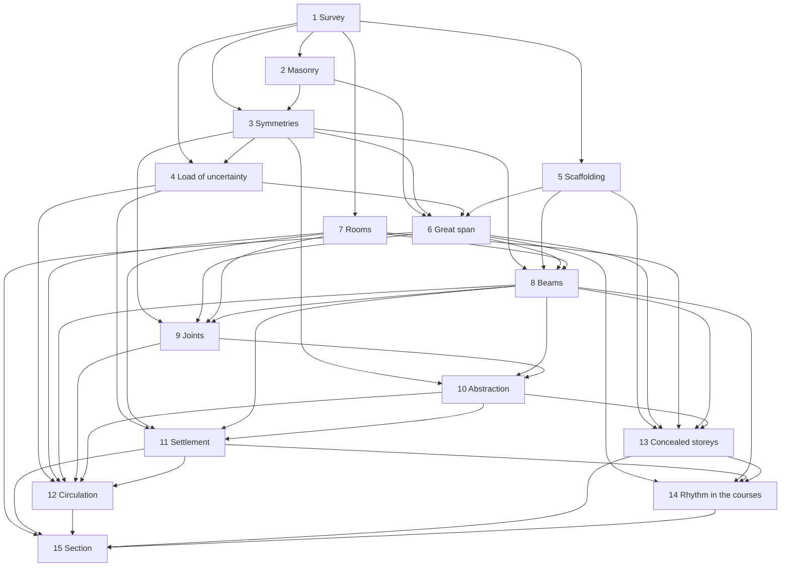

# Series content plan

**Updated 2026-11-10.** For Volumes 5–15 the definitive plan is [MASTER-PLAN-V5-V15.md](MASTER-PLAN-V5-V15.md) together with `book-05.md`–`book-15.md`. This document tells the story of all fifteen volumes and has been brought into agreement with that plan. Where a sentence here about Volumes 5–15 could be read differently, the master plan decides. Sections that the master plan replaced say so and keep only what concerns Volumes 1–4.

Planning document only. It does not change a manuscript, a catalog entry, a cover, or a build file. The reader's numbering is the Edition 1 order, Books 1–15. Part names are the ones in `common/series-catalog.json`. A citation in a manuscript uses the title-page number. The old number, one less than that, is only for reading commits from before the citation repair; the map is `docs/plan/volume-citation-map.md`. Book 6 is Crossroads, the analytic number theory volume. The old P1 problem book is not a volume of the edition.

The series subtitle that frames this plan is **Order and Chance: The Hidden Architecture of Mathematics**. The same frozen subtitles are already in `common/volume-subtitles.json`. This document does not put them on a cover or a title page.

## Frozen Edition 1 titles

Titles and subtitles are frozen. The plan changes content to fit them. It does not change a title to fit a chapter.

The series subtitle is the frame of the story: **Order and Chance: The Hidden Architecture of Mathematics**. One building. Each book is a floor. The floor's name is the promise a reader can see on the contents page.

| | |
| --- | --- |
| Series | Order and Chance: The Hidden Architecture of Mathematics |
| Part I. Foundations | |
| 1 | First Principles: Proof, Problem Solving and Mathematical Thinking |
| 2 | The Integers: Primes, Patterns and Proofs |
| 3 | Symmetry: Groups, Rings and Fields |
| 4 | Chance: The Logic of Uncertainty |
| Part II. Bridges | |
| 5 | Calculation: From Formula to Insight |
| 6 | Crossroads: Arithmetic Meets Analysis |
| Part III. Analysis and Geometry | |
| 7 | Spaces: Topology, Measure and Limits |
| 8 | Analysis: Operators, Spectra and Transforms |
| 9 | Shapes: The Geometry of Connection |
| 10 | Abstraction: Categories, Algebra and Homology |
| Part IV. Randomness | |
| 11 | Randomness: Martingales, Limits and Ergodicity |
| 12 | Random Motion: The Geometry of Random Paths |
| Part V. Number | |
| 13 | Arithmetic: From Equations to Hidden Worlds |
| 14 | The Primes: Their Hidden Rhythm |
| Part VI. Synthesis | |
| 15 | Order and Chance: The Meeting of Structure and Randomness |

**Design rule.** Each book's chapters must visibly deliver its title and its subtitle. The part names stay the catalog's. How a part delivers the subtitle is said in prose, under "How the subtitle is delivered" in the book file. A chapter that does not serve the title moves. A part name is renamed only when a move makes the existing name false, and only in the marked section below. Every directory in this plan is `volume1-first-principles` through `volume15-order-and-chance`.

Statuses were read off the files, not off the catalog blurb. Every chapter entry in `book-01.md`–`book-15.md` names the `volumeN-` path. The sources for the judgments are the nineteen `main.tex` files (sixteen remain), the chapter openings and section lists, `docs/review/SERIES-REVIEW-2026-10.md`, `docs/review/CAPSTONE-PLAN.md`, `docs/SERIES-STRUCTURE.md`, `docs/DESIGN.md`, and the 7×10 page table in `review/7X10-PAGINATION.md`. Several defects in the October review are already repaired in the sources; the rework order does not send anyone back to fix them. They are listed under "Already repaired".

## Status words

| Word | Meaning |
| --- | --- |
| KEEP | The chapter is the right mathematics, in the right book, at a length the floor can hold. |
| REVISE | The chapter stays. A proof, a label, a cross-reference, or the way it sits in the story has to change. |
| EXPAND | The chapter is the right one and is thinner than the load it carries. |
| MERGE | Two write-ups of one idea become one, and the surviving text says so. |
| SPLIT | One file is doing two jobs. |
| MOVE | The mathematics is good and belongs on another floor. |
| NEW | The floor needs this chapter and the file is an opening, or absent. |
| CUT | Do not print it as part of the fifteen-book story. |

A light REVISE often means one paragraph that names the series question, or a forward pointer. It does not mean a rewrite.

---

# A. The story

## The question

One question is asked on the ground floor and answered on the top floor.

**Can pure order and pure chance be told apart, and why do the primes look random yet obey laws?**

From the street the primes look like loose rubble, and chance looks like weather. The series is the walk inside. Each book opens another floor, or puts a hand on a member that was already carrying load. The last book draws the section through the whole building. The section is the answer, and the answer is not a single yes or no.

Pure order and pure chance can be told apart only by naming the member and the load. A deterministic set can match the mean and the variance of a random model and still fail a short-interval test. For the normal order of \(\omega(n)\), for the count of primes in bulk, and for \(\log|\zeta|\) at a random height, the Gaussian or the Poisson law is a theorem. For intervals of length \((\log x)^\lambda\), Maier's theorem says the coin model is false. For the pair correlation of the zeros, the sine kernel is a theorem only on a limited range and a conjecture past it. For class groups and ranks, the random model is a heuristic with a proved linear-algebra shadow. The primes look random because several of their statistics are the statistics of a random model. They obey laws because those statistics can be named, and because other statistics remember the small primes, the characters, and the zeros.

The workshop on the top floor is the drawing board. It teaches the reader to leave a conjecture labelled as a conjecture. That is how a finished section still has unfinished details.

## The building

The subtitle is the frame, used where the mathematics already has that shape.

| Stage | Books | What the reader can now see |
| --- | --- | --- |
| Setting out | 1–4 | The survey, the masonry, the symmetries of the plan, and the load of uncertainty. Four materials, not yet asked to carry one span. |
| The span | 5–6 | Scaffolding, then the first arch that puts the primes on both a law and a Gaussian. The arch holds in bulk. A crack is marked and not yet proved. |
| The inhabited structure | 7–10 | Rooms, beams, joints, and the hidden frame. "Typical", "spectrum", and "symmetry" become things a later floor can quote. |
| The structure in time | 11–12 | Settlement under a long load, and the circulation: paths with no tangent, spectra that move and repel. |
| The concealed storeys | 13–14 | Rooms that were already inside the integers, and the rhythm in the courses of primes. |
| The section | 15 | One drawing. Which members are order, which are chance, and which only look like one of the two. |

The same members return on later floors, doing different work. A motif that appears once and is reprinted is a defect. A motif that returns transformed is the building.

## The fifteen floors

| Book | Element | Question | Climax | Cliffhanger the next floor takes up |
| --- | --- | --- | --- | --- |
| 1 First Principles | The survey | When is a pattern a structural fact? | The weak law, after the sum of cubes and the hat check have used one standard of proof. Stirling gives an infinite process a shape. | The bell curve is an integral, not yet a theorem about many small loads. The primes are not yet a course of masonry. |
| 2 The Integers | The masonry | Do the primes have a pattern one can prove? | Quadratic reciprocity. | Unique factorisation has failed in \(\mathbb Z[\sqrt{-5}]\) and been restored by ideals, in one field. Characters and Legendre's sieve are in place. Dirichlet's theorem is not. |
| 3 Symmetry | The symmetries of the plan | What survives a transformation, and which openings cannot be cut? | \(X^5-4X+2\) has Galois group \(S_5\). The character table is the same floor's second summit. | Those characters are the detectors Book 6 will aim at residue classes. The same theory will later count shuffles and space eigenvalues. |
| 4 Chance | The load of uncertainty | What code does chance obey? | Lindeberg's central limit theorem. Brownian motion exists. | A walk comes home in the plane and may be lost in space. The primes are not yet these coins. Existence without a construction is now a method. |
| 5 Calculation | The scaffolding | What exact structure remains when a closed form does not? | Riemann's functional equation, and the same symmetry giving the Hardy–Ramanujan formula for \(p(n)\). | The prime number theorem is one Tauberian step away. The sign of the quadratic Gauss sum is known. The zeros are not yet carrying the primes. |
| 6 Crossroads | The great span | In bulk, are the primes a law or a game of chance? | The prime number theorem, the explicit formula, and Erdős–Kac. | Cramér's coins get the large gaps almost right. Maier's theorem is marked as a remark. A modular form appears, just long enough to show there is a further storey. |
| 7 Spaces | The rooms | What is a limit, a length, a room, once the lower floors are asked to define their words? | Lebesgue's integral, Fubini, and Baire's theorem: a typical continuous function is nowhere differentiable. | The rooms exist, and the debts of Books 4–6 are paid. Nothing lives in the rooms yet. |
| 8 Analysis | The beams | What is the spectrum of a beam of infinite dimension? | The compact spectral theorem, Plancherel, and Ikehara's second proof of the prime number theorem. | The spectral theorem stops at compact operators. Haar measure reaches \(\mathbb Q_p\). A Ramanujan graph has a Riemann hypothesis that is a theorem. The zeros are not yet a spectrum. |
| 9 Shapes | The joints | How do rooms connect, and what curvature is visible from inside? | Gauss–Bonnet, and Weyl's integration formula for a random unitary matrix. | The cubic group law is finished in Book 13, not here. Continued fractions return as cutting sequences on the modular surface. The zeros are not these eigenvalues yet. |
| 10 Abstraction | The hidden frame | What holds the rooms when one stops looking at a single object? | The abstract Dedekind domain, where ideals factor uniquely, and Peter–Weyl with Weyl's character formula. | The class group is an object. Book 13 will compute its size. Book 15 will ask whether it is a random group. |
| 11 Randomness | Settlement | What replaces the bell curve when there is no variance, or when one deterministic system is watched for a long time? | Donsker's theorem, and Furstenberg's proof of Roth's theorem. | Permutation cycles and prime factors want one Poisson–Dirichlet law. The arithmetic half quotes Selberg–Delange, which this book does not prove. |
| 12 Random Motion | The circulation | What is the geometry of a path with no tangent? | Itô's formula, Dyson Brownian motion, and the sine kernel for a random unitary matrix. | The eigenvalues now sit beside the zeros of zeta, and nobody has said what kind of function zeta is. \(\log\|\zeta\|\) is not yet a Gaussian. |
| 13 Arithmetic | The concealed storeys | When unique factorisation fails, what rooms were already inside the integers? | The class-number formula, and Tate's thesis for \(\mathbb Q\): the functional equation again, from adelic Poisson summation. | Artin reciprocity is admitted. The rank of an elliptic curve is finite and not determined. Modularity is stated. The statistical questions are Book 15's. |
| 14 The Primes | The rhythm in the courses | How much of the apparent randomness is a theorem, and where does the method stop? | Bombieri–Vinogradov, Maynard's bounded gaps, and Montgomery's pair correlation for \(\alpha\le 1-\varepsilon\). | Green–Tao is quoted. The parity barrier is stated with care. Pair correlation past \(\alpha=1\) is a conjecture. The dictionary is the next floor. |
| 15 Order and Chance | The section | The series question, asked as the meeting of structure and randomness. | Maier's theorem, and Selberg's central limit theorem for \(\log\|\zeta\|\). Matching mean and variance is not the same as being the model. | The conjectures that remain are labelled. The last chapter is a ledger of theorem, model and conjecture, and two projects. |

Book 6 is the turn. Before it, the reader has four materials. On it, the explicit formula and Erdős–Kac put order and chance on the same span. After it, every floor is either making that span rigorous, or showing where it cracks. Book 15 is the turn's resolution, not a second introduction.

## Recurring characters

Five characters carry the load. Each is introduced as itself, then put to work it could not have done on the floor where it first appeared.

**The primes.** Book 2 lays the courses: Euclid, Chebyshev, Bertrand, reciprocity. Book 6 proves they have a density and a Gaussian anatomy, and writes them as waves. Book 8 carries the same density by a different beam, Ikehara. Book 13 watches them split in extensions. Book 14 hears the rhythm: short intervals, averages, gaps, progressions. Book 15 says which of those rhythms are the coin model and which remember the small primes.

**The Gaussian.** Book 1 meets it as Stirling's shape and as an integral. Book 4 proves it is the law of many small independent loads. Book 6 proves it is the law of \(\omega(n)\). Book 11 asks what replaces it when the variance is infinite, and how fast the approximation is when the variance is finite. Book 12 builds the Gaussian process whose paths are Brownian motion. Book 15 proves Selberg's theorem: at a random height on the critical line, \(\log|\zeta|\) is Gaussian again, with variance \(\tfrac12\log\log T\).

**The zeta function.** Its shadow is the probability \(6/\pi^2\) that two integers are coprime, in Book 2. Book 5 builds it and proves the functional equation. Book 6 locates the zeros in the explicit formula. Book 8 proves the prime number theorem again from a tauberian theorem. Book 12 proves the sine kernel for a random unitary matrix and sets it beside the zeros. Book 13 derives the functional equation a third time, for \(\mathbb Q\), from Tate's thesis. Book 14 proves infinitely many zeros on the critical line, the mean square, and Montgomery's pair correlation on a limited range. Book 15 proves the value distribution: Bohr–Jessen off the line, Selberg on the line.

**Random walks.** Book 4: Pólya, the gambler, the first Brownian path. Book 9: the geodesic flow, so a continued fraction is a walk on a tiling. Abstraction keeps the Fourier analysis of \(S_n\). Book 11 proves the cutoff, because a cutoff is a limit. Book 11: Donsker, every finite-variance walk seen from far enough. Book 12: the path's fine structure, Itô's calculus, walks on graphs. Book 8: the graph-theoretic Riemann hypothesis, which is a spectrum. Book 15: the \(W\)-trick as a thinning of the integers by the small primes, the same walk read as structure versus randomness.

**Symmetry groups.** Book 3: groups, Galois, characters. Book 4: the deck as a walk on a group. Book 6: Dirichlet characters as the detectors in Dirichlet's theorem. Book 8: finite abelian Fourier analysis, and Haar measure. Book 9: Lie groups and Weyl's formula. Abstraction: representations, the hook-length formula, Peter–Weyl. Book 11: the shuffle cutoff. Book 13: class field theory and modular forms. Book 15: a random group in the sense of Cohen–Lenstra, and a random isotropic subspace in the sense of Poonen–Rains.

Three further motifs are joints, not characters.

- **The failure of unique factorisation**, written \(6=2\cdot 3=(1+\sqrt{-5})(1-\sqrt{-5})\). Book 2 shows it and repairs it for one ring of integers. Book 3 makes "ideal" a definition. Abstraction proves the repair for every Dedekind domain. Book 13 applies it to every ring of integers, keeps an elementary second proof for quadratic fields, and ties the class number to \(L(1,\chi)\). Book 15 asks for the distribution of that class group, and proves the measure, not the arithmetic identification.
- **The sine kernel.** Book 9 computes the eigenvalue law of a finite unitary group. Book 12 proves the scaled limit, in the same volume as Dyson Brownian motion, whose paths those eigenvalues are. Book 14 proves Montgomery's theorem for the zeros, under the Riemann hypothesis, for \(\alpha\le 1-\varepsilon\). Book 15 puts the two form factors on one page and states the rest.
- **The deck of cards.** Book 1 counts derangements. Book 4 announces that seven riffle shuffles mix fifty-two cards and defers the cutoff. Book 11 proves the transposition cutoff. Abstraction keeps the Fourier analysis of the symmetric group, which is algebra. Book 11 describes the cycle lengths. Book 11 also proves the Bayer–Diaconis formula and the riffle-shuffle cutoff, so Book 4's seven shuffles become a theorem there.

## Timeline

A cell is blank when the motif is not carrying load on that floor. "Plant" means the object appears and is not yet the theorem. "Law" means a theorem of that book. "Return" means the same object, transformed. "Answer" means the series question uses it.

| Motif | 1 | 2 | 3 | 4 | 5 | 6 | 7 | 8 | 9 | 10 | 11 | 12 | 13 | 14 | 15 |
| --- | --- | --- | --- | --- | --- | --- | --- | --- | --- | --- | --- | --- | --- | --- | --- |
| Primes | | Law | Plant | | Plant | Law | | Return | | | Plant | Plant | Return | Law | Answer |
| Gaussian | Plant | | | Law | Tool | Return | | Return | | | Return | Law | | | Answer |
| Zeta | | Plant | | | Law | Law | | Return | | | | Plant | Return | Law | Answer |
| Random walks | | | | Law | | | | | Return | Return | Law | Law | | | Return |
| Symmetry groups | Plant | Plant | Law | Plant | Tool | Return | | Return | Law | Law | | Return | Law | Return | Answer |
| Unique factorisation's failure | | Plant | Tool | | | | | | | Law | | | Return | Return | Answer |
| Sine kernel | | | | | | | | | Plant | Plant | | Law | | Law | Answer |
| Continued fractions | | Law | | | | | Return | | Return | | Return | | Return | | |
| The deck | Plant | | Plant | Plant | | | | | | Tool | Law | | | | |
| Möbius and sieves | Plant | Law | | | | Law | | | | | | | | Law | Answer |
| Explicit formula | | | | | Plant | Law | | | | | | | Return | Return | Answer |

Reading down a column gives the floor. Reading across a row gives the life of one member. The empty cells are intentional: Book 7 does not reprove the prime number theorem, and Book 11 does not reprove quadratic reciprocity.

## Where the chapters live

The chapter-by-chapter plan, with hooks, synopses, theorems, examples, figures, and statuses, is in the fifteen files below.

| Book | File | Directory |
| --- | --- | --- |
| 1 First Principles | [book-01.md](book-01.md) | `volume1-first-principles` |
| 2 The Integers | [book-02.md](book-02.md) | `volume2-integers` |
| 3 Symmetry | [book-03.md](book-03.md) | `volume3-symmetry` |
| 4 Chance | [book-04.md](book-04.md) | `volume4-chance` |
| 5 Calculation | [book-05.md](book-05.md) | `volume5-calculation` |
| 6 Crossroads | [book-06.md](book-06.md) | `volume6-crossroads` |
| 7 Spaces: Topology, Measure and Limits | [book-07.md](book-07.md) | `volume7-spaces` |
| 8 Analysis | [book-08.md](book-08.md) | `volume8-analysis` |
| 9 Shapes | [book-09.md](book-09.md) | `volume9-shapes` |
| 10 Abstraction: Categories, Algebra and Homology | [book-10.md](book-10.md) | `volume10-abstraction` |
| 11 Randomness | [book-11.md](book-11.md) | `volume11-randomness` |
| 12 Random Motion | [book-12.md](book-12.md) | `volume12-random-motion` |
| 13 Arithmetic | [book-13.md](book-13.md) | `volume13-arithmetic` |
| 14 The Primes | [book-14.md](book-14.md) | `volume14-primes` |
| 15 Order and Chance: The Meeting of Structure and Randomness | [book-15.md](book-15.md) | `volume15-order-and-chance` |

The directory names in that table become valid once step 2 in [PROGRESS.md](PROGRESS.md) merges.

Book 6, Crossroads, is the volume *Arithmetic Meets Analysis*. The old P1 problem book is removed by the renumbering branch. Its problems are appended there to the exercise lists of Books 1–6. This plan does not place them again. The harder-problem chapters that were Machinery and Frontiers already sit at the end of Books 7, 8, and 11.

---

# C. Series level

## Notation to unify

One convention sheet, adopted when a book is next touched. Section 4.5 of the master plan adds the points found in the audit of Volumes 5–15. It does not block the local repairs. Later books already use the right-hand column; the clashes are at the joints.

| Sign | Meaning everywhere after it is fixed | Where it now collides | What to do on the page |
| --- | --- | --- | --- |
| \(\Lambda\) | von Mangoldt's function, from Book 6 on | Completed zeta in Book 5; Legendre's \(\Lambda(k)\) in Book 5, Chapter 12 | In Book 5, call \(\pi^{-s/2}\Gamma(s/2)\zeta(s)\) the completed zeta. If the classical \(\Lambda(s)\) is displayed, the sentence says Book 6 uses \(\Lambda\) for von Mangoldt. Legendre's relation gets another letter. |
| \(\theta\) | Chebyshev's function, from Book 6 on | Jacobi theta in Book 5 | Jacobi theta is \(\vartheta\). |
| \(\omega\) | Number of distinct prime factors, from Book 6 on | Theta remainder in Book 5 | The remainder gets another letter. \(\Omega\) stays the total number of prime factors. |
| \(\psi\) | Chebyshev's second function, from Book 6 on | Digamma | Digamma is \(\psi_\Gamma\), as Book 6 already writes, and the sentence moves to the first use. |
| \(\Delta\) | Discriminant, or the modular discriminant, and the two are not used for each other in one chapter | Modular function of Haar measure and the Vandermonde product, twenty lines apart, in `volume9-shapes/chapters/ch08-haar.tex` | Vandermonde is written as a product or called \(V\). The modular function of a group is \(\delta\). |
| Fourier | \(\hat f(\xi)=\int f(x)e^{-2\pi i x\xi}\,\mathrm dx\), inversion without a constant, as in Book 8 | Book 3 puts \(1/|G|\) in the analysis. The shuffle chapter, now `volume11-randomness/chapters/shuffling.tex`, used to invert with the constant and a conjugation; its comparison sentence now states both differences | Finite abelian groups: \(1/|G|\) in the analysis, inversion without it, no extra conjugation. One sentence at the joint. |
| \(\log\) | The natural logarithm, in analysis and in probability | | The series does not switch to \(\ln\) in displays. |
| \(\mathrm{Li}(x)\) | \(\int_2^x \mathrm dt/\log t\), as in Book 6 | | The lower limit is stated at the first use in each later book. |
| \(\chi\) | A character. Dirichlet or group, by the sentence | Also the factor in the functional equation in Book 14 | That factor is named at first use as the root-number factor \(\chi(s)\). |
| \(q\) | A modulus, until a modular-forms chapter | Then the nome \(e^{2\pi i\tau}\) | The sentence is at the boundary, in Books 6 and 13. |
| \(D_n\) | The dihedral group of order \(2n\), as in Book 3 | | Later books do not switch to the order-\(n\) convention. |
| Probability | Kolmogorov's measure | Also a prime ideal and a polynomial | Probability is \(\mathbb P\) where a prime ideal \(\mathfrak p\) is in the same chapter. Elsewhere a sentence does the work. |
| Cohomology | Singular homology \(H_n\); de Rham \(H^k_{\mathrm{dR}}\); group cohomology \(H^n(G,M)\) | Euler characteristic and characters both want \(\chi\), in different books | The index distinguishes the cohomology. Euler characteristic is \(\chi\) only where no character is in the chapter. |

Homology, de Rham cohomology, and group cohomology stay separated by the index. Book 15 does not invent a fourth convention.

## Dependency graph

An arrow means a proof in the later book uses a theorem the earlier book proves. Every arrow points from a lower number to a higher one, so the graph has no cycle. The rules for every other kind of mention between volumes (admitted and discharged later, preview, quoted) are rules R1 and R2 of the master plan, and the full list of theorem homes is its section 4.3.

The load-bearing joints, the ones a rework has to protect:

| Joint | Earlier theorem | Later use |
| --- | --- | --- |
| Book 1 → 2 | Induction, binomial theorem, complex numbers, spectral theorem for symmetric matrices, integral comparison | Reciprocity's second proof, norms, Chebyshev's estimates |
| Book 2 → 6 | Characters, the Legendre symbol, Möbius inversion, Legendre's sieve | Dirichlet's theorem, the explicit formula's arithmetic side |
| Book 3 → 6 and 11 | Orthogonality of characters; \(1/|G|\) in the analysis | Dirichlet characters; the shuffle Fourier analysis |
| Book 4 → 11 and 12 | Lindeberg in one direction, Brownian motion, conditional expectation as a projection | Donsker, Itô, Girsanov |
| Book 5 → 6 | Functional equation, Stirling, Weyl's criterion, the sign of the Gauss sum, the transformation of \(\eta\) | Zero counting, the explicit formula, the first modular forms |
| Book 6 → 8 | No zero on \(\mathrm{Re}\,s=1\) | Ikehara, without a second proof of the zero-free line |
| Book 6 → 9 and 13 | The fundamental domain of the modular group | The modular surface; modular forms |
| Book 6 → 14 | The classical explicit formula, Selberg's sieve, Erdős–Kac, Weyl differencing, the shape of Cramér's model | Everything in Book 14 starts after that cut |
| Book 7 → 8 and 13 | \(\mathbb Q_p\) as a completion, with \(\mathbb Z_p\) compact | Haar measure on \(\mathbb Q_p\); the arithmetic of \(\mathbb Q_p\) |
| Book 7 → 11 and 12 | Prokhorov, Fubini, Radon–Nikodym, conditional expectation | Lévy's continuity theorem, Girsanov |
| Book 8 → 12 | Hoffman–Wielandt, the graph spectra | The semicircle; walks on networks |
| Book 8 → 13 | Haar measure, self-duality and Fourier inversion on \(\mathbb Q_p\); Mellin inversion | Tate's thesis |
| Book 9 → 12 | Weyl's integration formula and the finite-\(n\) correlation functions | The sine kernel |
| Book 10 → 11 | The character of a transposition | The shuffle cutoff |
| Book 10 → 13 | Unique factorisation of ideals in a Dedekind domain; integral closure | Rings of integers of number fields |
| Book 11 → 12 | Donsker, Stein's lemma, Gaussian concentration, Lyapunov | Brownian motion; the semicircle; the unitary ensemble |
| Book 11 → 15 | Berry–Esseen, the Gauss map, Furstenberg's Roth | The value-distribution chapters; the structure and randomness chapter |
| Book 12 → 14 and 15 | The sine kernel and Keating–Snaith's integer moments | Montgomery's theorem is set beside them; the moments chapter cites the matrix side |
| Book 13 → 14 and 15 | Class group, one 2-descent, the functional equation of \(L(s,\chi)\) for primitive Dirichlet characters | Siegel's theorem; Chebyshev's bias; the Cohen–Lenstra chapter |
| Book 14 → 15 | Bombieri–Vinogradov, Siegel–Walfisz, Halász, the \(U^2\) inverse theorem, Montgomery for \(\alpha\le 1-\varepsilon\) | Maier, the sieve chapter, the form-factor page |

## Already repaired

These were errors or gaps in `docs/review/SERIES-REVIEW-2026-10.md`. The sources now contain the repair. The plan does not schedule them again.

| Item | Where it now stands |
| --- | --- |
| Factor \(\tfrac12\) in Riemann's functional equation | `volume5-calculation/chapters/ch10-zeta.tex`, the sentence after the polar integral |
| \(\liminf\) and \(\limsup\) named backwards | `volume6-crossroads/chapters/ch01-mertens.tex` |
| Short-interval Brun–Titchmarsh tied to Siegel zeros | `volume6-crossroads/chapters/ch08-sieves.tex`, the paragraph that states the ratio \(2k\) |
| Maier's display typeset as a theorem | `volume6-crossroads/chapters/ch10-random.tex`, a remark headed "quoted" |
| Sign in Wiener's local inverse | `volume8-analysis/chapters/ch10-tauberian.tex`, the return map uses \(e^{+2\pi i\xi_0 x}\) |
| Three squares, the test when \(4\mid m\) | `volume13-arithmetic/chapters/ch07-hasse.tex`, \(n=4^am\) with \(4\nmid m\) |
| Primitive element theorem living only in an exercise | `volume3-symmetry/chapters/ch08-extensions.tex`, a numbered theorem |
| Three real roots of \(X^5-4X+2\) not shown simple | `volume3-symmetry/chapters/ch10-galois.tex` |
| Face of a box in the characterisation of Lebesgue measure | `volume7-spaces/chapters/ch06-measures.tex`, a sandwich |
| Division by \(n!\) in Andreief's identity | `volume9-shapes/chapters/ch08-haar.tex` |
| "Isomorphism" \(E(\mathbb C)\to\mathrm{Cl}(A)\) | `volume10-abstraction/chapters/ch05-dedekind.tex`, the sentence now refuses the word |
| Fourier comparison for the shuffle | Now `volume11-randomness/chapters/shuffling.tex`, both the factor and the conjugation |
| The bound \(600\) presented as if the certificate were on the page | `volume14-primes/chapters/ch09-maynard.tex`, the witness is named as unprinted. Decision D-27 of the master plan goes further: the book states its own proved bound, and 600 becomes a quoted record |

A second reader can still walk the new three-squares paragraph and the Galois root count. They are repairs, not open gaps.

## Gaps

Things a later chapter needs, or pretends to have, and does not have as a proof. For Volumes 5–15 the current list of what is proved, admitted, sketched and quoted is in each blueprint under "Stated without proof", and the open verification tasks are in the master plan. The table records how the gaps of the October review now stand.

| Gap | Status in the sources on 2026-11-10 | Decision |
| --- | --- | --- |
| Conditional expectation, including the tower property | Numbered theorems in `volume7-spaces/chapters/ch10-radon.tex` | Closed. To be verified. |
| Primary decomposition and associated primes | A theorem of `volume10-abstraction/chapters/ch04-localisation.tex` | Closed. To be verified. |
| de Rham's theorem in general | The proof on the page is the punctured plane | The general statement is headed "not proved". |
| Buchstab, Maier, Erdős–Rankin | Proved in `volume15-order-and-chance/chapters/ra-gaps.tex` and `ra-largemoduli.tex` | Keep in Book 15. The hypothesis of Gallagher's theorem is stated exactly and traced (master plan, D-29). |
| Selberg–Delange, the Kubilius model | Proved in `ra-selbergdelange.tex` and `ra-additive.tex`. Book 11 admits the formula | Keep. Confirm that Book 15's proof does not use Book 11's corollary. |
| Bohr–Jessen and Selberg's central limit theorem | Proved in `ra-bohrjessen.tex` and `ra-selberg.tex` | Keep. This is the analytic climax of Book 15. |
| Approximate functional equation | Quoted in Book 14, Chapter 14 | Stays quoted. Book 15 marks every use. |
| Chapters of Book 15 with no proof under them | Three remain as stubs: ranks, pseudorandomness, the closing chapter | Written under the master plan, D-30. |
| The old workshop | Files in Book 15's directory that `main.tex` does not reach | Removed after a check per file (D-29). The Research Workshop remains the part name, and holds the closing chapter. |
| Two proofs of Roth that do not know each other | Book 11, Chapter 10, and Book 14, Chapter 12 | Each introduction names the other proof. |
| Green–Tao, Artin reciprocity, modularity, genus theory, the general \(n\)-Selmer group, the unbounded spectral theorem, GUE for \(\alpha>1\), moments of \(\zeta\) past the second | Stated, and labelled | Stay stated. |

## Cuts

| Material | Decision |
| --- | --- |
| The old P1 problem book | Already leaving the catalog on the renumbering branch. Its problems are appended to Books 1–6. This plan does not treat that book, or the name Crossroads, as an open gap. |
| Unpublished drafts that never entered a book | CUT. The operators draft and the rare-events draft were removed in `9ba2905` and are not restored. The rare-events solutions did not prove the bounds they stated. |
| Reprinting the prime number theorem, Bombieri–Vinogradov, the sine kernel, Erdős–Kac, or Roth inside Book 15 | CUT. Compare, cite, or translate into the section's language. The one exception is the short derivation of Erdős–Kac from the Kubilius model, which is a second proof by a different method and is headed so. |
| Workshop tours that Books 5, 11, 12, and 14 already own | CUT: twin-prime appendix, Goldbach appendix, Riemann-hypothesis appendix, empty zeta-pointer appendix, Hadamard appendix, Birch–Swinnerton-Dyer appendix, the randomness-in-the-integers tour, the open-doors-in-algebra tour. Borwein integrals are printed in Book 5 and Mason–Stothers in Book 13. Any other piece of the old workshop is kept only if the per-file check of the master plan finds it a home. |
| A third public PDF, a notebook promise inside a book, a computing volume | Already cut. This plan does not bring them back. |

## The old problem book, and the harder-problem chapters

Book 6 is Crossroads. The P1 problem book is a different manuscript, and the renumbering branch deletes it after appending each problem to an exercise list in Books 1–6. This plan does not choose those homes again.

One set of those problems cites the graph appendix. The spectral-gap and Ramanujan problems belong with Book 8's graph chapters, and the matrix-tree problems with Book 12's appendix. That is a citation fix, not a second placement of the problem book.

The three harder-problem chapters already on disk stay as mathematics. Their titles are "Almost every number" (Book 7, inside Measures on Spaces), "The values of zeta" (Book 8, inside Fourier and Tauberian Methods), and "Sums of random pieces" (Book 11, the last chapter). A problem chapter obeys the same prerequisite order as any other chapter: the problems of Book 7 that need Book 11's ergodic theory move to Book 11.

## What does not serve its title

Titles are frozen, so these chapters move. The receiving book is the one whose subtitle they deliver and whose prerequisites they meet. The proofs move with them. The rows for Books 5–15 state the final position under the master plan; most of these moves are already made in the manuscripts, and the ones still to make are decisions D-10, D-11, D-15, D-16, D-18 and D-24.

| From | Chapter | To | Because |
| --- | --- | --- | --- |
| 2 The Integers | Quadratic fields, ideals and class groups, the \(p\)-adic field | 13 Arithmetic | They are hidden worlds behind equations. Hensel's lemma for a congruence stays in Book 2. One section keeps \(6=2\cdot 3=(1+\sqrt{-5})(1-\sqrt{-5})\). |
| 3 Symmetry | Spectral theorem, SVD, graph spectra, matrix inequalities, linear dynamics, and the linear algebra that repeats Book 1 | 8 Analysis | Operators, spectra, and transforms. Circulants, Perron roots of a symmetry, and the linear algebra method stay in Book 3. |
| 3 Symmetry | Tensors and the cost of multiplication | 10 Abstraction | Algebra. |
| 4 Chance | Orders: Dilworth, Sperner, partial orders | 1 First Principles | Mathematical thinking, not the logic of uncertainty. |
| 8 Analysis | The adèles | 13 Arithmetic | A hidden world. \(\mathbb Q_p\) is constructed in Book 7 as a completion. Haar measure, self-duality and Fourier inversion on \(\mathbb Q_p\) stay in Book 8, as transforms, and Book 13 cites them. |
| 8 Analysis | Jordan's theorem | 7 Spaces | Topology. |
| 8 Analysis | The Riemann mapping theorem | 9 Shapes | A conformal connection. |
| 9 Shapes | Euclid's triangle trivia that does not connect | Leaves the main text | No other title wants it. Ceva and the Euler line fold into the transformations appendix. |
| 10 Abstraction | The shuffle cutoff | 11 Randomness | A limit. The Fourier analysis of \(S_n\) stays, as algebra. |
| 12 Random Motion | Ramanujan graphs and the graph-theoretic Riemann hypothesis | 8 Analysis | Spectra. |
| 8 Analysis | The semicircle, the sine kernel, characteristic-polynomial moments (placed in Book 8 for a time) | 12 Random Motion | They need Books 9 and 11, and Book 12's last chapter needs them. They are the spectra whose motion Book 12 already studies. |
| 12 Random Motion | The unprinted file on zeta and matrices | Out of Book 12 | Book 15's moments chapter tells that story once. |
| 14 The Primes | Partitions | 5 Calculation, Part III | The Hardy–Ramanujan formula is the insight of the partition generating function, and Book 5 holds every tool it needs. Waring's problem and three primes are in Book 14. |
| 7 Spaces | The problems of "Almost every number" that use the Gauss map | 11 Randomness | The tool is Book 11's. |
| 15, the workshop chapters that are not the meeting | The files `main.tex` does not reach | The book each theorem serves, where it is already printed, or out of the edition | Decision D-29. |

## Approved part names

These are the catalog's names. The book files use them. Subtitle words are not part names.

| Book | Parts |
| --- | --- |
| 1 | The Language of Proof; Counting and Sums; Algebra, Limits and Functions; Chance and Inequality |
| 2 | Divisibility; The Primes; Congruences; Equations, Ideals and Characters |
| 3 | Groups; Rings and Polynomials; Fields and Galois Theory |
| 4 | Discrete Probability; Limit Theorems; Random Structures |
| 5 | Series and Products; Integrals and Transforms; The Zeta Function |
| 6 | Counting Primes; Zeros and Explicit Formulas; Sieves and Randomness |
| 7 | Metric and Topological Spaces; Measure and Integration; Measures on Spaces |
| 8 | Banach and Hilbert Spaces; Spectral Theory; Fourier and Tauberian Methods |
| 9 | Manifolds and Surfaces; Forms and Homology; Groups and Geometry |
| 10 | Categories; Commutative Algebra; Representations |
| 11 | Invariance Principles; Stable Laws; Martingales and Ergodic Theory |
| 12 | Brownian Motion; Stochastic Calculus; Networks and Random Matrices |
| 13 | Number Fields; Local and Global; Adèles and Tate's Thesis; Elliptic Curves and Modular Forms |
| 14 | Zeros and Sieves; Additive Problems and Bounded Gaps; Structure in the Primes |
| 15 | The Question; Arithmetic Statistics; Spectra; Structure versus Randomness; The Research Workshop |

## Proposed part-name changes

Only where an approved chapter move makes the catalog name false. Every other name stays, including where a move removes a chapter the name can still cover.

| Book | Catalog name | Proposed name | Why the catalog name would be false |
| --- | --- | --- | --- |
| 2, Part IV | Equations, Ideals and Characters | Equations and Characters | The ideals chapter, the quadratic-field chapter, and the \(p\)-adic chapter move to Book 13. What remains is sums of squares, continued fractions, Diophantine equations, the Gaussian and Eisenstein integers, one section on the failure of unique factorisation, and the characters chapter. "Ideals" would name a chapter that is no longer in the part. |

The earlier proposal to rename Book 12's third part "Networks" is withdrawn. The random-matrix chapters are in Book 12, and the part is "Networks and Random Matrices". The catalog is corrected in the pull request that moves the chapters.

Names that were checked and kept:

- Book 10, Representations. The shuffle cutoff moves to Book 11. The part is still representations, through compact groups. Shuffling no longer closes it.
- Book 14, Additive Problems and Bounded Gaps. Partitions are in Book 5. Waring's problem and three primes are the additive problems, followed by the bounded-gap theorems.
- Book 15, The Research Workshop. It holds one chapter: the closing ledger, a reading method and two projects.

## Pages and effort

Page numbers are the 7×10 interiors in `review/7X10-PAGINATION.md`, except where `docs/DESIGN.md` records a later measurement. They are baselines, not targets. Effort is the mathematical and narrative rework, not a calendar.

| Book | Baseline | After this plan | Effort |
| --- | --- | --- | --- |
| 1 | 295 print pages (`docs/DESIGN.md`) | 300–330 | Light. The ten chapters stay. Thread the series question through the preface and the field guide. |
| 2 | 189 in the October reconstruction, through the field guide; `ch14-characters.tex` is in `main.tex` and is about 520 lines | 230–270 | Moderate. Part titles, forward pointers from the quadratic chapters, no deletion of the reconstruction. |
| 3 | 372 | 370–400 | Moderate. The Galois repairs are in. Representations become a part. Appendix cross-references. |
| 4 | 251 | 400–500 | The owner set this range on 6 November 2026 (t67u). It replaces the earlier 260–290 cell. Fourteen chapters, full proofs and solutions, approved type size. Not a quota and not a reason to thin the book. |
| 5 | — | 280–320, estimated | See [book-05.md](book-05.md) |
| 6 | — | 230–260, estimated | See [book-06.md](book-06.md) |
| 7 | — | 200–230, estimated | See [book-07.md](book-07.md) |
| 8 | — | 360–400, estimated; main path 250–280 | See [book-08.md](book-08.md) |
| 9 | — | 310–340, estimated | See [book-09.md](book-09.md) |
| 10 | — | 140–160, estimated | See [book-10.md](book-10.md) |
| 11 | — | 230–260, estimated | See [book-11.md](book-11.md) |
| 12 | — | 180–210, estimated | See [book-12.md](book-12.md) |
| 13 | — | 320–350, estimated | See [book-13.md](book-13.md) |
| 14 | — | 160–200, estimated | See [book-14.md](book-14.md) |
| 15 | — | 200–250, estimated | See [book-15.md](book-15.md) |

For Books 5–15 the October baselines described manuscripts that have since changed, so they are no longer shown. The ranges are estimates from source lines, not measurements. Under rule R5 of the master plan a page budget is a measured number of printed pages, and the measured ledger is the first deliverable of its roadmap.

The series after the plan is on the order of 4,000–4,500 print pages. The P1 problems are already being absorbed into Books 1–6 by the renumbering branch. They are not a further 460 pages on top of this plan.

## Rework order

The executable checklist for the volumes in progress, with status and PR links, is [PROGRESS.md](PROGRESS.md).

**Volumes 5–15.** The order of work is section 7 of the [master plan](MASTER-PLAN-V5-V15.md): tools and baselines first, then the structural moves, then the mathematical repairs the architecture requires, then verification volume by volume, then editorial acceptance and production. The earlier ten-step order of this section is replaced by it.

**Volumes 1–4.** Two rules of the earlier order still hold.

1. **Leave the repaired proofs alone**, except for a second reading of the five real roots in Book 3. They are listed above so a later session does not "fix" them back.
2. **The story pass.** One paragraph in each preface that states the series question and names the structural element. Part names stay the catalog's. This pass is light because the chapters are already the right ones. The P1 problems are not placed again.

The section is Book 15. The floors under it are standing. What remains is to check that each one carries what the plan says it carries.
