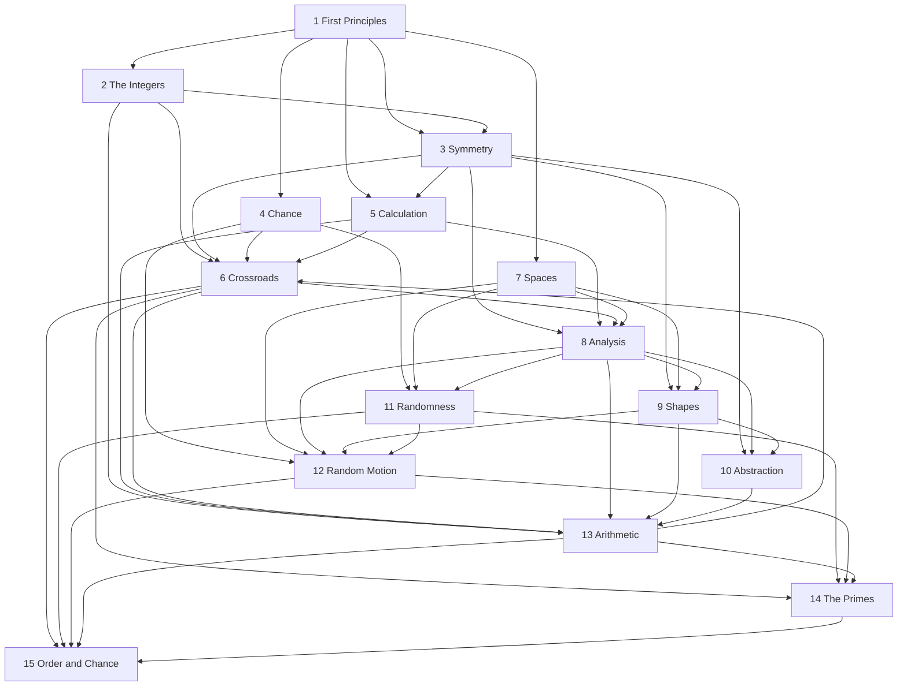

# Volume 5–15: expert review and proposed redesign

Planning document only. It does not change a manuscript, a catalog entry, a cover, or a build file. It does not replace `docs/plan/SERIES-CONTENT-PLAN.md`. Volumes 1–4 stay as they are on `main` at `b5543de`.

The series question, kept:

> Can pure order and pure chance be told apart, and why do the primes look random yet obey laws?

Reviewed from current `main`. Titles and subtitles in `common/volume-subtitles.json` are strong defaults. This review does not change one.

## How the review was made

Read in full: `docs/plan/SERIES-CONTENT-PLAN.md`, `docs/plan/book-05.md` through `docs/plan/book-15.md`, `docs/SERIES-STRUCTURE.md`, `common/series-catalog.json`, `common/volume-subtitles.json`, every `volumeN-*/main.tex` for N = 1…15, and `review/7X10-PAGINATION.md`.

Read in part: `docs/plan/book-01.md` (opening), `docs/review/SERIES-REVIEW-2026-10.md` (opening scores and the old Volumes 2–3 sections), `docs/review/CAPSTONE-PLAN.md` (opening and its dependency table), `docs/plan/PROGRESS.md` (opening). The October review and the capstone plan still use the old numbering and the old titles. They are historical. The judgments below come from the files on `main`.

For every volume, a script listed the files `\input` from `main.tex`, counted lines, and extracted theorem, lemma, proposition, and corollary environments with their labels. Nested `\input`s inside Volume 15 chapters were followed. Proofs of the climaxes were opened far enough to see the statement, the hypotheses, and whether a `proof` environment is present. They were not certified line by line.

Print pages were not rebuilt. The only measured interiors in the repository are the 27 October 2026 counts in `review/7X10-PAGINATION.md`, under the old numbering (old 0 is Volume 1). Those counts predate the chapter moves now visible in `main.tex`. Source line counts below are a size proxy, not a page count. Editorial page targets later in this file are targets, not measurements.

### Sources consulted for the benchmark

- Harold Davenport, *Multiplicative Number Theory*, contents page as listed by the Deutsche Nationalbibliothek record `https://d-nb.info/960452842/04` (chapters 1–30: Dirichlet, Gauss sums, the class-number formula, Riemann’s memoir, the functional equation of the \(L\)-functions, the gamma function, entire functions of order 1, the product for \(\xi\), zero-free regions, \(N(T)\), the explicit formula, the prime number theorem, Siegel, three primes, the large sieve, Bombieri’s theorem).
- Hugh L. Montgomery and Robert C. Vaughan, *Multiplicative Number Theory I: Classical Theory*, contents at `https://websites.umich.edu/hlm/mnt1con.html` and the chapter list on the 2007 Cambridge edition (Dirichlet series, elementary arithmetic functions, Selberg’s sieve, primes in arithmetic progressions, the prime number theorem, Ikehara, explicit formulae, zeros). That volume stops at oscillations of error terms. It does not contain Bombieri–Vinogradov or pair correlation.
- Montgomery and Vaughan, *Multiplicative Number Theory III*, draft contents and the opening of Chapter 30, “The pair correlation of zeta zeros”, at `https://personal.science.psu.edu/rcv4/571s25/Vol3.pdf`. Pair correlation is chapter 30. The draft says the main term beats the error only when the length \(X\) is \(o\bigl(T(\log T)/\log\log T\bigr)\), which is the range \(\alpha<1\).
- Elias M. Stein and Rami Shakarchi, *Princeton Lectures in Analysis*, order and chapter lists from the Wikipedia series page and the MAA review of *Complex Analysis* (Fourier; Complex, including the zeta functional equation, the prime number theorem, and the Riemann mapping theorem; Real, measure and Hilbert space; Functional, \(L^p\), distributions, Baire, probability and Brownian motion).
- Richard Durrett, *Probability: Theory and Examples*, 5th edition, Cambridge contents and the author’s contents page at `https://sites.math.duke.edu/~rtd/PTE/pte.html`: measure, laws of large numbers, central limit theorems, martingales (conditional expectation first), Markov chains, ergodic theorems, Brownian motion, Donsker, multidimensional Brownian motion and Itô’s formula.
- Jean-François Le Gall, *Brownian Motion, Martingales, and Stochastic Calculus*, Springer contents: Gaussian processes, Brownian motion, filtrations and martingales, continuous semimartingales, stochastic integration through Girsanov, Markov processes, Brownian motion and PDE, Lipschitz SDEs (Ornstein–Uhlenbeck, geometric Brownian motion, Bessel), local times. No Dyson Brownian motion.
- Greg W. Anderson, Alice Guionnet, and Ofer Zeitouni, *An Introduction to Random Matrices*, Cambridge contents and the abstract of Chapter 4: Wigner and the semicircle, Hermite polynomials and the sine kernel for GUE, then “Some generalities”, whose Section 4.3 is stochastic analysis and Dyson’s Brownian motion, then free probability.

Iwaniec–Kowalski was not opened. No chapter of that book is cited below.

### Not read

- The body of most proofs, and almost all exercises, hints, and solutions.
- `docs/review/SERIES-REVIEW-2026-10.md` after its opening and the old Volumes 2–3 sections; `docs/review/CAPSTONE-PLAN.md` after its opening table; `docs/plan/book-01.md` after its opening; `docs/plan/book-02.md`, `book-03.md`, and `book-04.md`.
- The twenty-four Volume 15 chapter files that `main.tex` does not reach (listed under Volume 15). Their theorem labels were extracted. Their proofs were not read.
- Any `.aux` file. A citation such as “Volume 6, Theorem 6.7” was not checked against a typeset run. Counts of `\chapter` commands were checked by hand where a cross-reference is discussed.
- Current print-page counts. None were produced for this review.

---

## Verdict

The plan’s story is the right story. Volume 6 puts a law (the explicit formula) and a Gaussian (Erdős–Kac) on the same primes, marks Maier’s theorem as the crack, and leaves Volume 15 to prove the crack and Selberg’s central limit theorem for \(\log|\zeta|\). That is a serious answer to the series question, and the manuscripts already contain those proofs.

The plan is no longer an accurate map of the files, and it is not yet a realistic curriculum. Several gaps it schedules are already closed. Several chapters it calls openings are already written. The page table is the October baseline and does not count the chapters that have since moved. The one structural mistake that did get executed is the move of the sine-kernel chapter into Volume 8: `volume8-analysis/chapters/ch11-cue.tex` uses Weyl’s formula from Volume 9 and Lyapunov’s theorem from Volume 11 as premises. A reader who starts at Volume 1 cannot read that chapter when the book offers it. Volume 13, at 11,459 included lines, is two graduate books in one cover. Volume 14’s bound \(p_{n+1}-p_n\le 600\) is correctly labelled as resting on a witness that is not in the book, and it should not be sold as a theorem of the volume.

Titles can stay. The repair is a reordering and a cut inside Volumes 8, 12, and 13, an audit of the short flagship proofs in Volume 6, and a decision to stop growing Volume 15.

---

## Where the written plan and the manuscripts disagree

The plan says titles are frozen and that directory names become valid once a tracker step merges. On `main` the directories are already `volume1-first-principles` through `volume15-order-and-chance`, and `common/volume-subtitles.json` already has the fifteen subtitles the plan calls frozen. The parenthetical “on-disk subtitle” lines in `book-06.md`, `book-08.md`, `book-11.md`, and `book-14.md` (“Where Numbers Meet Infinity”, “Limits, Measures and Transformations”, “The Structure of Randomness”, “The Hidden Rhythm of Primes”) do not match the JSON. The JSON is the live subtitle.

These plan items are already in the sources:

| Plan item | What the file now contains |
| --- | --- |
| Conditional expectation is only Exercise `ex:condexp` in Volume 7 | `volume7-spaces/chapters/ch10-radon.tex` has Theorem `thm:condexp` and Theorem `thm:tower`. The exercise is a finite check of the tower. |
| Primary decomposition is absent from Volume 10 | `volume10-abstraction/chapters/ch04-localisation.tex`, Theorem `thm:assprimes`. The preface of that volume already names it. |
| de Rham’s theorem might be read as general | `volume9-shapes/chapters/ch03-forms.tex`, Theorem `thm:h1punctured`, with the next sentence restricting the result to the punctured plane. |
| The shuffle cutoff must move from Volume 10 to Volume 11 | `volume10-abstraction/main.tex` does not input it. `volume11-randomness/main.tex` inputs `chapters/shuffling.tex`, Theorem `thm:ds` (Diaconis–Shahshahani). |
| Partitions and Waring must move from Volume 14 to Volume 5 | Volume 14 inputs `chapters/three-primes.tex`. Volume 5 inputs `chapters/hardy-ramanujan.tex` and `chapters/waring.tex`. |
| Jordan and the Riemann mapping theorem must leave Volume 8 | Volume 7 inputs `chapters/jordan.tex`. Volume 9 inputs `chapters/riemann-mapping.tex`. Volume 8’s complex chapter is now “Cauchy’s Theorem, Growth and Mellin Inversion”. |
| The five Volume 15 openings are about fifteen lines and prove nothing | `ch05-short.tex` is 521 lines and proves `thm:pairexpansion`, `thm:pairsecond`, `thm:gallagherk`, `thm:gallagherpoisson`. `ch06-sieves.tex` proves `thm:bonferroni` and `thm:selbergproj`. `ch08-ranks.tex` proves `thm:lagrangian`. `ch09-gue.tex` proves `thm:formfactor`. `ch12-pseudorandom.tex` proves `thm:u2count`. `ch14-meeting.tex` is the workshop the plan asked for. |
| The second Erdős–Kac write-up should shrink to a comparison | `volume15-order-and-chance/chapters/ra-erdoskac.tex` is 29 lines, Theorem `thm:erdoskac-cor`. |
| Roth’s two proofs do not know each other | `volume11-randomness/chapters/ch10-ergodic.tex` names Volume 14. `volume14-primes/chapters/ch12-roth.tex` names Volume 11, Theorems 10.15 and 10.16. Those theorem numbers were not checked against an `.aux` file. Counting `\chapter` in Volume 14, `ch12-roth.tex` is the eleventh chapter, which matches the “Chapter 11” cited from Volume 11. |
| Maier is only a remark in Volume 6, and the proof lives in Volume 15 | Still true. Volume 15, `ra-gaps.tex`, Theorem `thm:maier`, with a proof environment. The input is Theorem `thm:gallagher` in `ra-largemoduli.tex`, headed “under the zero-free region of Volume 14”. |

These plan items are not what the files do:

| Plan claim | File |
| --- | --- |
| Volume 8 may quote Weyl’s formula from Volume 9, and the dependency graph draws that arrow backwards | `ch11-cue.tex` lines 23–32 remind the reader of Volume 9, Theorems 8.3, 8.13, 8.15 and Corollary 8.16, and of Volume 11, Corollary 4.2. The count central-limit argument at line 113 uses Lyapunov’s condition. Line 567 uses the Cramér–Wold device from Volume 11. Both are premises, not previews. |
| Haar measure on \(\mathbb Q_p\) and the adèles live in Volume 8, and Volume 13 starts from them | `ch08-haar.tex` says \(\mathbb Q_p\) is constructed in Volume 13, then proves Theorem `thm:qpselfdual` and Theorem `thm:qpfourier`. The adele ring is deferred to Volume 13. The construction the measure needs is later in the reading order. Volume 13’s construction is `ch12-padic.tex`, label `ch:padic`. |
| The Bayer–Diaconis profile is proved in the Volume 15 workshop and nowhere else | Volume 4, `ch08-markov.tex`, Theorem `thm:bayerdiaconis`, is the exact probability of an arrangement with \(r\) rising sequences after an \(a\)-shuffle, and the distances for 52 cards are computed from it. The transposition cutoff is Volume 11, Theorem `thm:ds`. The asymptotic riffle profile is Theorem `thm:bd` in `volume15-order-and-chance/chapters/ch03-shuffling.tex`, and that file is not input by `main.tex`. |
| Volume 4 supplies conditional expectation as a projection to Volumes 11 and 12 | Volume 4, `ch10-martingales.tex`, Definition `def:condexp`, is the average on a finite partition. `ch11-brownian.tex` says the general construction is later. The theorem Volumes 11 and 12 can cite is Volume 7, `thm:condexp`. |
| Book 1’s spectral theorem is a load-bearing input to Book 2 | Volume 1 has Theorem `thm:spectral`. A search of `volume2-integers` for the spectral theorem found no use of it. Volume 2’s reciprocity proof is Eisenstein’s (`lem:eisenstein`, `thm:qr`). |
| The climax of Volume 10 is the transposition cutoff | The cutoff is no longer in that volume. The theorems that close it are `thm:dedekind` and `thm:peterweyl` / `thm:weylchar`. |
| \(F(\alpha)=\lvert\alpha\rvert\) for \(0\le\alpha\le 1-\varepsilon\) is Montgomery’s theorem | `volume14-primes/chapters/ch14-critical.tex`, Theorem `thm:montgomerypc`, assumes the Riemann hypothesis and proves \(F(\alpha)=(1+o(1))T^{-2\alpha}\log T+\alpha+o(1)\) for \(0\le\alpha\le 1-\varepsilon\). The diagonal term is part of the theorem. It is negligible for \(\alpha\) bounded away from 0. The slogan in the plan drops it. |
| Chebotarev is stated in Dirichlet density, and natural density is explicitly not claimed | Theorem `thm:chebotarev` says “density”. The chapter defines Dirichlet density just above, and the proof uses Dirichlet series. A remark after the proof says the theorem also holds with natural density, by a zero-free region for Hecke \(L\)-functions. That natural-density sentence is not given a proof in the pages read. |

Volume 2’s part names in `main.tex` are “The Arithmetic of Integers”, “Patterns in Remainders”, “Equations in Integers”, and “The Hidden Structure”. `docs/SERIES-STRUCTURE.md` still says the fourth part is “Equations and Characters”. The catalog matches `main.tex`. The plan’s proposed rename was overtaken by a different one. This review leaves the catalog names alone.

---

## What Volumes 1–4 actually prove

These are the inputs Volumes 5–15 may use. Nothing in this list is a proposal to edit those books.

**Volume 1, First Principles.** High-school start, and the book does prove a first university course. Language (`thm:lang-inverse`, `thm:lang-partition`); induction and the binomial theorem (`prop:induction`, `prop:binom`, `thm:newton`); inclusion–exclusion and derangements (`thm:incexc`, `prop:derang`); sequences, the intermediate-value theorem, the mean-value theorem (`thm:ivt`, `thm:mvt`); complex numbers and the roots-of-unity filter (`thm:filter`); the fundamental theorem of algebra (`thm:dalembert`); the spectral theorem for symmetric matrices (`thm:spectral`); Taylor’s theorem and Stirling’s formula (`thm:taylor`, `thm:stirling`); Cauchy–Schwarz, Hölder, Jensen (`thm:cs`, `thm:holder`, `thm:jensen`); the weak law (`thm:wlln`). Orders, including Dilworth’s material, are `orders.tex`, already in this volume. The Gaussian integral is Proposition `prop:gaussianintegral`, from Wallis, not a measure-theoretic Gaussian.

**Volume 2, The Integers.** Euclid (`thm:euclid-primes`), Chebyshev-type bounds (`thm:cheb`), Bertrand (`thm:bertrand`), the fundamental theorem of arithmetic (`thm:fta`), congruences through Hensel (`thm:hensel`), Möbius inversion (`thm:mobius`), primitive roots (`thm:cyclic`), quadratic reciprocity (`thm:qr`), two squares and four squares (`thm:twosq`, `thm:foursq`), Pell (`thm:pell`), Dirichlet characters and their orthogonality (`thm:t1-ortho`), the Euler product for \(\operatorname{Re}s>1\) (`thm:t1-eulerprod`), Legendre’s sieve (`thm:t1-sieve`). The failure \(6=2\cdot 3=(1+\sqrt{-5})(1-\sqrt{-5})\) is Theorem `thm:six` in `ch10-gaussian-eisenstein.tex`. Dirichlet’s theorem on primes in arithmetic progressions is not in this volume. The general class group is not in this volume. Quadratic fields as a chapter live in Volume 13 (`ch11-algebraic.tex`, `ch12-ideals-quadratic.tex`).

**Volume 3, Symmetry.** Groups through Sylow, the structure theorem for finitely generated modules over a PID (`thm:structure`), Galois theory (`thm:ftgt`, `thm:primitiveelement`), and the quintic: Theorem `thm:abelruffini` states that the Galois group of \(X^5-4X+2\) is \(S_5\). Character orthogonality is `thm:orth`. Fourier analysis on a finite abelian group is `thm:fourier`, and Dirichlet orthogonality is `prop:dirichletorth`. Maschke is `thm:maschke`. The cap-set theorem of Ellenberg–Gijswijt is `combinatorial:thm:capset` in `combinatorial.tex`, still in this volume, so Volume 8’s finite-Fourier chapter must not found it a second time. The linear-algebra block the plan moved (spectral theorem, SVD, graph spectra) is in Volume 8, except Perron–Frobenius (`linear:thm:perron`) and the symmetry chapter, which stayed.

**Volume 4, Chance.** Borel–Cantelli (`thm:bc`), Lindeberg’s theorem (`thm:lindeberg`) and the classical central limit theorem (`cor:clt`), Pólya’s theorem (`thm:polya`), martingale convergence (`thm:doob`, `thm:asconv`), and Lévy’s construction of Brownian motion (`thm:levy` in `ch11-brownian.tex`). Conditional expectation is only the finite-partition definition `def:condexp`. Fubini is the continuous rectangle, Proposition `prop:fubini` in `ch05-continuous.tex`. The exact riffle probability is `thm:bayerdiaconis`. The probabilistic method, entropy, and the extremal chapter (`thm:vdw`) are in this volume. Measure theory, Prokhorov’s theorem, and the general conditional expectation are not.

A reader who has finished Volume 4 has done a great deal, and has not done complex analysis, the Lebesgue integral, or Dirichlet’s theorem. Volume 5 is the right next book. It is also the first place the series can still be redesigned.

---

## Audit, Volumes 5–15

Source lines are the files `\input` from `main.tex`, including nested inputs in Volume 15. October pages are the old-numbered interiors of 27 October 2026.

| Vol. | October pages (old number) | Included source lines now | Chapters in `main.tex` |
| ---: | ---: | ---: | ---: |
| 5 | 178 (old 4) | 10,580 | 15 |
| 6 | 176 (old 5) | 8,264 | 13 |
| 7 | 179 (old 6) | 7,002 | 14 |
| 8 | 178 (old 7) | 14,093 | 25 |
| 9 | 343 (old 8) | 11,200 | 23 |
| 10 | 152 (old 9) | 4,896 | 12 |
| 11 | 192 (old 10) | 7,812 | 15 |
| 12 | 228 (old 11) | 4,995 | 11 |
| 13 | 248 (old 12) | 11,459 | 19 |
| 14 | 211 (old 13) | 4,996 | 14 |
| 15 | 194 and 313 (old 14 and old 15) | about 5,455 reached | 14, plus 24 files not reached |

### Volume 5 — Calculation

**Title.** Unchanged in the recommendation: *Calculation: From Formula to Insight.*

**Does the climax deliver the title?** Yes, if the climax is the functional equation. Theorem `thm:functional` in `ch10-zeta.tex` is Riemann’s functional equation, and Theorem `thm:zetaneg` gives the values at the negative integers. A formula (the Euler product, `thm:eulerproduct`) becomes an insight (the completed zeta is symmetric). The primes are not counted. That is the right restraint.

**Coherence.** The spine in `main.tex` is the one the plan describes, and it reads as one book: finite calculus, generating functions, products, integrals, gamma, Fourier, the discrete transform, Poisson summation (`thm:poisson`) and the sign of the Gauss sum (`thm:gausssign`), residues, zeta, asymptotics, the arithmetic–geometric mean. Two extra chapters, `hardy-ramanujan.tex` and `waring.tex`, now sit in Part I. They deliver “formula to insight”, and they are not what Volume 6 needs. `ch12-agm.tex` is 2,072 lines because the old problem book was appended there (`docs/SERIES-STRUCTURE.md` lists 36 of those problems in this file). The narrative chapter and the problem annex are different lengths of the same filename.

**Difficulty.** After Volumes 1–4 this is a fair next step, and it matches the Stein–Shakarchi order: Fourier and complex analysis before measure theory, on the Riemann integral. Stein’s *Complex Analysis* spends a chapter on the zeta function and a chapter on the prime number theorem. This volume correctly stops at the functional equation and leaves the prime number theorem to Volume 6. The hazard is the Hadamard theory of entire functions, which Volume 6 will need and which this volume does not own. Volume 6 proves its own Stirling formula in the complex plane (`thm:stirlingc`) and its own Hadamard factorization (`thm:hadamard`). That split is workable if Volume 6’s proofs are complete. A 16-line Hadamard proof is the sentence a later audit has to walk.

**Length.** The October interior is 178 pages. The file is now 10,580 lines, swollen by `ch12-agm.tex` and by the two moved chapters. An editorial target for the narrative spine is 220–260 pages. The appended problems are exercises, not a second target.

**Prerequisites, against the manuscripts.** Volume 1’s calculus and series (`thm:mvt`, `thm:taylor`, `thm:stirling`). Volume 3’s finite abelian Fourier analysis (`thm:fourier`) for the discrete transform. Volume 2 is not required for the zeta chapter’s Euler product; Volume 5 rebuilds it as `thm:eulerproduct`. General Fubini–Tonelli is not in Volumes 1–4. Volume 5’s own integral chapter has to keep the continuous-rectangle case, as the plan says. This review did not re-check that label.

**Reuse.** The twelve original chapters can stay. Notation at the first use of the completed zeta: Volume 6 will use \(\Lambda\) for von Mangoldt and \(\theta\) for Chebyshev. Effort: moderate, and it is an audit plus a notation pass, not a new book.

### Volume 6 — Crossroads

**Title.** Unchanged: *Crossroads: Arithmetic Meets Analysis.*

**Does the climax deliver the title?** Yes. This is the turn. Theorem `thm:pnt` (Newman, `thm:newman`, after the zero-free line `thm:line`), Theorem `thm:explicit`, and Theorem `thm:erdoskac` are three theorems a reader can point at. Arithmetic and analysis are both on the page. The modular-forms chapter is a taste, and `main.tex` places it last, which is right, provided it does not pretend to be Volume 13.

**Coherence.** Twelve mathematical chapters, in an order Davenport would recognize up through the explicit formula, then sieves, Erdős–Kac, a model, exponential sums, and a modular exhibit. Davenport’s contents put the functional equation of \(L(s,\chi)\) (his Chapter 9) before the explicit formula (his Chapter 17). This volume proves the explicit formula for \(\psi\) and, in `ch07-explicit.tex`, Proposition `prop:biasidentity` says the functional equation of \(L(s,\chi)\) is not proved here and points to Volume 13. That label has to stay. Chebyshev’s bias is not a theorem of this volume until that hypothesis is discharged.

**Difficulty.** This is a graduate analytic-number-theory book sitting on Volume 5. Davenport reaches the prime number theorem only after entire functions of order 1 and the product for \(\xi\). Montgomery–Vaughan I reaches it in their Chapter 6, after Dirichlet series and a zero-free region, and spends later chapters on explicit formulae. The series is attempting Davenport’s Chapters 7–18 in one volume, after a single complex-analysis chapter. The proofs exist as `proof` environments: `thm:newman` is about 45 lines, `thm:hadamard` about 16, `thm:explicit` about 20, `thm:zerofree` about 21. Short can be complete — Newman’s proof is famous for being short — and short can hide a gap. These four are the proofs the rest of the series stands on. They are the audit, not a reason to move the climax.

**Length.** October baseline 176 pages. `ch12-modular.tex` is 2,574 lines, again a problem annex (`docs/SERIES-STRUCTURE.md` lists 39 problems there). Editorial target for the narrative: 200–240 pages.

**Prerequisites that the files actually have.**

| Later theorem | Earlier label |
| --- | --- |
| Dirichlet’s theorem, `ch04-dirichlet.tex` | Volume 2, `thm:t1-ortho`; Volume 3, `prop:dirichletorth`; non-vanishing proved in this volume’s `ch03-characters.tex` |
| Prime number theorem, `thm:pnt` | `thm:functional` and residues from Volume 5; `thm:line` proved here |
| Explicit formula, `thm:explicit` | `thm:hadamard`, `thm:rvm`, `thm:zerofree` in `ch06-zeros.tex` |
| Erdős–Kac, `thm:erdoskac` | `thm:tk` in the same file; Volume 4, `thm:lindeberg` or the method of moments the chapter uses. The precise citation inside the proof was not re-walked. |
| Gauss-sum sign used for characters | Volume 5, `thm:gausssign` |

Maier’s theorem is a remark in `ch10-random.tex`, as the plan says. This review confirmed the proof lives in Volume 15, not here.

**Reuse.** High. Effort: moderate, and it is the audit of the four short proofs plus the bias label. The preface should say the series question in the form this span can touch. That paragraph is still worth writing. It is not the first job.

### Volume 7 — Spaces

**Title.** Unchanged: *Spaces: Topology, Measure and Limits.*

**Climax.** Baire’s theorem and a comeagre set of nowhere differentiable functions in `ch05-baire.tex`; the Lebesgue integral; Fubini in `ch08-products.tex`. “Typical” becomes a theorem, and it is not the same word as Volume 4’s “almost surely”. The chapter says so in the plan, and the file is the place to keep that sentence.

**Coherence.** The book does the job its subtitle names. Jordan’s theorem has arrived (`jordan.tex`). The problem chapter is already titled “Almost every number”. Conditional expectation is no longer the gap the plan schedules.

**Difficulty.** Durrett starts with measure. This series, like Stein, does measure after Fourier and complex analysis, and after a probability book that admitted what it used. That order is honest if every admission in Volumes 4 and 5 is labelled, and if Volume 7 is where the label is paid. Prokhorov’s theorem is `thm:prokhorov`. Kolmogorov’s extension on \(\mathbb R^{\mathbb N}\) is `thm:kolmogorov`. Those two are what Volume 11’s Donsker argument is allowed to cite.

**Length.** October 179 pages, plus the problem chapter already in the 7,002 lines. Editorial target 210–250. The book should not grow.

**Prerequisites.** Volume 1’s completeness and calculus. Volume 4 is motivation. Volume 4’s theorems are not inputs. No functional analysis.

**Reuse.** High. The plan’s remaining local sentences (an infinite outer measure, cylinder additivity before Kolmogorov, the Hausdorff citation) were not re-audited here. Effort: light.

### Volume 8 — Analysis

**Title.** Unchanged: *Analysis: Operators, Spectra and Transforms.* The chapters that deliver the title are the compact spectral theorem and the Fourier–Tauberian block. The random-matrix chapters do not belong in the reading order this file now has.

**Climax the file can actually hold, in order.** Theorem `thm:spectralcompact` in `ch04-spectral.tex` (compact self-adjoint operators; the unbounded theorem is not this file’s load, and this review did not re-check the blurb). Corollary `cor:pntikehara` in `ch10-tauberian.tex`, a second proof of the prime number theorem from Wiener–Ikehara, using the zero-free line and not reproving it. The chapter’s own opening says the non-vanishing is the input.

**The misplaced block.** `main.tex` inputs, before Banach spaces have been used and before Volume 9 exists, the linear-algebra reprise (`linear-ch01-duality.tex` through `linear-ch12-dynamics.tex`), `spectral-expansion.tex`, `ch09-expanders.tex`, `ch10-semicircle.tex`, and `ch11-cue.tex`. That block is why the volume is 14,093 lines against an October baseline of 178 pages. The sine-kernel chapter cites Volume 9 and Volume 11 as premises, as recorded above. The semicircle chapter can be told with the moment method and Volume 4, but it currently sits in a volume the reader has not finished, and the cue chapter cannot.

**\(\mathbb Q_p\).** Theorem `thm:qpselfdual` is a real theorem of Fourier analysis, and its object is constructed in Volume 13. The reading order is backwards.

**Difficulty.** Stein’s *Functional Analysis* is \(L^p\), distributions, Baire, and an introduction to Brownian motion. It is not Wigner, the sine kernel, and the graph-theoretic Riemann hypothesis. Those are a second book. Putting them here makes the difficulty curve jump sideways: the reader meets a research-level point process in the same volume as Hahn–Banach, and meets it before the tools.

**Length.** Editorial target for the operator–Fourier–Tauberian spine: 220–280 pages. The linear reprise and the random-matrix chapters are additional books and are not part of that target.

**Reuse.** The analysis chapters stay. `ch10-semicircle.tex` and `ch11-cue.tex` move back to Volume 12. The \(\mathbb Q_p\) section of `ch08-haar.tex` moves to Volume 13, after `ch:padic`. The linear reprise becomes an appendix that is not a prerequisite. Expanders can stay with spectra only after a citation check that this review did not do; until that check, they are an appendix, not an input to Volume 9. Effort: moderate, and it is a move, not a rewrite of the proofs.

### Volume 9 — Shapes

**Title.** Unchanged: *Shapes: The Geometry of Connection.*

**Climax.** Gauss–Bonnet in `ch04-curvature.tex`, and Weyl’s integration formula, Theorem `thm:weyl` in `ch08-haar.tex`, with the correlation functions `thm:correlations` and Dyson’s finite-\(n\) pair correlation `cor:dyson`. Those are the joints the later floors cite. de Rham is honestly local (`thm:h1punctured`).

**Coherence.** The ten main chapters and `riemann-mapping.tex` are one geometry book. Appendices B–L (`geometry-ch02` through `geometry-ch12`) are a second, pictorial book: inversion, projective geometry, conics, lattices, convex bodies. Euclid’s appendix is already out of `main.tex`. The appendices are not what Volume 12 or Volume 13 needs, except as pictures (the cubic, Bézout). They should stay appendices and should be marked as not on the prerequisite path. The cubic appendix must not be cited as the proof of the group law. Volume 13’s `thm:grouplaw` is that proof.

**Difficulty.** A first course in manifolds, forms, and Lie groups, after Volume 7, is a full book. The appendices make it two. October’s 343 pages already showed the strain. The file is 11,200 lines.

**Length.** Editorial target 280–340 for the main chapters. The appendices stay available and are not counted as the floor the next volume stands on.

**Prerequisites.** Volume 7 (topology, measure, Fubini, change of variables). Volume 3 (groups, quaternions, the double cover). The inverse-function theorem is proved in `ch01-manifolds.tex` if the plan’s description is right; this review did not re-open that proof.

**Reuse.** High for the main chapters. Effort: light, mostly citations and the appendix signpost. The two \(\Delta\)s in `ch08-haar.tex` are still the notation debt the plan names; this review did not re-check the letters.

### Volume 10 — Abstraction

**Title.** Unchanged: *Abstraction: Categories, Algebra and Homology.*

**Climax.** Not the shuffle. Theorem `thm:dedekind` (the axiom set for a Dedekind domain) and Theorems `thm:peterweyl` and `thm:weylchar` (Peter–Weyl, and Weyl’s character formula for \(U(n)\)). Yoneda’s lemma is the thesis of the first chapter and is the right opening, not the summit.

**Coherence.** At 4,896 lines and twelve chapters this is the one volume in the block whose length matches its job. Primary decomposition is in. The shuffle is out. Schur–Weyl was to be moved into a remark; this review did not re-check `ch11-compact.tex` for that sentence.

**Difficulty.** A first graduate algebra course: Nullstellensatz, dimension, Dedekind, Ext, group cohomology, Wedderburn, Specht modules, compact groups. Volume 13 needs the Dedekind axioms and does not need Yoneda. The categories chapter earns its place by being short. Spectral sequences are correctly absent.

**Length.** October 152 pages. Editorial target 170–200. It should not absorb anything else.

**Prerequisites.** Volume 3 entire, including `thm:maschke` and `thm:orth`. Volume 9’s homology of \(\mathbb{RP}^2\) is cited by the universal-coefficient discussion; this review did not re-locate that citation. Volume 8’s compact operators are the input Peter–Weyl needs, and they sit in `thm:spectralcompact`, which remains in Volume 8 under the redesign.

**Reuse.** The files stay. The plan’s climax sentence has to be rewritten so it names `thm:dedekind` and `thm:peterweyl`. Effort: light.

### Volume 11 — Randomness

**Title.** Unchanged: *Randomness: Martingales, Limits and Ergodicity.*

**Climax.** Donsker’s theorem in `ch03-donsker.tex`, and Furstenberg’s proof of Roth in `ch10-ergodic.tex`. Both deliver the subtitle: a limit, and an ergodic theorem. The Gaussian is no longer the only limit (`ch05-stable.tex`). The arithmetic chapters quote what they do not prove.

**Coherence.** This is a probability book with one arithmetic cliffhanger, which is the right shape. `ch11-modphi.tex` already says the Selberg–Delange theorem is proved in Volume 15, Chapter 3, and calls the uniform-integer statement a corollary of a quoted formula. That label should stay. The transposition cutoff `thm:ds` belongs here: it is a limit. The problem chapter is already titled “Sums of random pieces”.

**Difficulty.** Durrett’s order is measure, laws of large numbers, CLT, martingales, ergodic theorems, Brownian motion, then Donsker. This volume assumes Volume 4’s Lindeberg and Volume 7’s Prokhorov (`thm:prokhorov`) and, now, `thm:tower`. It then does the sharpening Durrett spreads across his Chapters 3, 4, 6, and 8, and adds Stein’s method, large deviations, and concentration. That is a full second probability course. It is coherent. It is not the place to prove Selberg–Delange.

**Length.** October 192 pages plus the problem chapter, now 7,812 lines. Editorial target 220–260.

**Prerequisites.** Volume 4 (`thm:lindeberg`, `thm:levy` as the process Donsker names). Volume 7 (`thm:prokhorov`, `thm:condexp`, `thm:tower`). Volume 6’s `thm:erdoskac`, quoted. Volume 8’s compact operators for the weakly mixing lemma; this review did not re-open that lemma.

**Reuse.** High. Effort: light. The stable-law sentences the plan asks for (triangular-array converse, non-symmetric stable laws) were not re-checked.

### Volume 12 — Random Motion

**Title.** Unchanged: *Random Motion: The Geometry of Random Paths.*

**Climax the files now support.** Itô’s formula in `ch04-ito.tex`, and Theorem `thm:dyson`: Hermitian Brownian motion started with distinct eigenvalues never collides, and the eigenvalues solve the \(\beta=2\) Dyson system. The remark immediately after the proof says the entrance from a multiple eigenvalue, and in particular from \(H_0=0\), is not proved, and neither is the Gaussian unitary joint density. That remark is the honest boundary. Anderson–Guionnet–Zeitouni put Dyson’s Brownian motion in Section 4.3, after the semicircle, the GUE joint law, and the sine kernel. Le Gall’s SDE chapter stops at Bessel processes. So `thm:dyson` is a chapter beyond a first stochastic-calculus course. It can stay as the last theorem of the SDE chapter because the proof that was read (the non-collision estimate via the function \(\psi\)) uses Itô’s formula and Lévy’s characterization, which this volume owns. It cannot be asked to produce the GUE density.

**Coherence.** With the matrix chapters removed, `main.tex` is Brownian motion, stochastic calculus, the branching random walk, and networks. That delivers the subtitle. The catalog part name is already “Networks”. Bringing the semicircle and the sine kernel back, which this review recommends, makes the third part “Networks and Random Matrices” again. That is a catalog change, proposed here and not made.

**Why the spectra return.** `ch11-cue.tex` needs Volume 9’s `thm:weyl` and Volume 11’s Lyapunov theorem. Both exist before Volume 12. They do not exist before Volume 8. The sine kernel is a spectrum, and it is a spectrum with a path (Dyson’s). Volume 12 can hold both without a forward citation. Volume 8’s subtitle is already delivered by `thm:spectralcompact`, the graph appendix if it stays, and Plancherel.

**Difficulty.** Le Gall’s book is the template for Chapters 1–7: Gaussian processes, path properties, martingales, Itô, Girsanov for bounded drift, the Dirichlet problem, Lipschitz SDEs, Lévy–Itô. Dyson is the one extra theorem, with the entrance left open. The sine kernel, restored, is a second summit and should be labelled as using Volume 9 and Volume 11 by label, not by a reminder that names theorem numbers from a different chapter numbering.

**Length.** October 228 pages included the matrix chapters. The current 4,995 lines are the path book without them. Editorial target after the return: 260–320. Still one volume, because the proofs already exist.

**Prerequisites.** Volume 4, `thm:levy`. Volume 7, `thm:prokhorov` and Radon–Nikodym (the Girsanov citation). Volume 11, Donsker and, for the restored sine-kernel chapter, Lyapunov. Volume 9, `thm:weyl`, `thm:correlations`, `cor:dyson`. Volume 8, Plancherel.

**Reuse.** The path chapters stay, including the Dyson remark. `ch10-semicircle.tex` and `ch11-cue.tex` come back from Volume 8 and are edited only to cite Volume 9 and Volume 11 by the labels those books actually have. Effort: moderate, almost all of it citation and order.

### Volume 13 — Arithmetic

**Title.** Unchanged: *Arithmetic: From Equations to Hidden Worlds.*

**Climax.** The class-number formula in `ch08-zeta.tex`, and Theorem `thm:tate` (Tate’s thesis for \(\mathbb Q\), including the functional equation of a primitive Dirichlet \(L\)-function as Corollary `cor:dirichletFE`). The general functional equation of \(\zeta_K\) is the remark headed “Hecke’s functional equation; a sketch”. That heading matches the plan and should stay. Fujisaki’s lemma is Theorem `thm:fujisaki`, and it gives a second proof of the unit theorem. The second proof is a return only if Chapter 4 is named.

**Coherence.** The subtitle is right and the book is too big. `main.tex` now contains the quadratic chapters moved from Volume 2 (`ch11-algebraic.tex`, `ch12-ideals-quadratic.tex`, `ch12-padic.tex`), then the general theory of the same things (`ch01-number-fields.tex` through `ch06-local.tex`), then Hasse–Minkowski, zeta functions, Tate, class field theory, curves, elliptic curves, modular forms, and `polyfermat.tex`. That is 19 files and 11,459 lines. A reader meets unique ideal factorization twice. Marcus’s *Number Fields* is one book and stops before Tate, curves, and modular forms. This volume is Marcus plus Tate plus Silverman’s first chapters plus a modular-forms course.

**What is written as a proof, and what is admitted.**

| Statement | Label | Status in the file |
| --- | --- | --- |
| Three squares | `thm:threesq` | The statement is the classical one, \(4^a(8b+7)\). The “only if” cites Volume 2, Exercise 7.1. The converse is the Davenport–Cassels lemma `lem:dc` after Hasse–Minkowski. This review did not re-walk the 2-adic test. |
| Hasse–Minkowski | `thm:hm` | A `proof` environment of about 33 lines, after the local theory. Not line-certified. |
| Chebotarev | `thm:chebotarev` | Written as a proof in Dirichlet density, by Deuring’s reduction and a cyclotomic crossing, depending on `thm:dirichletF`. Natural density is a remark and names Hecke \(L\)-functions. |
| Kronecker–Weber, Artin reciprocity | `ch10-cft.tex` | The plan says Kronecker–Weber is proved and Artin reciprocity is admitted. This review did not re-open the headings. |
| Mordell–Weil over \(\mathbb Q\) | `thm:mordell` | The statement is finite generation. The file splits weak Mordell–Weil and a height descent. Not line-certified. The \(n\)-Selmer group in general is not this theorem. |
| Group law | `thm:grouplaw` | Proved here, from Riemann–Roch. The Volume 9 appendix is not the home. |
| Tate for \(\mathbb Q\) | `thm:tate` | A `proof` environment of about 29 lines, after adelic Poisson summation `thm:adelicpoisson`. Not line-certified. The scope in the heading is \(\mathbb Q\). |
| Modularity | `ch14-modular.tex` | The plan says it is stated. This review did not re-open the modularity paragraph. The Eichler–Shimura sentence the plan flags was not re-checked. |

**Difficulty.** Tate’s thesis for \(\mathbb Q\), with Poisson summation already in Volume 5 (`thm:poisson`) and Haar measure in hand, is one long chapter. It is not a chapter plus the general number field. Artin reciprocity is correctly left admitted: the proof is class field theory proper, and the series has not built the machinery. Chebotarev in Dirichlet density is a reasonable theorem if `thm:dirichletF` is complete. Natural density is not, until a zero-free region for Hecke \(L\)-functions is proved or the remark is marked “not proved here”.

**Length.** October 248 pages, before the quadratic chapters were added. Editorial target after the cut below: 280–340. The uncut file is past one volume.

**Prerequisites.** Volume 2’s examples (`thm:six`, `thm:qr`, `thm:pell`), not its general theorems, because it has no general theorems of this kind. Volume 3’s Galois theory (`thm:ftgt`). Volume 10’s `thm:dedekind`, as the axiom set, with the number-field case proved again here. Volume 6’s value of \(L(1,\chi)\). Volume 8’s Haar measure on \(\mathbb R\) and on compact groups. The \(\mathbb Q_p\) measure comes after this volume’s own construction, under the redesign.

**Reuse.** Most chapters stay. The duplicated quadratic development is the rewrite: one of the two unique-factorization narratives becomes the worked example inside the other. `polyfermat.tex` can stay; it is 144 lines. Effort: heavy for the merge of the quadratic chapters, moderate everywhere else.

### Volume 14 — The Primes

**Title.** Unchanged: *The Primes: Their Hidden Rhythm.*

**Climax.** Theorem `thm:bv`, Bombieri–Vinogradov, is the climax that delivers the title: the Riemann hypothesis on average, which is a rhythm. Maynard’s sieve deduction is the second summit, and it is in the book. Montgomery’s theorem is the bridge to Volume 15, under the Riemann hypothesis, on a limited range.

**What the headings actually claim.**

| Result | Label | In the heading |
| --- | --- | --- |
| Primes in short intervals from Carlson | `thm:carlson`, `cor:hoheisel` | Proved. Huxley, Baker–Harman–Pintz, Guth–Maynard: the plan says they stay quoted. Not re-checked line by line. |
| Siegel, Siegel–Walfisz | `thm:siegel`, `cor:sw` | Proved, and the constant is ineffective if the chapter says so. The ineffective sentence was not re-read. |
| Parity | `thm:parity` | Proved for a weight the sieve does not see. Chen is `thm:chen`, headed “quoted”. |
| Bombieri–Vinogradov | `thm:bv` | A `proof` environment of about 20 lines, after Vaughan’s identity `lem:vaughan` and `thm:mainest`. Davenport’s Bombieri theorem is two chapters at the end of his book (Chapters 27–28), after the large sieve. A 20-line deduction can be the last step of a complete argument. It can also be the step that cites an estimate it has not proved. This is the second audit, after Volume 6’s explicit formula. |
| Three primes | `thm:threeprimes` | Proved for large odd numbers. Helfgott is not this theorem. |
| Maynard | `thm:maynard`, `thm:six` | The reduction is a theorem. Part (b) gives the rational \(M_5\ge 1417255/708216\), which is printed. Part (a) says \(M_{105}>4.002\) and \(p_{n+1}-p_n\le 600\) use a rational witness and Engelsma’s tuple, neither printed. Polymath’s 246 is `thm:246`, headed “quoted”. |
| Halász | `thm:halasz` | A `proof` environment. Matomäki–Radziwiłł is `thm:mr`, headed “quoted”. |
| Roth | `thm:roth` | The density-increment proof. The ergodic proof is cited, not absorbed. |
| Green–Tao | `thm:greentao` | Headed “quoted”. The \(W\)-trick lemma `lem:wtrick` is in the file. |
| Montgomery | `thm:montgomerypc` | Riemann hypothesis in the first sentence. Range \(0\le\alpha\le 1-\varepsilon\). The formula includes \(T^{-2\alpha}\log T\). A positive proportion of critical zeros is `thm:proportion`, a citation with an empty proof body. The approximate functional equation is `thm:afe`, headed “quoted”. |

**Difficulty.** Montgomery–Vaughan I does not reach Bombieri–Vinogradov or pair correlation. Pair correlation, in their Volume III draft, is Chapter 30 and is limited to \(\alpha<1\) for the same reason this file stops at \(1-\varepsilon\). Maynard’s 2013 paper is a research article. The series can own the variational criterion and the printed \(k=5\) rational. It cannot own the number 600 without the witness. Davenport reaches three primes as one chapter (his Chapter 26), after Vinogradov’s exponential sums. Keeping three primes and quoting the Vinogradov mean-value theorem (`thm:vmvt`, headed “quoted”) is the right cut.

**Length.** October 211 pages. The current 4,996 lines are in that range, because partitions and Waring have already left. Editorial target 220–260. Do not add a chapter.

**Prerequisites.** Volume 6 entire: `thm:pnt`, `thm:explicit`, `thm:erdoskac`, the large sieve as far as Volume 6 took it, the shape of Cramér’s model. Volume 5’s residues and Euler–Maclaurin. Volume 13’s discriminant and class group for the class-number bound in `thm:classnumber`. Volume 11’s ergodic Roth, cited.

**Reuse.** High. Effort: light, and the light work is the discipline of the word “quoted”, plus the decision on 600.

### Volume 15 — Order and Chance

**Title.** Unchanged: *Order and Chance: The Meeting of Structure and Randomness.*

**Climax.** Theorem `thm:maier` and Theorem `thm:selberg`. Both are in files `main.tex` reaches. Maier says that matching a mean is not being the model: for every \(\lambda>1\), the short-interval count is sometimes too large and sometimes too small, with the Buchstab weights. Selberg says that \(\log|\zeta(\tfrac12+it)|\), at a random height, is Gaussian with variance \(\tfrac12\log\log T\). The proof followed is the Radziwiłł–Soundararajan argument, laid out in the first pages of `ra-selberg.tex`: move slightly off the line, replace the logarithm by a short prime sum, compare in mean square. The reminder at the head of that file cites Volumes 4, 5, 6, and 14, not an unproved zero-density estimate. Whether every later line keeps that promise was not certified. The histogram caption already says the classical variance is too small at height \(10^{10}\). That sentence should stay. It stops the theorem from being read as a description of a picture the reader can compute.

**Coherence.** `main.tex` is the five-part book the plan asked for. The twelve workshop chapters and the conjecture tours are on disk and are not input. Twenty-four files are unreached: `ch01-research.tex`, `ch02-reading.tex`, `ch03-shuffling.tex`, `ch04-selberg.tex`, `ch05-sandpiles.tex`, `ch06-chaos.tex`, `ch07-experiments.tex`, `ch08-heuristics.tex`, `ch09-lean.tex`, `ch10-writing.tex`, `ch11-problems.tex`, `ch12-projects.tex`, and `conjectures-ch01-born.tex` through `conjectures-ch12-algebra.tex` except `conjectures-ch05`, which is also unreached. They are not part of the book. They should not be put back.

The thin chapters are no longer the five stubs the plan describes. What is still thin, and should stay thin:

- `ch08-ranks.tex` (51 lines) proves the linear algebra `thm:lagrangian` and rewrites one descent. Goldfeld, Birch–Swinnerton-Dyer, Bhargava–Shankar, and modularity stay stated. That is the right size.
- `ch12-pseudorandom.tex` (51 lines) proves one \(U^2\) count. It must not grow a nilsequence.
- `ch10-moments.tex` is a seven-line wrapper. Its prose already says the approximate functional equation is not proved, and that every use is marked. `ra-moments.tex` is the body. The wrapper’s promise has to be true of the body. This review did not check every display in `ra-moments.tex`.
- `ch09-gue.tex` proves `thm:formfactor` in half a page, which is an honest computation with the series’ Fourier convention, and then inputs `moments-zeta.tex` (374 lines). That input must not become a second proof of Montgomery.

**Difficulty.** Maier’s theorem, from Gallagher’s weighted prime number theorem under a zero-free hypothesis, is the right level for a last chapter: the sieve ideas are Volume 6’s and Volume 14’s, and the new step is the matrix. Selberg’s central limit theorem is a research theorem with a modern proof that fits a long chapter if the twisted second moment `thm:twisted` is unconditional on the hypotheses the reminder lists. It is the climax. It is not a lemma.

**Length.** The reached files are about 5,455 lines. The old separate volumes were 194 and 313 pages. The condensation has already happened in `main.tex`. Editorial target 260–320. Growing the thin chapters back into tours would undo it.

**Prerequisites.** Volume 6: `thm:pnt`, `thm:explicit`, `thm:erdoskac`. Volume 14: `thm:bv`, `cor:sw`, `thm:halasz`, `thm:montgomerypc`, Maynard’s criterion. Volume 13: the class group, `thm:mordell`, `cor:dirichletFE`. Volume 11: Berry–Esseen (the constant lives in `ch04-clt.tex`; the label was not re-checked), the Gauss map, the ergodic Roth. Under the redesign, the sine kernel and `thm:ksmoments` are cited from Volume 12, not from Volume 8.

**Reuse.** The reached files are the book. Effort: moderate, and it is citation hygiene after the Volume 8 move, not a new draft. The orphan files are a cut already performed by `main.tex`. Deleting them is a separate decision and is not required for the plan.

---

## Series level

### Missing tools

The tools that are genuinely missing, as opposed to merely later, are these.

1. **A legal home for the sine kernel.** The proof in `ch11-cue.tex` needs Volume 9 and Volume 11. Volume 8 is before both. This is the missing-tool bug the move created.
2. **A legal home for Haar measure on \(\mathbb Q_p\).** The measure is proved in Volume 8. The field is built in Volume 13.
3. **The functional equation of \(L(s,\chi)\) before anyone uses it.** Volume 6’s bias proposition already refuses to use it. Volume 13 proves it for primitive characters, as `cor:dirichletFE`. No earlier chapter may drop the hypothesis.
4. **Hecke \(L\)-functions**, if anyone wants Chebotarev in natural density. They are not a theorem of Volume 13 in the pages read. The remark that asserts natural density is ahead of the book.
5. **General conditional expectation** is no longer missing. It is `thm:condexp`.

Complex analysis is not missing. It is Volume 5’s `ch09-complex.tex` and Volume 6’s additions (complex Stirling, Hadamard for \(\xi\)). Measure theory is not missing. It is Volume 7, and Volumes 4 and 5 have to keep labelling what they use early. Linear algebra is not missing. Volume 1 has `thm:spectral`, and Volume 8’s reprise is a second course.

### Duplication

Some returns are the building. Some are two proofs that do not know each other. The ones that are already in good order: the prime number theorem as `thm:pnt` and again as `cor:pntikehara`; Erdős–Kac as `thm:erdoskac` and as the corollary `thm:erdoskac-cor`; Roth in Volume 11 and Volume 14, with the cross-citations in place; quadratic reciprocity in Volume 2 (`thm:qr`) and again by Fourier in Volume 8 if that chapter still finishes it. The functional equation three times — theta in Volume 5, a tool in Volume 6, Tate in Volume 13 — is a return if each introduction counts the previous one.

The duplication that should be cut is the quadratic theory printed twice inside Volume 13.

The cap-set bound lives in Volume 3 as `combinatorial:thm:capset`. If Volume 8’s finite-Fourier chapter also proves it, one of the two is the home and the other cites it. This review did not compare the two write-ups.

### Topics on the wrong floor

- The sine kernel and the semicircle, currently in Volume 8, belong in Volume 12.
- Haar measure of \(\mathbb Q_p\), currently in Volume 8, belongs after `ch:padic` in Volume 13.
- The elementary linear-algebra reprise, currently the opening of Volume 8’s mathematical text, is an appendix. Volume 1 already proved `thm:spectral`.
- The geometry appendices in Volume 9 are a pictorial book. They are not the floor Volume 12 stands on.
- The riffle limit profile in the unreached `ch03-shuffling.tex` is not Volume 15’s meeting. Volume 4 owns the exact formula. Volume 11 owns the transposition cutoff. The asymptotic profile can stay out.

### Over-ambitious climaxes

| Claimed climax | Honest status |
| --- | --- |
| Maynard’s bound 600 | The sieve deduction is a theorem. The number 600 is not, until the witness is printed. `thm:six` already says the witness is absent. |
| Bombieri–Vinogradov | Written as a proof at the end of a chapter that contains Vaughan and a large-sieve estimate. Davenport needed two chapters after a book of preparation. Treat the written proof as the thing to audit, not as a theorem that has been certified by its length. |
| Tate’s thesis for \(\mathbb Q\) | The heading is the right theorem. The general \(\zeta_K\) sketch must not be quoted as the same theorem. |
| Tate’s thesis for a general number field | A sketch. Leave it a sketch. |
| Dyson Brownian motion from \(H_0=0\), with the GUE density | The remark after `thm:dyson` already withdraws this. Do not let a later sentence restore it. |
| Artin reciprocity, modularity, Green–Tao, a positive proportion of critical zeros, pair correlation for \(\alpha>1\) | Labelled as quoted or as conjectures in the files that were opened. They stay that way. |
| Chebotarev in natural density | A remark, depending on Hecke \(L\)-functions. Not a theorem of the volume until those are proved. |
| Selberg’s central limit theorem | The right climax of Volume 15, by a modern proof, if the twisted moment stays inside the hypotheses the reminder lists. |
| Montgomery for \(\alpha\le 1-\varepsilon\) | A theorem under the Riemann hypothesis, with the diagonal term kept. It is not the pair-correlation conjecture, and it is not \(F(\alpha)=\lvert\alpha\rvert\) at \(\alpha=0\). |

### Narrative, and the balance of order and chance

Volumes 6 and 15 carry the series question. Volume 5 builds the zeta function. Volume 14 hears the rhythm. Volumes 11 and 12 are the chance half after the turn. Volumes 7 and the operator half of Volume 8 are the rooms and the beams those probability books stand on. That is a building.

The silence is Volume 8’s linear reprise, Volume 9’s appendices, and the second copy of algebraic number theory inside Volume 13. A reader who has just seen the primes written as waves then spends a volume on inversion geometry and another on a repeated ideal theory before the waves return. The redesign leaves the titles and the six parts, and takes those stretches off the prerequisite path.

Order and chance are both present after the redesign: Volumes 5–6 and 13–14 are order, Volumes 4, 11, and 12 are chance, Volume 7 is the language both use, and Volume 15 is the meeting. Volume 9’s Weyl formula is the one geometric theorem the chance half needs. Volume 10’s Dedekind domain is the one algebraic theorem the order half needs. The rest of those two volumes is a frame, and a frame can be short.

---

## Benchmark, in one paragraph each

**Davenport** reaches Dirichlet’s theorem, the class-number formula, and only then the prime number theorem, and he proves the functional equation of \(L(s,\chi)\) before the explicit formula. Bombieri’s theorem is his last substantial chapter. The series’ decision to put the prime number theorem in Volume 6 and Bombieri–Vinogradov in Volume 14 matches that distance. The series’ decision to use \(L(s,\chi)\) in Volume 6 before Volume 13 proves the functional equation does not, and the manuscript already patches it with a label. Keep the label.

**Montgomery–Vaughan I** is a 500-page book that stops before Bombieri–Vinogradov and before pair correlation. Their draft Volume III puts pair correlation in Chapter 30 and records that the method reaches \(\alpha<1\). Volume 14’s `thm:montgomerypc` is that theorem, not a stronger one. Asking Volume 14 to prove it in a chapter that also contains Hardy’s theorem and the mean square is the compression. It is acceptable as a last chapter. It is not acceptable as one of three research climaxes each written as if it were elementary.

**Stein–Shakarchi** do Fourier, then complex (zeta, the prime number theorem, Riemann mapping), then measure, then functional analysis. Volumes 5, 6, 7, and 8 follow that order, which is why complex analysis before the Lebesgue integral is not a bug. Stein’s complex book includes the prime number theorem; the series splits it into Volume 6, which gives Volume 5 a cleaner climax. Stein do not do Wigner matrices in the functional-analysis volume. The series should not either.

**Durrett** puts conditional expectation at the start of the martingale chapter, after measure and the central limit theorem, and puts Donsker after Brownian motion. The series puts a first central limit theorem and a Lévy construction in Volume 4, the measure and the general conditional expectation in Volume 7, and Donsker in Volume 11. That is Durrett’s order with an elementary first pass. It works if Volume 4 never cites `thm:condexp`.

**Le Gall** is the whole of a stochastic-calculus course and does not reach Dyson’s Brownian motion. **Anderson–Guionnet–Zeitouni** reach it in Section 4.3, after the joint eigenvalue law. The series proves non-collision from a simple spectrum inside the SDE chapter and refuses the entrance law. That refusal matches the sources. Restoring it would mean writing a section these books take many pages to write.

---

## The recommended plan

One plan. Titles and subtitles unchanged. The six catalog parts unchanged. One catalog part-name restored if the random-matrix chapters return to Volume 12: “Networks and Random Matrices” in place of the current “Networks”. No volume is reordered. Volumes 1–4 are not edited.

The alternative, if the author wants the sine kernel to sit in the volume whose subtitle says “Spectra”, is recorded after the volume table. It is a real trade-off. It is not the recommendation.

### Volume by volume

For each chapter, “proved” means the file contains a proof environment whose heading states that theorem. “Quoted” means the heading says so, or the proof body is empty and the heading names another author. This review did not certify the algebra inside the proofs.

#### Volume 5 — Calculation: From Formula to Insight

Unchanged title.

| Chapter file | Proved here | Quoted | Needs |
| --- | --- | --- | --- |
| `ch01-finite.tex` | Summation by parts, power sums in Bernoulli numbers, at the strength the file states | | Volume 1, `prop:induction` |
| `ch02-generating.tex` | Rational generating functions of linear recurrences | The Hardy–Ramanujan asymptotic, until the next row | Volume 1 series |
| `hardy-ramanujan.tex` | The circle-method asymptotic for \(p(n)\), at the error the file proves | Rademacher’s exact formula, if the file quotes it | `ch02-generating.tex`; Volume 6’s \(\eta\) only as a citation, not as a prerequisite cycle. If the proof needs Volume 6, the chapter states that and is not used before Volume 6. This review did not open the proof. |
| `waring.tex` | Waring for \(s\ge 2^k+1\), if that is the file’s theorem | | Volume 5 Fourier. Not an input to Volume 6. |
| `ch03-series.tex` | The sine product, \(\zeta(2k)\) | | |
| `ch04-integrals.tex` | Differentiation under the integral sign on compact intervals; Fubini for continuous functions on rectangles | General Fubini–Tonelli, labelled, discharged in Volume 7 | Volume 1 calculus |
| `ch05-gamma.tex` | Bohr–Mollerup, reflection, Stirling for \(\Gamma\) | | |
| `ch06-fourier.tex` | Fejér, Weyl’s criterion | | |
| `ch07-fft.tex` | Inversion, convolution, the operation count | | Volume 3, `thm:fourier` |
| `ch08-transform.tex` | `thm:ftinversion`, `thm:poisson`, `thm:gausssign` | | |
| `ch09-complex.tex` | Cauchy's formula, residues, Rouché, for the contours the chapter states | Winding-number Cauchy, the Riemann mapping theorem | |
| `ch10-zeta.tex` | `thm:eulerproduct`, `thm:functional`, `thm:zetaneg` | The Riemann hypothesis | `thm:poisson` or the theta argument the file uses |
| `ch11-asymptotics.tex` | Euler–Maclaurin with a remainder, Laplace’s method | A complex saddle, unless a short one is added | |
| `ch12-agm.tex` | Convergence of the AGM, Gauss’s elliptic-integral identification | The theory of elliptic curves | |

**Climax.** `thm:functional`.

**Hook.** Volume 6 can quote the functional equation, the Gauss-sum sign, and Euler–Maclaurin. The prime number theorem is the next book. The zeros are not yet carrying the primes.

**Pages.** Editorial target 220–260 for the narrative. The problem annex inside `ch12-agm.tex` is extra and is not a prerequisite.

**Reuse.** All current files. Rewrite: the notation warning at the completed zeta, and a sentence in the Hardy–Ramanujan chapter if its proof cites Volume 6. New writing: none required. Effort: moderate.

**Reach-back.** Volume 1’s calculus, Stirling, and complex numbers. Volume 3’s finite Fourier analysis. Volume 2 is not required. Volume 4 is not required.

#### Volume 6 — Crossroads: Arithmetic Meets Analysis

Unchanged title. Chapters stay in the current `main.tex` order.

| Chapter | Proved | Quoted or labelled |
| --- | --- | --- |
| 1 Mertens | Mertens’s theorems, Chebyshev’s liminf and limsup | The prime number theorem is not the corollary about \(\theta(x)/x\) |
| 2 Averages | The divisor problem at the error the file reaches; partial summation | |
| 3 Characters | Non-vanishing of \(L(1,\chi)\); the evaluation of \(L(1,\chi)\) the file contains | The functional equation |
| 4 Dirichlet | Dirichlet’s theorem | Natural density in arithmetic progressions, which is `thm:pntap` if Chapter 5 proves it |
| 5 The prime number theorem | `thm:line`, `thm:newman`, `thm:pnt`, `thm:mobiussum` | |
| 6 Zeros | `thm:stirlingc`, `thm:hadamard`, `thm:rvm`, `thm:zerofree` | Any numerical percentage of zeros on the critical line |
| 7 The explicit formula | `thm:explicit`, `thm:pnterror`, `thm:rhequiv` | `prop:biasidentity`, until Volume 13’s `cor:dirichletFE` |
| 8 Sieves | Selberg, Brun, the large sieve at the strength of the file | Bombieri–Vinogradov; Buchstab’s fixed-range theorem |
| 9 Erdős–Kac | `thm:tk`, `thm:erdoskac` | |
| 10 Random models | The Borel–Cantelli consequences inside Cramér’s model | Maier; the Hardy–Littlewood conjectures, as conjectures |
| 11 Exponential sums | Weyl, van der Corput | Sums over primes, which are Volume 14 |
| 12 A taste | \(E_4^2=E_8\) and \(\tau(n)\pmod{691}\), if the file’s theorems are those | The valence formula, modularity |

**Climax.** `thm:pnt`, `thm:explicit`, `thm:erdoskac`.

**Hook.** The arch holds in bulk. Maier’s theorem is the crack, proved in Volume 15. A modular form has been seen, and its theory is Volume 13.

**Pages.** Editorial target 200–240 of narrative, plus the problem annex in `ch12-modular.tex`.

**Reuse.** All current files. The work is the audit of `thm:hadamard`, `thm:explicit`, `thm:zerofree`, and the bias label. Effort: moderate.

**Reach-back.** Volume 2: `thm:cheb`, `thm:mobius`, `thm:qr`, `thm:t1-ortho`, `thm:t1-sieve`. Volume 3: `prop:dirichletorth`. Volume 4: `thm:bc`, means and variances, `thm:lindeberg` as the shape of the Gaussian. Volume 5: `thm:functional`, `thm:gausssign`, `thm:poisson`, Euler–Maclaurin.

#### Volume 7 — Spaces: Topology, Measure and Limits

Unchanged title. Current `main.tex` order, which already includes Jordan and the retitled problem chapter.

**Proved, the load-bearing list.** Construction of \(\mathbb R\); Banach’s fixed-point theorem; Heine–Borel, Arzelà–Ascoli, Stone–Weierstrass; Baire; Carathéodory’s extension; the Lebesgue integral and dominated convergence; Fubini and Tonelli; `thm:condexp` and `thm:tower`; `thm:riesz`, `thm:prokhorov`, `thm:kolmogorov`.

**Climax.** Fubini, and Baire’s theorem: a typical continuous function is nowhere differentiable.

**Hook.** Volume 8 puts operators in the rooms. Volume 11 cites `thm:prokhorov` and `thm:tower`. Volume 12 cites Radon–Nikodym for Girsanov.

**Pages.** Editorial target 210–250.

**Reuse.** All current files. Effort: light.

**Reach-back.** Volume 1’s completeness, the mean-value theorem, and the integrals Volume 7 now founds. Volume 4’s admissions are paid here. Volume 4’s theorems are not rewritten.

#### Volume 8 — Analysis: Operators, Spectra and Transforms

Unchanged title. Reading order:

1. `ch01-banach.tex`, `ch02-hilbert.tex`
2. `ch03-operators.tex`, `ch04-spectral.tex`
3. `ch05-fourier.tex`, `ch06-distributions.tex`, `ch07-finite.tex`
4. `ch08-haar.tex`, with the \(\mathbb Q_p\) section removed to Volume 13
5. `ch09-complex.tex` as it now stands (Mellin, growth; not Jordan, not the Riemann mapping theorem)
6. `ch10-tauberian.tex`, Corollary `cor:pntikehara`
7. The problem chapter `ch11-harder.tex`, whose current title is “The values of zeta”

Appendix, not a prerequisite: the `linear-ch*.tex` reprise, `spectral-expansion.tex`, and `ch09-expanders.tex` until a citation check shows the expander chapter uses only this volume and Volume 3. `ch10-semicircle.tex` and `ch11-cue.tex` are not in this volume.

**Proved.** Hahn–Banach and the three consequences of Baire; `thm:spectralcompact`; Plancherel; finite abelian Fourier analysis; Haar measure on the circle, on \(\mathbb R^n\), and on compact groups whose construction the reader has; Mellin inversion; `thm:ikehara` and `cor:pntikehara`.

**Quoted.** The unbounded spectral theorem. The converse of Bochner, which the plan says the exercise already refuses. Lévy’s continuity theorem, which is Volume 11.

**Climax.** `thm:spectralcompact` and `cor:pntikehara`.

**Hook.** The zeros are not this spectrum. The unitary sine kernel waits for Volume 9’s `thm:weyl` and Volume 11’s Lyapunov theorem, and it is proved in Volume 12. The adèles are Volume 13, after \(\mathbb Q_p\) exists.

**Pages.** Editorial target 220–280 for the spine. The appendix is extra.

**Reuse.** The analysis files stay. Two files move out. One section moves out. Effort: moderate.

**Reach-back.** Volume 7 entire. Volume 5’s Fourier series and residues. Volume 3’s characters, cited, not reproved, except for the Fourier proof of reciprocity if `ch07-finite.tex` still gives one; that proof must name `thm:qr`. Volume 6’s `thm:line`, cited by `cor:pntikehara` and not reproved.

#### Volume 9 — Shapes: The Geometry of Connection

Unchanged title. Main path: the ten chapters plus `riemann-mapping.tex`, in the current order. Appendices B–L stay in the file and are marked, in the part-page, as not used by Volumes 10–15 except for pictures.

**Proved on the main path.** Inverse and implicit functions; Stokes; `thm:h1punctured` and no general de Rham theorem; Gauss–Bonnet; `thm:weyl`, `thm:correlations`, `cor:dyson`; the fundamental group and singular homology through the theorems the file numbers; the modular fundamental domain.

**Quoted.** The group law on a cubic, which is Volume 13, `thm:grouplaw`. The sine-kernel limit, which will be Volume 12.

**Climax.** Gauss–Bonnet, and `thm:weyl`.

**Hook.** Volume 12 scales `cor:dyson` to the sine kernel. Volume 13 proves the group law the appendix only draws. Volume 11’s Gauss map is the ergodic form of the cutting sequences, and one sentence may say so.

**Pages.** Editorial target 280–340 for the main path.

**Reuse.** All current main-path files. Effort: light.

**Reach-back.** Volume 7. Volume 3’s double cover and groups. Volume 8’s inverse-function theorem only if this volume’s own proof is the citation rather than the home; `ch01-manifolds.tex` is the home if it contains the proof. Volume 2’s continued fractions, as the thing the modular surface returns.

#### Volume 10 — Abstraction: Categories, Algebra and Homology

Unchanged title. Current `main.tex` order. No shuffle chapter.

**Proved.** Yoneda; the snake lemma; Hilbert’s basis theorem and the Nullstellensatz; `thm:assprimes`; `thm:dedekind`; Ext and Hilbert 90; Wedderburn; the hook-length formula; `thm:peterweyl` and `thm:weylchar`.

**Quoted.** Schur–Weyl, if it is still stated. Schemes, one sentence. The number-field case of unique factorization, which Volume 13 proves.

**Climax.** `thm:dedekind` and `thm:weylchar`.

**Hook.** Volume 13 computes class groups. Volume 15 asks whether a class group is a random group, and proves a measure, not the identification. Volume 11 has already taken the cutoff.

**Pages.** Editorial target 170–200.

**Reuse.** All current files. Effort: light. The plan text that still calls the cutoff the climax is what changes, in a later edit of `book-10.md`, not in this review’s manuscript.

**Reach-back.** Volume 3, `thm:maschke`, `thm:orth`, `cor:abelian` for finite abelian groups. Volume 8, `thm:spectralcompact`. Volume 9, the homology exercise the universal-coefficient section cites.

#### Volume 11 — Randomness: Martingales, Limits and Ergodicity

Unchanged title. Current order, including `shuffling.tex` and the problem chapter.

**Proved.** Kolmogorov’s zero–one law; Etemadi’s strong law; Lévy’s continuity theorem; Donsker in \(C[0,1]\); Lindeberg–Feller both ways; Berry–Esseen; Lévy–Khintchine with uniqueness; symmetric stable laws; Stein and Chen–Stein; Cramér’s theorem under a global moment generating function; Birkhoff; the Gauss map; Roth for three-term progressions; `thm:ds`.

**Quoted.** Selberg–Delange, from Volume 15. The Fourier proof of Roth, from Volume 14. Non-symmetric stable laws, if the preface still says so. The empirical-process form of Donsker.

**Climax.** Donsker, and Furstenberg’s Roth.

**Hook.** The cycles of a permutation and the prime factors of an integer want one Poisson–Dirichlet law. The permutation half is proved here. The arithmetic half is Volume 15, and `ch11-modphi.tex` already says so.

**Pages.** Editorial target 220–260.

**Reuse.** All current files. Effort: light.

**Reach-back.** Volume 4, `thm:lindeberg`, `thm:levy`, `def:condexp` only as the finite picture. Volume 7, `thm:prokhorov`, `thm:condexp`, `thm:tower`. Volume 6, `thm:erdoskac`, quoted.

#### Volume 12 — Random Motion: The Geometry of Random Paths

Unchanged title. Part III proposed name: Networks and Random Matrices.

Order: the current path chapters (`ch01` through `ch07`, then `ch12-logcorrelated.tex` for the branching random walk), then networks and `spectral.tex`, then `ch10-semicircle.tex` and `ch11-cue.tex` returned from Volume 8.

**Proved.** Kolmogorov–Chentsov; Lévy’s modulus; the Itô integral and Itô’s formula; Lévy’s characterization; Girsanov for bounded drift; Lipschitz SDEs; `thm:dyson` from a simple spectrum; the electrical interpretation of resistance; the semicircle and Marchenko–Pastur, by the proofs those files contain; the sine kernel; `thm:ksmoments`; the central limit theorem for \(\log|\det|\).

**Not proved, and the heading says so.** The entrance of Dyson Brownian motion from a multiple eigenvalue. The GUE joint density. Novikov’s condition, a citation. Tracy–Widom. Bulk universality. Montgomery’s theorem.

**Climax.** Itô’s formula, and `thm:dyson`. The sine kernel is the second summit, placed after Volume 9 and Volume 11.

**Hook.** Volume 14 proves `thm:montgomerypc` for the zeros. Volume 15 puts the two form factors on one page (`thm:formfactor`) and does not prove either side again.

**Pages.** Editorial target 260–320.

**Reuse.** Every current file, plus the two files returning from Volume 8. The Dyson remark stays word for word. Effort: moderate.

**Reach-back.** Volume 4, `thm:levy` and `thm:polya` as the discrete ancestor. Volume 7, Radon–Nikodym. Volume 8, Plancherel. Volume 9, `thm:weyl`. Volume 11, Donsker and Lyapunov.

#### Volume 13 — Arithmetic: From Equations to Hidden Worlds

Unchanged title. Four parts, as now. Inside them:

- One quadratic narrative. `ch11-algebraic.tex` and `ch12-ideals-quadratic.tex` become the worked case of `ch01-number-fields.tex` and `ch02-ideals.tex`, or the other way around. The series prints one proof of unique ideal factorization.
- `ch12-padic.tex` (`ch:padic`), then the \(\mathbb Q_p\) Haar section from Volume 8 (`thm:qpselfdual`, `thm:qpfourier`), then `ch06-local.tex`.
- `ch03-geometry.tex`, `ch04-units.tex`, `ch05-cyclotomic.tex`, `ch07-hasse.tex`, `ch08-zeta.tex`, `ch09-tate.tex`, `ch10-cft.tex`, the curve chapters, `polyfermat.tex`.

**Proved.** Unique ideal factorization in \(\mathcal O_K\); finiteness of the class group; Dirichlet’s unit theorem; Kronecker–Weber; `thm:hm` and `thm:threesq`; the class-number formula; `thm:chebotarev` in Dirichlet density; `thm:tate` and `cor:dirichletFE`; `thm:grouplaw`; `thm:mordell` for \(E(\mathbb Q)\); Hasse’s bound for the curves the file treats; the functional equation of a modular \(L\)-function of the type the file proves.

**Quoted or sketched.** Artin reciprocity and the existence theorem. The functional equation of \(\zeta_K\) for a general field. Modularity, Sato–Tate, Mazur, Weil for a general curve. Natural-density Chebotarev, unless the remark is rewritten as “not proved here”. The general \(n\)-Selmer group. Class-group moments.

**Climax.** The class-number formula, and `thm:tate`.

**Hook.** The rank is finite and not determined. Modularity is stated. Volume 15 builds one Selmer group for one curve and a measure on finite abelian groups, and does not prove the averages.

**Pages.** Editorial target 280–340 after the quadratic merge. The uncut 11,459 lines are over that target.

**Reuse.** All files except the duplicated half of the quadratic theory, which is shortened to examples. The \(\mathbb Q_p\) section arrives from Volume 8. Effort: heavy for that merge, moderate for the Chebotarev remark and the Tate sketch heading.

**Reach-back.** Volume 2, `thm:six`, `thm:qr`, `thm:pell`, `thm:twosq`, as examples. Volume 3, `thm:ftgt`. Volume 6, the value of \(L(1,\chi)\), and `prop:biasidentity` can now cite `cor:dirichletFE`. Volume 10, `thm:dedekind`. Volume 5, `thm:poisson`. Volume 9’s cubic picture, not its group law.

#### Volume 14 — The Primes: Their Hidden Rhythm

Unchanged title. Current `main.tex` order. No partitions chapter. No Waring section.

**Proved.** `thm:carlson` and the short-interval corollary; `thm:siegel` and `cor:sw`; the fundamental lemma and `thm:parity`; `thm:bv`; Vinogradov’s bound for exponential sums over primes; `thm:threeprimes`; the GPY criterion as a conditional theorem; Maynard’s reduction, and \(M_5\ge 1417255/708216\); `thm:halasz`; `thm:roth`; the \(U^2\) inverse theorem and `lem:wtrick`; Hardy’s theorem; the critical-line mean square; `thm:montgomerypc` under the Riemann hypothesis.

**Quoted.** Chen, Zhang, the Vinogradov mean-value theorem, Weil’s Kloosterman bound, Green–Tao, a positive proportion of critical zeros, the approximate functional equation, Polymath’s 246, and the bound 600.

**Climax.** `thm:bv`, and Maynard’s criterion with the printed rational. Montgomery is the hook, not a third climax that the preface calls elementary.

**Hook.** Volume 15 asks which of these statistics are Cramér’s coins. The form factor for \(\alpha>1\) is a conjecture. Green–Tao stays quoted.

**Pages.** Editorial target 220–260.

**Reuse.** All current files. One heading change if the author agrees: `thm:six` states the conditional criterion and the printed \(M_5\), and the number 600 moves to a remark beside the unprinted witness. Effort: light.

**Reach-back.** Volume 6, the whole spine. Volume 5, residues. Volume 13, `thm:chebotarev` in Dirichlet density and the class-number formula, for `thm:classnumber`. Volume 11’s ergodic Roth, by the citation already in `ch12-roth.tex`. Volume 12’s sine kernel, once it lives there, cited and not reproved.

#### Volume 15 — Order and Chance: The Meeting of Structure and Randomness

Unchanged title. Current five parts. Orphan files stay out of `main.tex`.

| Chapter | Proved here | Quoted |
| --- | --- | --- |
| 1 Integers, `ra-anatomy.tex` | The Dickman delay equation for the continuous model | Normal order of \(\omega(n)\), from Volume 6 |
| 2 Models, `ra-gaps.tex`, `ra-largemoduli.tex` | `thm:buchstab`, `thm:maier`, `thm:erdosrankin`, `thm:gallagher` under its zero-free hypothesis | Granville’s factor; the Ford–Green–Konyagin–Maynard–Tao bound |
| 3 Divisors | `thm:tkgeneral`, `thm:kubilius`, `thm:sd`; `thm:erdoskac-cor` as a corollary | |
| 4 Multiplicative | The moment calculations and periodic orthogonality of \(\mu\) | Chowla; Sarnak for nilsequences, which the series does not have |
| 5 Short intervals | `thm:pairexpansion`; `thm:pairsecond` and `thm:gallagherpoisson` under the hypotheses in their headings | Montgomery–Soundararajan past the second moment |
| 6 Sieves | `thm:bonferroni`, `thm:selbergproj` | Chen; the parity barrier for twins, as a belief |
| 7 Class groups | The Cohen–Lenstra measure and its moments; a cokernel theorem | The heuristic, including the 2-part |
| 8 Ranks | `thm:lagrangian`; the 2-Selmer group of \(y^2=x^3-x\) as a rewrite | Goldfeld; Bhargava–Shankar; modularity |
| 9 Form factor | `thm:formfactor` | Both sides, from Volumes 12 and 14. The case \(\alpha>1\) is a conjecture |
| 10 Moments | The comparisons `ra-moments.tex` proves without an approximate functional equation | The recipe’s lines that use one; moments past the fourth |
| 11 Values | `thm:bohrjessen`, `thm:selberg` | Fyodorov–Hiary–Keating |
| 12 Pseudorandomness | `thm:u2count`, citing Volume 14 for the inverse step | Green–Tao |
| 13 Bias | The logarithmic-density integral under the hypotheses in `thm:rubinsteinsarnak` | Lemke Oliver–Soundararajan |
| 14 Workshop | `prop:tkshort`, and the reading method | The two open lines, named |

**Climax.** `thm:maier` and `thm:selberg`.

**Hook.** None. `ch14-meeting.tex` leaves two projects: the short-interval Erdős–Kac theorem, and the average of a singular series that would make the consecutive-residue bias a theorem.

**Pages.** Editorial target 260–320. The reached files are already near that size. The orphan files are not added.

**Reuse.** Every reached file. No new chapter. Effort: moderate, after the citation targets in Volumes 8 and 12 have stopped moving.

**Reach-back.** The labels in the tables above. Volume 1’s weak law and Volume 4’s Gaussian are the words the glossary uses, not theorems this volume reproves.

### Pages, as targets

These are editorial targets for the narrative a reader must follow. They are not print measurements. The October 2026 interiors are the last measurements, and they predate the moves.

| Vol. | October 2026 (old number) | Target for the prerequisite path |
| ---: | ---: | --- |
| 5 | 178 | 220–260, problems extra |
| 6 | 176 | 200–240, problems extra |
| 7 | 179 | 210–250 |
| 8 | 178 | 220–280 for the spine; the linear reprise is an appendix |
| 9 | 343 | 280–340 for the main path; appendices extra |
| 10 | 152 | 170–200 |
| 11 | 192 | 220–260 |
| 12 | 228 | 260–320, with the two matrix chapters back |
| 13 | 248 | 280–340 after one quadratic narrative |
| 14 | 211 | 220–260 |
| 15 | 194 + 313 | 260–320 of the files `main.tex` already reaches |

The prerequisite path is on the order of 2,500–3,200 pages for Volumes 5–15, plus the appendices and the problem annexes. Adding those annexes back into the count, and adding Volumes 1–4 at their October sizes (239, 173, 372, 251), puts the whole series near the plan’s 4,000–4,500 pages only if the appendices are included. The plan’s table does not say that. A typeset of current `main` is the only way to replace these targets with page counts. This review did not typeset.

### Dependency graph

An arrow means the later volume uses a theorem the earlier volume is responsible for proving, as a premise. Reading order is still 1 through 15. The backwards arrows of the current plan (Volume 9 into Volume 8, Volume 11 into Volume 8, Volume 13’s \(\mathbb Q_p\) into Volume 8) are gone.

The arrow from Volume 13 back to Volume 6 is only `cor:dirichletFE` discharging `prop:biasidentity`. It is not a permission to use Tate’s thesis inside Volume 6. A reader of Volume 6 is told the bias identity waits.

### Where each theorem lives

One home each. A later chapter may cite it and may compare proofs. It may not found it again.

| Theorem | Home |
| --- | --- |
| Weak law | Volume 1, `thm:wlln` |
| Spectral theorem, symmetric matrices | Volume 1, `thm:spectral` |
| Quadratic reciprocity, first proof | Volume 2, `thm:qr` |
| \(S_5\) for \(X^5-4X+2\) | Volume 3, `thm:abelruffini` |
| Character orthogonality | Volume 3, `thm:orth` |
| Lindeberg and the first CLT | Volume 4, `thm:lindeberg`, `cor:clt` |
| Brownian motion, Lévy’s construction | Volume 4, `thm:levy` |
| Riffle probability, exact | Volume 4, `thm:bayerdiaconis` |
| Functional equation of \(\zeta\) | Volume 5, `thm:functional` |
| Sign of the quadratic Gauss sum | Volume 5, `thm:gausssign` |
| Poisson summation on \(\mathbb R\) | Volume 5, `thm:poisson` |
| Prime number theorem, Newman | Volume 6, `thm:pnt` |
| Explicit formula for \(\psi_0\) | Volume 6, `thm:explicit` |
| Erdős–Kac, first complete proof | Volume 6, `thm:erdoskac` |
| Conditional expectation and the tower | Volume 7, `thm:condexp`, `thm:tower` |
| Prokhorov | Volume 7, `thm:prokhorov` |
| Compact spectral theorem | Volume 8, `thm:spectralcompact` |
| Prime number theorem, Ikehara | Volume 8, `cor:pntikehara` |
| Weyl’s integration formula | Volume 9, `thm:weyl` |
| Dedekind axioms | Volume 10, `thm:dedekind` |
| Peter–Weyl, Weyl’s character formula | Volume 10, `thm:peterweyl`, `thm:weylchar` |
| Donsker in \(C[0,1]\) | Volume 11 |
| Roth, ergodic | Volume 11, `ch10-ergodic.tex` |
| Transposition cutoff | Volume 11, `thm:ds` |
| Itô’s formula | Volume 12, `ch04-ito.tex` |
| Dyson, from a simple spectrum | Volume 12, `thm:dyson` |
| Sine kernel, Keating–Snaith moments | Volume 12, `ch11-cue.tex` |
| Unique ideal factorization in \(\mathcal O_K\) | Volume 13, `ch02-ideals.tex` |
| Three squares | Volume 13, `thm:threesq` |
| Class-number formula | Volume 13, `ch08-zeta.tex` |
| Chebotarev, Dirichlet density | Volume 13, `thm:chebotarev` |
| Functional equation of primitive \(L(s,\chi)\) | Volume 13, `cor:dirichletFE` |
| Mordell–Weil over \(\mathbb Q\) | Volume 13, `thm:mordell` |
| Bombieri–Vinogradov | Volume 14, `thm:bv` |
| Maynard’s criterion, and the printed \(M_5\) | Volume 14, `thm:maynard`, `thm:six` |
| Roth, Fourier | Volume 14, `thm:roth` |
| Montgomery, \(\alpha\le 1-\varepsilon\), under RH | Volume 14, `thm:montgomerypc` |
| Maier | Volume 15, `thm:maier` |
| Selberg–Delange, Kubilius | Volume 15, `thm:sd`, `thm:kubilius` |
| Selberg’s central limit theorem | Volume 15, `thm:selberg` |
| Bohr–Jessen | Volume 15, `thm:bohrjessen` |
| Form factor of the sine kernel | Volume 15, `thm:formfactor` |
| Cohen–Lenstra measure | Volume 15, `ra-cohenlenstra.tex` |

The bound \(p_{n+1}-p_n\le 600\), Green–Tao, Artin reciprocity, modularity, natural-density Chebotarev, the GUE density of Dyson Brownian motion started at 0, and pair correlation for \(\alpha>1\) have no home. They are quoted or they are conjectures.

### Rework order

Volume 5 is next, because it is the next unpublished volume and Volume 6 stands on `thm:functional`, `thm:gausssign`, and Euler–Maclaurin. The job is an audit and a notation pass, not a new climax.

1. **Leave Volumes 1–4 alone.** Their theorems are the list above.
2. **Volume 5, then Volume 6, as an audit.** Walk `thm:functional`, `thm:hadamard`, `thm:explicit`, `thm:zerofree`, and `thm:pnt`. Keep `prop:biasidentity` labelled. Do not add Bombieri–Vinogradov to Volume 6.
3. **Move before anyone is sent through Volume 8 as a finished book.** Return `ch10-semicircle.tex` and `ch11-cue.tex` to Volume 12. Move the \(\mathbb Q_p\) Haar section to Volume 13 after `ch:padic`. Park the linear reprise as an appendix. This is the change that removes the forward citations.
4. **Volume 7 is not a project.** `thm:condexp` and `thm:tower` exist. A light pass when the volume is next touched.
5. **Volumes 9 and 10, signposts only.** Mark the geometry appendices as off the prerequisite path. Rewrite the climax sentence of the Volume 10 plan so it names `thm:dedekind` and `thm:weylchar`.
6. **Volume 13’s quadratic merge, before Tate is cited as settled.** One unique-factorization narrative. Mark the natural-density remark. Keep the \(\zeta_K\) sketch headed as a sketch.
7. **Volume 14’s word “quoted”.** Decide the fate of the number 600. Do not renumber `ch14-critical.tex` without a pass over Volume 15’s citations.
8. **Volume 15 last, and only for citations.** The proofs of `thm:maier` and `thm:selberg` are drafted. The thin chapters stay thin. The orphan files stay unreached.
9. **A typeset, when a volume’s `main.tex` has settled,** replaces the editorial page target for that volume. Not before.

Story paragraphs in the prefaces are real work, and they come after the theorem they point at has a home. A preface that points at the sine kernel “in Volume 8” will be false after step 3.

### Alternative

Keep `ch10-semicircle.tex` and `ch11-cue.tex` in Volume 8, so that the subtitle “Operators, Spectra and Transforms” contains the sine kernel in the same volume as the compact spectral theorem.

The cost is the reading order. The cue chapter’s premises are Volume 9, Theorems 8.3, 8.13, and 8.15, and Volume 11, Corollary 4.2. Making those premises legal inside Volume 8 means proving Weyl’s formula and Lyapunov’s theorem there, which duplicates Volumes 9 and 11 and makes the largest volume in the series larger. Leaving the citations as forward references breaks the rule Volume 1 and Volume 2 already obey: a later theorem is not a premise.

If the author prefers this alternative, the cue chapter has to be a second-pass chapter, after Volume 11, and Volumes 9 and 10 must not cite it. Volume 14 and Volume 15 may. The part-page has to say that a reader who has only finished Volume 8 has not yet read it. That is an honest book and an awkward one. The recommendation is the move.

---

## Risks, ranked

1. **Forward premises in Volume 8.** `ch11-cue.tex` uses Volume 9 and Volume 11. `ch08-haar.tex` uses \(\mathbb Q_p\) from Volume 13. A reader in order cannot check the proofs. Mitigation: the moves in step 3 of the rework. Until then, those theorems are not available to Volumes 9 and 10.

2. **Volume 6’s short flagship proofs.** `thm:hadamard`, `thm:explicit`, `thm:zerofree`, and `thm:pnt` are the beams under Volumes 8, 14, and 15. Their `proof` environments are short. Mitigation: a line-by-line audit before Volume 14 cites them as settled. Newman’s proof being classical does not certify this write-up.

3. **Volume 13 is two books.** Unique factorization is printed twice, and Tate, Chebotarev, Mordell–Weil, and modular forms share the cover. Mitigation: one quadratic narrative; Tate’s heading stays “for \(\mathbb Q\)”; the general \(\zeta_K\) paragraph stays a sketch; Artin reciprocity stays admitted.

4. **The number 600.** `thm:six` tells the truth and still puts 600 in a theorem heading. A reader will quote the heading. Mitigation: the heading states the criterion and the printed \(M_5\). The unprinted witness is a remark.

5. **Chebotarev’s natural-density remark.** `ch08-zeta.tex` asserts natural density by way of Hecke \(L\)-functions. Mitigation: the remark says the natural-density statement is not proved in this book, until a zero-free region for those \(L\)-functions is a numbered theorem.

6. **Selberg’s central limit theorem quietly gaining a hypothesis.** The opening of `ra-selberg.tex` is unconditional on the Riemann hypothesis and says a zero-density estimate is not the method. A later section that uses one would make the climax conditional without saying so. Mitigation: the audit of `thm:twisted`, and a heading that repeats the hypotheses.

7. **Dyson’s entrance law restored by a later sentence.** The remark after `thm:dyson` withdraws the claim that \(\lambda(1)\) has the GUE density. Mitigation: Volume 12’s restored semicircle chapter cites that remark and does not derive the density from the SDE.

8. **Bombieri–Vinogradov cited as certified because it has a label.** `thm:bv` is about twenty lines after a long estimate. Mitigation: the same audit as Volume 6, before Volume 15’s Gallagher theorem is described as “not the same as Bombieri–Vinogradov” in a way that assumes both are known to be complete.

9. **Theorem numbers.** Volume 15’s Selberg file cites “Volume 6, Proposition 6.2, Theorems 6.7 and 6.9”. Volume 14’s Roth file cites “Volume 11, Theorems 10.15 and 10.16”. No `.aux` file was checked. Mitigation: one typeset of Volumes 6, 11, 14, and 15 after the moves, and a pass over `\ref`s. Counting chapters by hand is not a substitute.

10. **The orphan Volume 15 files re-entering `main.tex`.** They contain real theorems (`thm:bd`, `thm:mason` in a conjecture file, `thm:bbp`) and also tours the plan cut. Mitigation: `main.tex` is the book. A file not input is not a chapter. If a theorem in an orphan file has no other home and is wanted, it moves to the volume whose title it serves, as the plan’s table said, and it is not added to Volume 15.

11. **Page targets treated as measurements.** The October interiors are the last print counts, under the old numbering, before the moves. Mitigation: the targets in this file stay labelled as targets until a volume is typeset.

12. **The series question going quiet.** Even after the cut, Volumes 7–10 are four books between the explicit formula and the primes’ return. Mitigation: the appendices are off the path, Volume 10 stays short, and each of those prefaces names the member the later floor will cite (`thm:prokhorov`, `thm:spectralcompact`, `thm:weyl`, `thm:dedekind`). A preface that only says “this is the next subject” is the failure mode.

---

## Decisions that need the author

1. **Sine kernel.** Return `ch11-cue.tex` and `ch10-semicircle.tex` to Volume 12, or keep them in Volume 8 as a second-pass chapter that Volumes 9 and 10 do not use. The recommendation is the return. The subtitle of Volume 8 still has a spectral theorem without them.

2. **The number 600.** Leave it in the heading of `thm:six`, with the witness sentence, or move it to a remark. The recommendation is the remark.

3. **Volume 13’s two quadratic narratives.** Which one survives as the proof, and which becomes the example. This review does not choose. Both files are competent homes. One is enough.

4. **Natural-density Chebotarev.** Mark the remark as not proved, or add a zero-free region for Hecke \(L\)-functions to the book. The recommendation is the mark. The second option is another chapter Volume 13 does not have room for.

5. **Geometry appendices.** Keep them in Volume 9 as a pictorial second half that is not a prerequisite, or give them up. The recommendation is to keep them and signpost them. They are not false mathematics. They are a second book.

6. **Titles.** This review changes none. A change of title costs the cover, the catalog, and the citation map, and none of the delivery failures above is cured by a new title. The one catalog string worth changing is Volume 12’s third part, back to “Networks and Random Matrices”, and only if the matrix chapters return.

7. **Volume 15’s orphan files.** Leave them unreached, or mine the few theorems that have no other home (the riffle limit profile, Mason–Stothers, the BBP series) into Volumes 11, 13, and 5. The recommendation is to leave them out of Volume 15 either way. Putting them back would rebuild the workshop the current `main.tex` has already closed.

8. **Whether Volume 6’s four short proofs survive an audit.** If `thm:hadamard` or `thm:explicit` is a sketch, the later volumes that cite them have to be relabelled before any further climax is added. That audit is the next mathematical act. It is not a license to edit Volumes 1–4.
