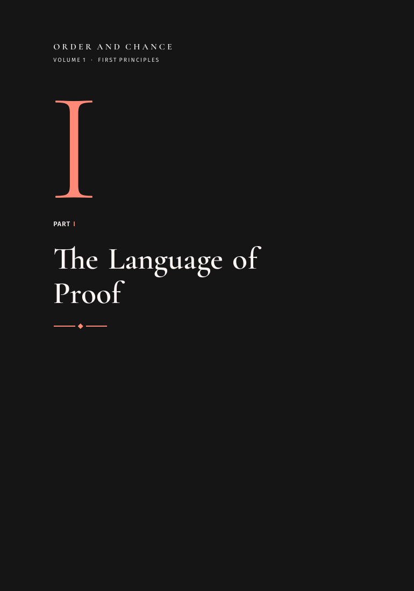
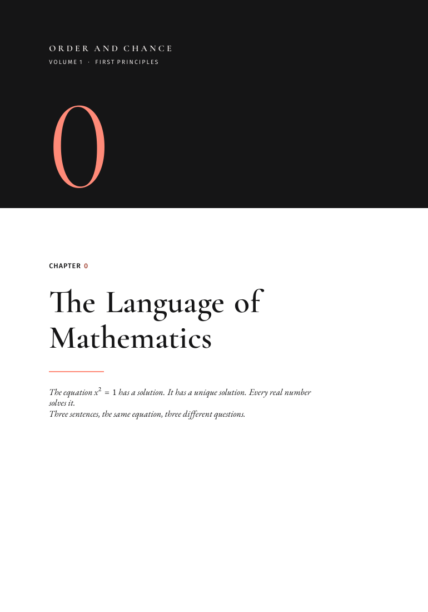
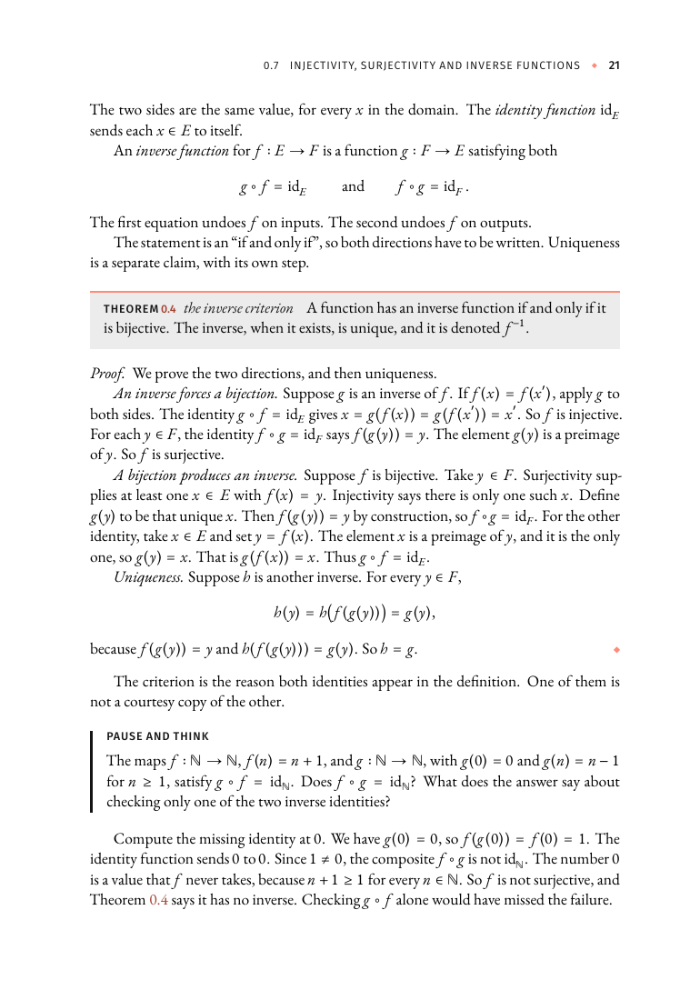
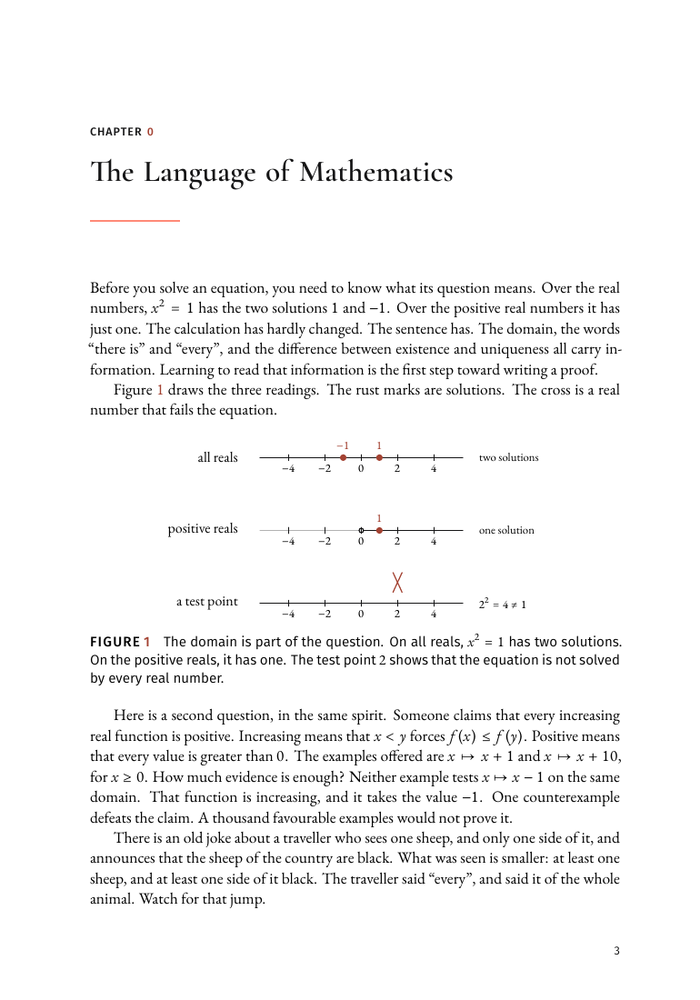
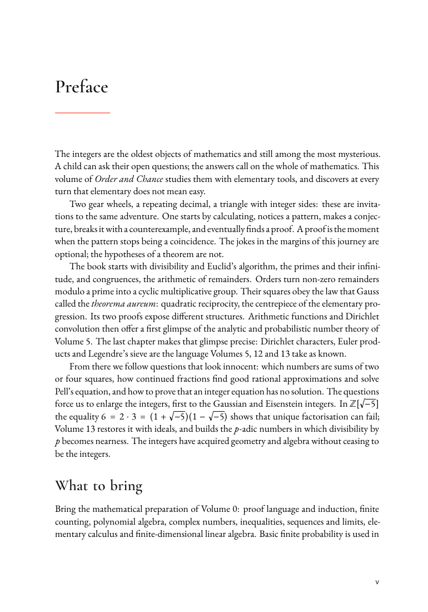
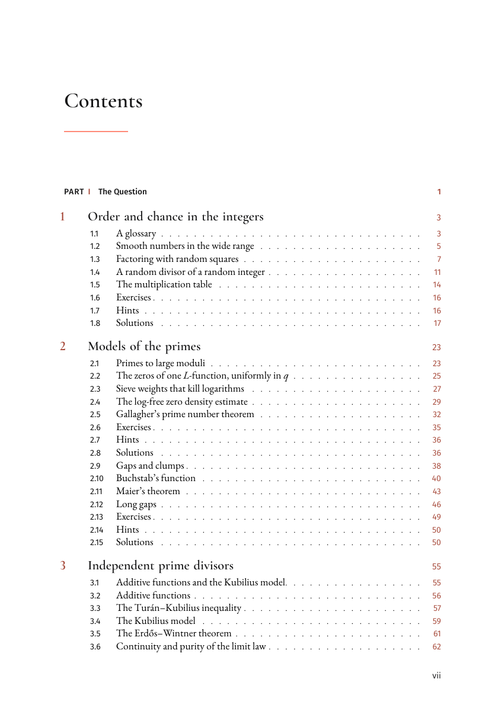
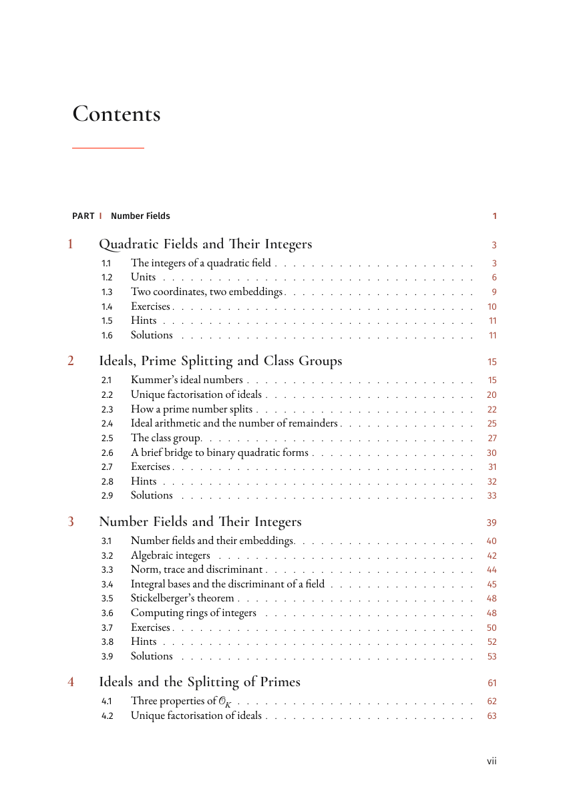
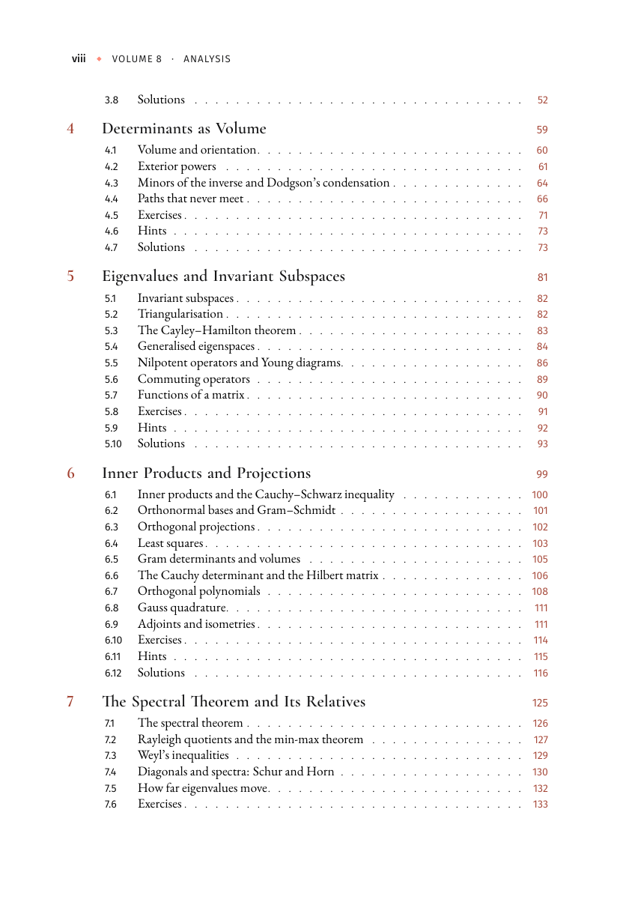
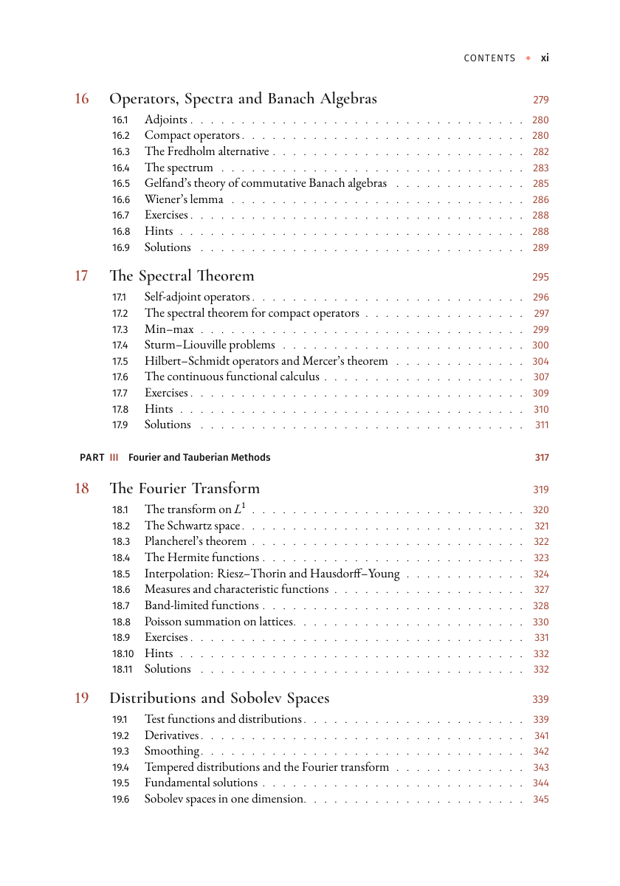
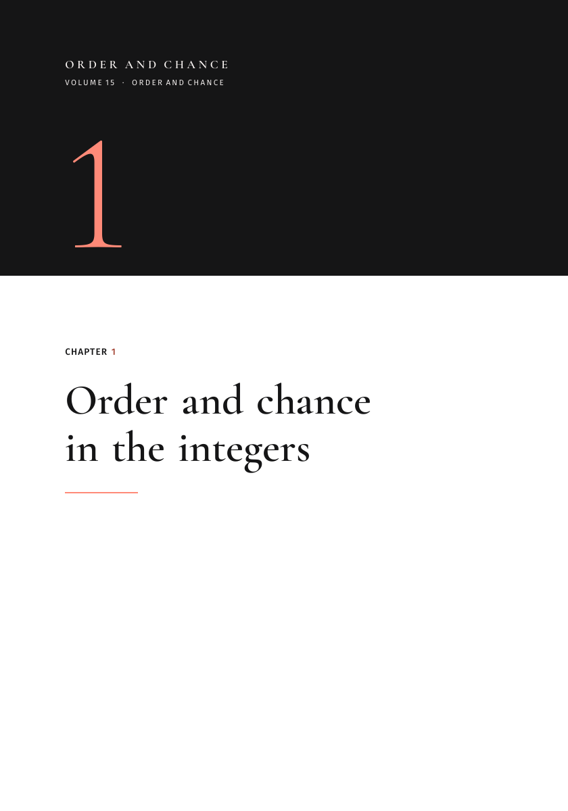

# Interior design and structure

Read-only review of the interiors, dated 31 October 2026, from `main` at `3f264ba`. No manuscript file was edited.

Five interiors were typeset with the production settings in `build.sh`: XeLaTeX, three passes, `\PRINTINNER{0.9in}`, trim 7 × 10 in, no bleed. The reading-PDF cover was left off; these are the interiors that file attaches.

| Volume | Interior | Pages | Layout check | Style check | Overfull boxes |
| --- | --- | --- | --- | --- | --- |
| 1 First Principles | `build/volume1-first-principles/main.pdf` | 501 | passed, 453 whole boxes | passed | 0 |
| 2 The Integers | `build/volume2-integers/main.pdf` | 269 | passed, 383 whole boxes | — | 0 |
| 8 Analysis | `build/volume8-analysis/main.pdf` | 485 | passed, 628 whole boxes | passed | 0 |
| 13 Arithmetic | `build/volume13-arithmetic/main.pdf` | 365 | passed, 513 whole boxes | — | 0 |
| 15 Order and Chance | `build/volume15-order-and-chance/main.pdf` | 257 | passed, 258 whole boxes | passed | 0 |

`tools/check_book_layout.py` and, where noted, `tools/check_interior_style.py` were run on those PDFs. Pages below are the printed folios. Screenshots are the PNG files in `docs/reviews/img/`.

The comparison texts are `docs/design/interior.md` (design 5e), `docs/WRITING-STYLE.md`, `docs/agents/mathematician-writer.md`, `docs/SERIES-STRUCTURE.md`, and `docs/plan/`. This is a design and structure review. It does not reopen the mathematical errata in `docs/reviews/volume1-final-grok-review.md`.

## What already holds

Volume 1 is a finished example of design 5e, and the other four interiors use the same system.

The page is 504 × 720 pt, which is 7 × 10 in. On a text page the measure is 5.33 in. That is the specified 5.3 in, with a point or two of microtype protrusion past the margin. The gutter is the wide side. A full prose line of the Volume 1 preface runs to about 90 characters. That is long for a novel and ordinary for a 7 × 10 mathematics page at 11.5 pt. The geometry should stay as specified.

The embedded faces are EB Garamond (regular, italic, semibold), Garamond-Math, Cormorant Garamond (semibold and light), and Fira Sans (book and medium). DejaVu Sans Mono appears where there is code. Body size and leading match the 11.5 / 14.75 pt setting. Running heads are Fira capitals on the outside, with a coral diamond: verso folio and volume line, recto section and folio. Opening pages keep only the folio, at the foot.

Part pages are full charcoal rectos: coral numeral, ivory title, rule and diamond, no picture. Chapter openers are the verso behind that recto: a charcoal band, a 150 pt coral numeral, then the chapter label, the title, a short coral rule, and the epigraph when the chapter has one. The text starts on the facing recto.

Formal statements sit in an 8% charcoal box under a coral rule. Proofs run in, and they end with a coral diamond. Pause boxes use the 2 pt charcoal bar. Definitions, theorems, and exercises share one label style: Fira capitals, coral number, italic note. Figure captions are Fira, and the captions that were checked state a takeaway. The number-line figure in Chapter 0 is the right kind: the domain is part of the question, and the caption says so.

The series page in every sampled volume lists Parts I–VI and Volumes 1–15 with the current subtitles, and it sets the current volume in semibold. It fits on one verso with air under the last line. Contents use Cormorant chapter titles, coral numbers, and Fira section lines with dotted leaders. Leaders align. Exercises, hints, and solutions sit at the end of the chapter in Volumes 1, 2, 8, and 13, in that order, with “How to find it” and “Write-up”. That is the house pattern, and it is holding in those four books.

Volume 1’s field guide names the next book in full: Volume 2, *The Integers: Primes, Patterns and Proofs*. Its cross-references use the title-page numbers. There is no “Volume 0” in that book.

`clubpenalty` and `widowpenalty` are 10000. Formal boxes are unbreakable, and none of the five books has one taller than the text block. The blank pages are the blanks the opener inserts so that a chapter can open on a verso.

## Critical

### 1. Cross-volume numbers are two systems at once

`docs/SERIES-STRUCTURE.md` and `docs/plan/SERIES-CONTENT-PLAN.md` still say that a citation “Volume \(N\)” inside a chapter means the old number, whose title-page number is \(N+1\). `docs/WRITING-STYLE.md` says the opposite for reader-facing text: current numbers 1–15, and never the legacy 0–14. Volume 1 follows the writing style. The other sampled books follow the plan, except where a sentence has already been rewritten, so the two systems sit in the same preface.

A reader who trusts the series page will open the wrong book. “Volume 0” is the obvious case, because no such volume is on that page. The quieter case is worse. “Volume 5” can mean Calculation, which is what the spine says, or Crossroads, which is what an unrepaired citation still means.

There are 285 occurrences of `Volume 0` or `Volume~0` in 70 volume source files. Volume 1 has none. The counts are Chance 78, Calculation 65, Symmetry 45, The Integers 40, Spaces 29, Analysis 9, Crossroads 9, Arithmetic 3, and one each in Abstraction, Randomness, and Random Motion. Four more sit in Volume 15 files the book does not input.

Printed examples:

- Volume 2, preface, p. v. “Bring the mathematical preparation of Volume 0: proof language and induction…” The same page says that Dirichlet characters are the language “Volumes 5, 12 and 13 take as known.” On the old map those are Crossroads, Arithmetic, and The Primes, which are now 6, 13, and 14. The next paragraph says “Volume 13 restores” unique factorisation with ideals. That Volume 13 is the new Arithmetic. One page uses both maps. The preface then says these are “references to mathematical tools, independent of printed numbering.” The printed number is what the reader has.

- Volume 8, preface, p. v. “Volume 6 built the stage: real numbers, limits, measures and integrals.” That is Spaces, now Volume 7. The same preface assigns Fourier and complex analysis to Volume 4 (now 5, Calculation) and groups to Volume 2 (now 3, Symmetry). Later sentences put the Jordan curve in Volume 7 and the Riemann mapping theorem in Volume 9, which are the new numbers, and they put the adèles in Volume 13, which is also the new number.

- Volume 13, Chapter 3, p. 39. A reminder headed “from Volumes 0 and 2” cites Volume 0, Proposition 3.7, for rational roots (now Volume 1) and Volume 2, Theorems 10.4 and 10.6, for Galois theory (now Volume 3, Symmetry). The quadratic chapter a few pages earlier uses “Volume 2” for the Gaussian and Eisenstein integers, which is the new Volume 2 and is right.

- Volume 15, §1.2, p. 5. “Volume 5, Theorems 1.3 and 1.5” is Mertens’ estimate \(\sum_{p\le x}(\log p)/p=\log x+O(1)\). That theorem lives in Crossroads, now Volume 6. The opening of the same chapter correctly cites the normal order of \(\omega(n)\) to Volume 6, and Chapter 2 correctly cites Siegel–Walfisz to Volume 14. The wrapper was renumbered. The included files were not.

**Recommendation.** One mechanical pass, then a human check of the ambiguous sentences. Replace every reader-facing `Volume~N` with the title-page number, and on the first mention in a chapter add the title, as Volume 1 already does. Use the table in `docs/SERIES-STRUCTURE.md`. Delete the sentence that tells the reader the numbers are independent of the printed numbering. After that pass, a citation of Volume 5 means Calculation and nothing else. Leave the old-number table in the internal plan; it should not survive in a preface.

### 2. Volume 15 prints solutions in the middle of a chapter

The house pattern is exercises, then hints, then solutions, and then the chapter ends. Volume 15 breaks it in five chapters, because `main.tex` concatenates old chapter files that each end with their own exercise block.

The contents of Chapter 2, p. vii, reads:

- 2.6 Exercises, 2.7 Hints, 2.8 Solutions (p. 36)
- 2.9 Gaps and clumps (p. 38), then Buchstab, Maier, and long gaps
- 2.13 Exercises, 2.14 Hints, 2.15 Solutions

Maier’s theorem, the chapter’s climax, is section 2.11, after the first solution section. The same splice is in the contents of Chapters 3, 4, 7, and 11. Chapter 3 reaches “Solutions” at 3.9 and then opens “The Selberg–Delange method” at 3.10. Chapter 11 prints Bohr–Jessen’s solutions at 11.8 and starts Selberg’s central limit theorem at 11.9.

The source is the `\input` of `ra-*.tex` from a short wrapper. `ch02-cramer.tex` inputs `ra-largemoduli.tex` and then `ra-gaps.tex`. Each of those files still has its own `\section{Exercises}`.

**Recommendation.** For each assembled chapter, move every exercise, hint, and solution section to the end, once. Keep one run of numbering. A reader who has just been shown the solution of the first half should not then meet Maier’s theorem. Chapters 5, 6, 8, and 12 currently have no exercises at all; either give them a short set or say in the preface that those four are reading chapters. The workshop, Chapter 14, can stay without an exercise list: the projects are the work.

## Important

### 3. Volume 13 teaches the quadratic theory, then teaches it again

The contents, p. vii, open Part I like this:

1. Quadratic Fields and Their Integers, including a section called Units
2. Ideals, Prime Splitting and Class Groups, including “Unique factorisation of ideals” and “The class group”
3. Number Fields and Their Integers
4. Ideals and the Splitting of Primes, including “Unique factorisation of ideals” again

Chapter 6 is Units a second time. The preface describes this as a shortcut the book then leaves. `docs/plan/book-13.md` asks for something sharper: Book 2 computed the quadratic ring, and this book’s general chapter is where that computation returns as the first example. The printed book still contains both foundations. A reader who has just proved unique factorisation of ideals in \(\mathbb Z[\sqrt{-5}]\) is asked, two chapters later, to learn what an ideal is.

The chapter order inside the part is the right pedagogical order (quadratic, then general). The duplication is the length, not the order. Chapter 1 is explicit that Chapter 3 will stop using the shortcut. Chapter 3 then repeats the definition of an algebraic integer and the rational-root test.

**Recommendation.** Keep a short quadratic chapter that computes \(\mathcal O_K\), the failure \(6=2\cdot 3=(1+\sqrt{-5})(1-\sqrt{-5})\), and one unit, and that stops when the general definition is about to be given. Point the ideal theory, the class group, and Dirichlet’s unit theorem at Chapters 4 and 6, and let those chapters use \(\mathbb Q(\sqrt{-5})\) and \(\mathbb Q(\sqrt{2})\) as the first example, named as a return. The preface should count four parts, in the contents’ names. It currently says “the second part” for both Local and Global and the adèles, and “the third part” for the curves, which are Part IV.

### 4. Volume 8 has two chapters called the spectral theorem

Part II of the contents runs from Chapter 3 to Chapter 17, fifteen chapters, after a Part I of two. Inside it:

- Chapter 7, p. viii, “The Spectral Theorem and Its Relatives”, whose first section is “The spectral theorem”
- Chapter 17, p. xi, “The Spectral Theorem”, whose second section is “The spectral theorem for compact operators”

Both are real theorems, and the preface distinguishes them: matrices first, compact operators later. The titles and the running heads do not. A citation of “the spectral theorem” in this volume, or from Volume 15, has two homes. The contents also show what the part has absorbed: determinants, Young diagrams, the semicircle, matrix inequalities, and linear dynamics sit between Banach space and the compact spectral theorem. That is a second book placed in the middle of this one. `docs/plan/book-08.md` asked for those spectra to live here. It did not ask for two chapters to share a title.

**Recommendation.** Rename Chapter 7 to “The Spectral Theorem for Matrices” and Chapter 17 to “The Spectral Theorem for Compact Operators”. Use those phrases in the running heads. In the preface and in Volume 15, cite one or the other. A later pass can split Part II into “Matrices” and “Operators” if fifteen chapters under one part title still feels like two books. That split is a contents decision; the rename is the one a reader needs now.

### 5. The text layer still drops spaces

The ink is spaced. The PDF text is not. On Volume 1, p. v, the sentence that begins “The series is called Order and Chance” is stored as `TheseriesiscalledOrderandChance: TheHiddenArchitectureofMathematics`. The same join appears in every volume that was built: 25 lines in Volume 1 caught by a conservative scan, 11 in Volume 2, 25 in Volume 8, 21 in Volume 13, 10 in Volume 15. Search, copy, and a screen reader see one token. The earlier Volume 1 review named this and left it out of the repair; it is still on p. v.

The likely cause is `\usepackage[final]{microtype}` in `common/preamble.tex`, which turns on font expansion. Expansion with XeTeX and `fontspec` moves glyphs and leaves the space out of the content stream. The rendered page looks right, which is why a visual proof is the wrong picture of the bug.

**Recommendation.** Rebuild the reading PDF so the text layer matches the ink. Turn expansion off for the text font, or use a microtype setup that keeps the space character. Check p. v of Volume 1 by copying the series sentence into a plain-text buffer. Do not change the wording or the line breaks to do it.

### 6. Copyright pages are not yet KDP interiors

Only Volume 1 prints an ISBN (`9798165526770`). Volumes 8, 13, and 15 print `ISBN (paperback): to be assigned`, because that is the default of `\bookisbnprint` in `common/frontmatter.tex`. Volume 2 sets the command to empty, and its copyright page omits the line. Every copyright page also says “This printing typeset on” followed by `\today`, so two exports of the same edition carry different dates. The 31 October 2026 date on these proofs is the build day.

The charcoal reaches the trim. Part pages are solid to the edge, and the chapter band meets the top and side trim. `docs/design/interior.md` already says that a no-bleed KDP interior will show the usual hairline, and that a bleed interior needs both `\OCBLEED` and a change of the KDP setting. Neither has been done. A full charcoal page is the page on which that hairline shows.

**Recommendation.** Leave “to be assigned” out of any file uploaded to KDP. Print the ISBN when it exists, and omit the whole line until then, as Volume 2 almost does. Replace `\today` with the edition date. For the charcoal, either inset the band and the part page by a couple of millimetres inside the trim, or switch the KDP interior to bleed and build with `\OCBLEED`. Do one of those before a proof copy, on a part page and a chapter opener.

### 7. No index, and no volume bibliography

`docs/design/interior.md` describes the index and the bibliography as unnumbered chapters with the short heading. No volume calls `\printindex` or builds a `thebibliography`. Many chapters do end with “Sources and further reading”, and those lists are real citations (Schmidt, Riesz, and Brezis at the end of Volume 8’s Hilbert chapter, for example). They are not gathered, and there is no index of names or of theorems.

A 501-page Volume 1 and a 485-page Volume 8 can be read without an index. They cannot be used the way a working mathematician uses a book: to find the spectral theorem, the class-number formula, or Maier’s theorem from a later volume. The cross-volume citations in finding 1 are already hard to follow. An index would not repair the numbers, and the numbers will stay hard to use without one.

**Recommendation.** After the numbering pass, add a back-matter index of named theorems and a single further-reading list per volume, set as the unnumbered chapters the design already styles. Per-chapter source lists can stay; the volume list should point at them. This is a first-edition item for Volumes 8, 13, and 15 in particular, where the argument depends on books the reader is told to consult.

### 8. Volume 15’s unused chapters are still in `chapters/`

`main.tex` inputs fourteen chapters and matches the five parts in `docs/SERIES-STRUCTURE.md`. Beside those files sit the old workshop (`ch01-research.tex`, `ch02-reading.tex`, the guided readings, `ch12-projects.tex`) and twelve `conjectures-ch*.tex` files, plus `moments-zeta.tex`, each with its own `\chapter`. They are not in the book. Their figures are still in `figures/`. The four `Volume 0` citations in this directory are in those unused files.

The preface of the printed book matches the shorter book, which is what the plan asked for. The risk is the next edit. `\input{chapters/ch01-research}` and `\input{chapters/ch01-integers}` are one token apart, and both files begin with `\chapter`.

**Recommendation.** Move the unused chapter files and their figures to an archive directory that `main.tex` does not scan, and say in the plan that they are out of the edition. Do not delete the mathematics until someone has checked that nothing in the printed chapters still `\input`s them. A search of `main.tex` and the wrappers shows the printed chapters input `ra-*.tex` only.

## Polish

**Chapter 0 in Volume 1.** The contents, the opener, and the later citations all use 0, on purpose. A reader can still think a chapter fell out. One sentence in the preface, that the language chapter is numbered 0 because the counting of proofs starts at the next chapter, is enough. Renumbering would touch every cross-reference.

**Heading case.** Volumes 1, 2, 8, and 13 use title case (“The Language of Mathematics”, “Quadratic Fields and Their Integers”). Volume 15 uses sentence case on the opener and in the contents (“Order and chance in the integers”), and Volume 8’s last chapter is “The values of zeta”. The opener below is otherwise the same object as Volume 1’s: band, numeral, rule. It has no epigraph, so the white field under the rule is empty, which the design allows. The case is the inconsistency.

Use Volume 1’s title case for chapter titles across the series. Keep sentence case for section titles if that is the choice; the contents already mix them.

**Long titles on the opener.** Volume 2, Chapter 4, breaks as “Primitive Roots and / the Multiplicative / Group”. “Group” sits alone on a third line of 38 pt Cormorant. A discretionary break after “and”, or a slightly shorter title in the chapter mark, would keep the noun with its adjective. The same measure will do this to other titles of five words or more.

**Displays scaled to fit.** `common/preamble.tex` puts every `\[...\]` in a box and, when the box is wider than the measure, scales it down with `\resizebox`. Volume 1 does this twice, by about 1%. Volume 2 and Volume 15 each have a display scaled from about 423 pt to 383 pt, a 10% reduction. Volume 8 does it 19 times, Volume 15 fifteen times, Volume 13 six times. The scaled line is visibly smaller than the mathematics around it, and it will not copy as text of the same size. Break those displays, or set them with `\allowdisplaybreaks` in a multline. Reserve the scale for a one-line matrix that cannot break.

**Loose lines.** The layout check rejects overfull boxes and ignores underfull ones. Volume 8’s log has 56 underfull boxes, Volume 15 has 44, and one line in Volume 2 is badness 10000 (“The previous example gives an”). Worth a pass with the eye on the worst badness, not a change of `\tolerance` for the series.

**One-chapter parts.** Volume 2 spends a full charcoal recto on Divisibility, and another on The Primes. The series structure chose those names. A reader who has just turned a part page meets one chapter and then another part page. If the parts stay, the opener is doing what it should. If a later structure pass merges them, the book loses two charcoal pages and gains a quieter contents.

**Volume 2’s handoff.** The last paragraph of the preface says the next floor “takes up what survives a transformation” and that “Volume 3 develops groups, rings and fields.” It does not give the subtitle *Groups, Rings and Fields*, and the field guide ends at the illustration credits. Volume 1’s field guide is the model: name, subtitle, and one object the next book owns. Give Volume 2 that sentence once the number in it is the title-page number.

**Tables.** Sampled chapters almost never use `tabular`. The few that do (a modular-forms table in Volume 13, a table in Volume 8’s zeta problems) have no shared style in `common/`. When a table is added, give it the Fira caption and the charcoal rule the figures already use, so it does not arrive as a default LaTeX grid.

**EPUB.** A device EPUB was not built for this review. `build.sh` compiles every figure to SVG first (121 figures in Volume 1, 61 in Volume 15) before Pandoc runs. `tools/epub.css` and `tools/epub.lua` do follow design 5e on the points that can be checked without that render: EB Garamond body, Cormorant headings, Fira labels, coral numbers, an 8% charcoal formal box under a coral rule, a 2 pt teaching bar, and a compact charcoal strip in place of the full part page and the banded opener. Those two pages are print-only, which is the right split. The text-layer bug above is a PDF bug; the EPUB is HTML and will keep the spaces if the source has them. Confirm that on one built chapter, Volume 1’s preface, the next time `build.sh` runs.

## Suggested order of work

1. Renumber reader-facing volume citations to 1–15, Volume 1’s way, and remove Volume 0. This is the repair that makes the other books usable beside Volume 1.
2. Move Volume 15’s exercise blocks to the end of each assembled chapter.
3. Rename Volume 8’s two spectral-theorem chapters, and shorten Volume 13’s quadratic opening so the general chapters are the theorem.
4. Fix the PDF text layer, the copyright ISBN line, and `\today`.
5. Add the index and the further-reading chapter the design already describes, then align Volume 15’s title case and Volume 2’s handoff.

The interior of Volume 1 can be printed as it stands, apart from the text layer and the known hairline on the charcoal. The structure of Volumes 2, 8, 13, and 15 cannot be followed from the series page until the numbers and the two duplicated theorems are straightened.
