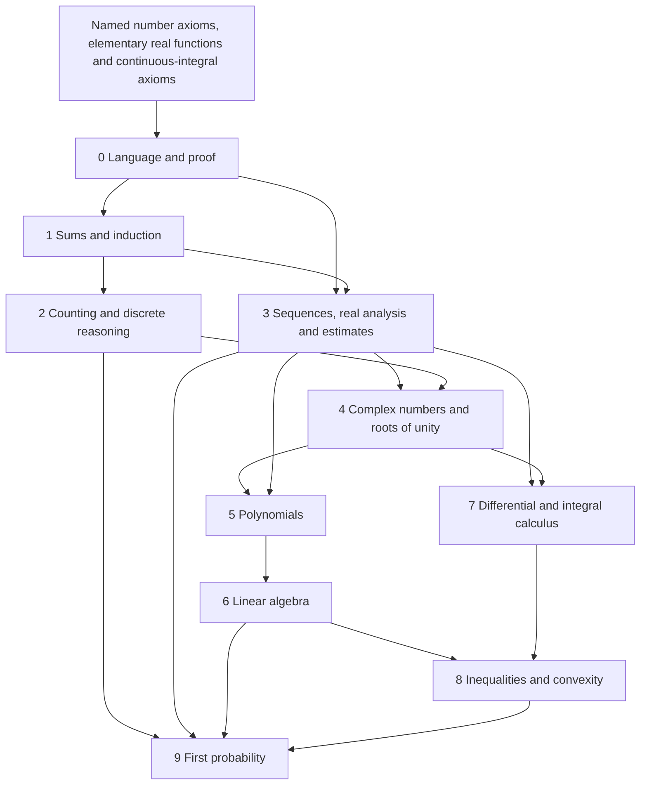

# Chapter dependency map and foundational boundary

Solid arrows describe core exposition, not every optional return problem.

| Topic | Available before use |
|---|---|
| Logic, quantifier scope and set/function notation | Chapter 0, with concrete proofs |
| Well ordering and induction | Well ordering named as axiom; induction equivalence proved in Chapter 1 |
| Arithmetic cancellation/prime factorisation | Chapter 1 arithmetic bridge after well ordering |
| Counting and coefficient identities | Chapters 1--2; formal generating functions require no convergence |
| Archimedean property, real triangle inequalities | Derived from completeness/order in Chapter 3 before convergence examples |
| Monotone/Cauchy/Bolzano--Weierstrass | Proved in Chapter 3 from completeness |
| Continuity, IVT/EVT/Heine/Rolle/MVT | Proved in Chapter 3, not separately assumed |
| Derivative rules/real powers/first FTC | Proved in Chapter 3 before integral comparisons; systematic calculus follows in 7 |
| Nonnegative double sums/absolute rearrangement | Chapter 3 finite-tail and rectangle arguments |
| Complex exponential/polar form | Real functions admitted; complex definition and addition law in Chapter 4 |
| Polynomial factors in roots-of-unity argument | Elementary factor identity proved at point of use in Chapter 4 |
| Monic division for cyclotomic integrality | Short algorithm proved in Chapter 4; general algorithm and gcd in Chapter 5 |
| Polynomial compactness | Earlier real Bolzano--Weierstrass, applied coordinatewise in Chapter 5 |
| Linear maps/rank-nullity/change of basis | Chapter 6 before determinant invertibility and eigenvalues |
| Inner products/Gram--Schmidt/projection | Chapter 6 before spectral theorem and Gram determinants |
| Taylor and integration transformations | Chapter 7, from earlier rules and admitted integral axioms |
| Gamma log-convexity | Chapter 8 after convexity/Young; recurrence and values in Chapter 7 |
| Finite moments/covariance/concentration | Chapter 9 in that order; matrix positivity uses Chapter 6 |
| Countable waiting/Poisson | Explicit mass and truncation extension in Chapter 9, after finite core |

The exact foundational contract is printed in the revised preface. It assumes
classical logic, ordinary sets/functions, standard natural/integer/rational/real
arithmetic, well ordering of N, least-upper-bound completeness of R, named real
exp/log/sin/cos properties and the integral axioms for continuous functions.
It does not claim to construct the real numbers, elementary functions or a
measure space of infinite trials.

Explicit return problems include Chapter 1 finite-sum/product limits (after 3),
the sine-recursion asymptotic (after Taylor in 7), complex trigonometric integral
(after 7), circulants (after 6), finite Basel formal differentiation (after 5),
Chebyshev orthogonality and the Hilbert integral Gram interpretation (after 7).
The complex exponential series identification is proved in `ex:taylorln(c)`;
core complex multiplication/polar arguments do not require that later identity.
Within chapters, some results refer explicitly to complete solved exercises,
including Hölder in the inequality chapter. These are visible proof locations,
not admitted axioms. Advanced challenge notes retain external references and
are distinguished from proved elementary assertions.
