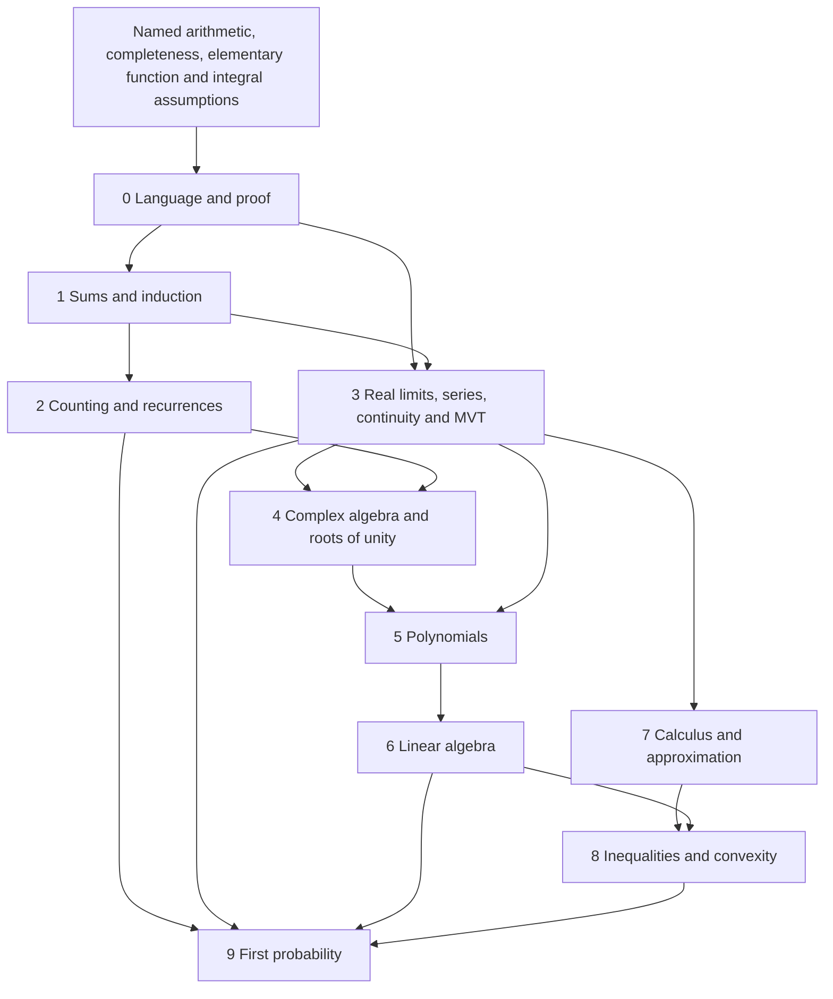

# Volume 0 reconstruction: evidence and migration plan

Date: 28 October 2026. Original local commit:
`3259d462860e13150fc6cb15ecb0e3109f95b5ed`.
Working branch: `editorial/volume0-reconstruction-20261028`.
Original source archive: `/workspace/volume0-checkpoints/baseline/`.
Upstream publishing changes through `8135b0b` were fetched and fast-forwarded
before manuscript editing. They are upstream work, not editorial changes to other
volumes. The original main file's local challenge environment was moved upstream
into the common preamble; mathematical chapter sources were unchanged.

## Evidence and scope

Canonical entry: `tome0-mathematical-maturity/main.tex`; shared infrastructure:
`common/preamble.tex`, `common/frontmatter.tex`, `build.sh`. Chapter sources total
6,137 lines, including preface and back matter. The initial source contains 250
explicit labels and 130 exercise/hint/solution triples. `baseline-inventory.json`
records source locations, headings, environments, labels, references and hashes;
it is a source inventory, not a mathematical verification certificate.

Three assigned mathematical reviewers read the complete discrete/probability,
analysis, and algebra chapters, including their exercises and solutions. Their
reports record specific findings, checks, and remaining limits. The integrating
editor read the preface, roadmap, field guide, existing review records, build
configuration, source structure, and selected arguments independently.

The unmodified original compiled to 241 interior PDF pages (504 × 720 pt), plus
a covered reading PDF. The complete PDF production build passed whole-box,
reference, font, interior style, cover identity, and cover-resolution checks.
It retained two unicode-math package warnings and underfull lines; no overfull
boxes or undefined references were reported. The first build attempt exposed
missing pypdf in the selected virtual environment; installing its pinned version
resolved this dependency. The existing mathematical audit script also ran; its
exact output is preserved separately. Earlier review records are historical
evidence and are not treated as results of this revision.

## Decisions by mathematical role

| Concept group | Necessary / later use | Ordering / present adequacy | Decision and connection |
|---|---|---|---|
| Logic, quantifiers, proof status | Essential throughout | Used but not taught systematically | Essential addition: Chapter 0; limits and counterexamples |
| Sets, functions, relations, orders | Essential throughout | Notation assumed | Essential addition: concrete definitions and proofs in Chapter 0 |
| Induction, sums, double counting | Essential; integers and probability | Rich existing treatment | Retain; repair local prerequisites and duplication |
| Arithmetic bridge | Needed by existing exercises | Uses unnamed notation and well-ordering early | Explain notation and state foundational well-ordering before use |
| Binomial and finite differences | Essential discrete methods | Strong existing material | Retain; avoid later polynomial root bound where direct factoring works |
| Counting, paths, inclusion–exclusion | Essential probability prerequisite | Split between Chapters 1 and 8 | Structural improvement: one Chapter 2, retain binomial proof in Chapter 1 |
| Recurrences / generating functions | Useful early mathematical language | Recurrences present; generating functions not systematic | Short formal coefficient treatment; no analytic convergence detour |
| Real convergence / completeness | Essential analysis and algebra | Already substantial and proved | Move to Chapter 3; teach negation and error certificates |
| Differentiability / MVT | Needed for complex exponential and estimates | Already proved with continuity | Retain brief toolkit in Chapter 3; systematic rules in Chapter 7 |
| Complex convergence | Useful, not prerequisite to real core | Currently interwoven | Stage real results first and explicitly extend after complex algebra |
| Asymptotics / Abel summation | Essential future analytic number theory | Already present | Strengthen meaning and error control; no redundant new chapter |
| Complex numbers / roots of unity | Essential algebra and filters | Strong existing treatment | Move to Chapter 4; clarify exponential construction and discrete Fourier meaning |
| Polynomials / interpolation | Essential later integers and structures | Rich existing theory | Move to Chapter 5; retain arithmetic and geometry |
| Polynomial gcd / Bézout | Needed even in later cited arguments | Genuine missing toolkit | Short essential addition over fields; no abstract algebra expansion |
| Vector spaces / maps / rank | Essential later algebra and probability | Concepts overly compressed | Expand proofs, rank-nullity before determinants, change of basis example |
| Inner product / spectral theorem | Essential covariance and estimates | Gram–Schmidt occurs after its use | Move foundations before spectral proof; define quadratic forms and PSD |
| Calculus / Taylor / errors | Essential approximation | Existing deep applications | Chapter 7; retain beauty, prove requested numerical certificate |
| Gamma / Wallis / Stirling | Useful bridges, already present | Convexity creates potential cycle | Resolve explicitly; keep approximation theme central |
| Inequalities / convexity | Essential estimates and probability | Uses calculus before current justification | Move to Chapter 8 after toolkit; retain equality cases |
| Finite probability / expectation | Essential synthesis | Vocabulary introduced too quickly | Chapter 9; expand finite construction sequentially |
| Countable distribution examples | Valuable but exceed finite contract | Coupon and geometric waiting need care | Explicit countable extension or finite truncation proof; no hidden interchange |
| Concentration / weak law | Essential preparation | Already present | Preserve, audit independence and variance hypotheses |
| Advanced challenge material | Motivating optional outlook | Existing 24 topics with sources | Retain and distinguish from elementary exercises |
| Further advanced theory | Not necessary here | Later volumes own it | Unnecessary expansion: omit measure theory, Galois and functional analysis |

## Planned section migration

| Original source | Destination | Preservation rule |
|---|---|---|
| No predecessor | Chapter 0, The Language of Mathematics | New material, separate labels |
| `ch01-sums`, excluding lattice paths/Catalan triple | Chapter 1 | Retain existing labels and mathematical content |
| `ch01-sums`: lattice paths, figure, Catalan exercise/hint/solution | Chapter 2 | Move all linked components together |
| `ch08-counting-probability`: counting through finite derangement identity | Chapter 2 | Defer analytic derangement conclusions explicitly |
| Same: stars, pigeonhole, totient, derangement recurrence, surjections, Erdős–Szekeres triples and associated figure | Chapter 2 | Preserve complete statements, hints and solutions |
| `ch05-sequences-series` | Chapter 3 | Keep actual completeness and MVT proofs; repair staging |
| `ch02-complex-roots` | Chapter 4 | Existing source filename and asset names remain stable |
| `ch03-polynomials` | Chapter 5 | Add gcd toolkit conservatively |
| `ch07-linear-algebra` | Chapter 6 | Move rank-nullity and inner-product foundations internally |
| `ch06-integrals-taylor` | Chapter 7 | Preserve examples, figures, exercises and challenges |
| `ch04-inequalities` | Chapter 8 | Resolve Gamma dependency; preserve inequality suite |
| Remaining `ch08-counting-probability` | Chapter 9 | Return to derangement asymptotics and probabilistic figure |
| Existing preface and field guide | Revised front/back matter | Accurate ten-chapter roadmap and foundational contract |

No original result, exercise, hint, solution, challenge or asset is proposed for
deletion. Unlabelled moved blocks are tracked by source ranges and content hashes;
labelled blocks by their retained identifiers. New automated checks must account
for all 130 original exercise identifiers individually, rather than merely a total.

## Prerequisite graph

The graph describes core exposition. A few existing advanced exercises depend on
later calculus; label these as delayed bridges and state the precise prerequisite.
Derivative rules needed in Chapter 3 must be proved there or explicitly named in
the foundational contract, not silently borrowed. Finite combinatorial generating
functions use coefficient identities and require no convergence. Derangement
limits are delayed until analytic prerequisites are established.

## Numbering and other volumes

Semantic labels remain stable. Chapter-based printed theorem/exercise numbers
necessarily change when material moves. Other volumes contain hardcoded Volume-0
citations. Do not edit those volumes: generate a legacy-to-revised number concordance
and a list of affected citations for a separately authorized follow-up. Explain this
compatibility issue in the revised book. Do not freeze misleading old chapter
numbers or silently claim cross-volume numerical references remain correct.

## Batches and acceptance

A: preserve, compile, inventory, independent audit, dependency and migration plan.
B: add Chapter 0 and its full exercise apparatus.
C: split counting and probability; transfer paths and complete exercise triples.
D: stage real analytic foundations and strengthen quantifier/error explanations.
E: complex/polynomial/linear-algebra repairs and foundations.
F: calculus/inequality progression, rigorous numerical approximation.
G: probability definitions, countable boundaries, covariance and synthesis.
H: select 8–12 explicit bridge problems, investigation workshop, front/back matter.
I: skeptical mathematical review, exact/numeric checks, preservation/reference checks.
J: complete production rebuild, PDF inspection, source archive and final reports.

Each batch starts with a recoverable source checkpoint, compiles the complete book,
runs applicable checks, records actual limitations, and ends in a Git checkpoint.
Do not infer mathematical correctness from compilation or finite numerical checks.
