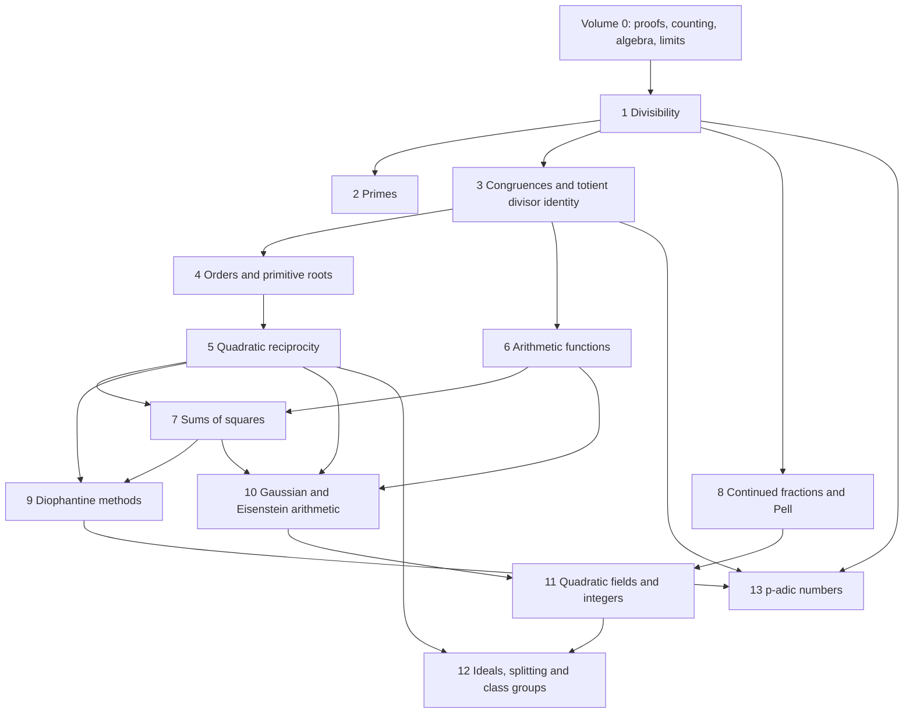

# Chapter dependency map and prerequisite contract

The available Volume 0 has chapters 0 language/proofs, 1 sums/induction, 2 counting, 3 sequences/series/limits, 4 complex roots, 5 polynomials, 6 linear algebra, 7 calculus, 8 inequalities, 9 finite probability. All are inspected as source, not assumed future work. No change to Volume 0 is needed.

Chapter 2's quantitative sections use real logarithms, integration/comparison and derivative monotonicity (Volume 0, calculus); this is declared before them. Chapter 6 uses harmonic asymptotics, absolutely convergent double sums and Basel (Volume 0, sequences/series and polynomials). The second reciprocity proof uses complex roots and prime cyclotomic irreducibility; the latter is also available in Volume 0's polynomial exercises. Chapter 8 uses complete real sequences, polynomial mean-value bounds and finite two-dimensional linear algebra. Chapter 10 uses complex arithmetic and elementary integer gcd; all ring-theoretic consequences are proved there. Chapter 11 obtains existence of real units from Pell; Chapter 12 obtains cancellation from conjugate ideal identities before proving ideal factorization. Chapter 13 constructs its complete spaces before Newton iteration; elementary polynomial Taylor expansion is independent of real analysis.

The intentionally postponed r2 formula in Chapter 7 is labelled as proved in Chapter 10 and is not used in its proof chain. The three-square converse is expressly admitted only for the triangular-number exercise. Advanced outlooks are not prerequisites.
